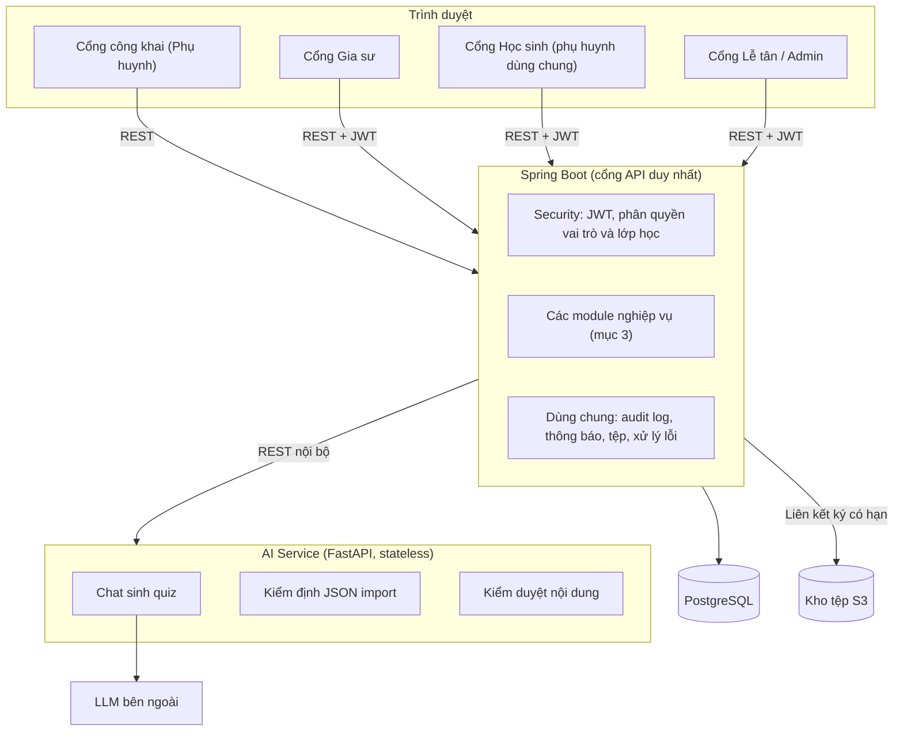
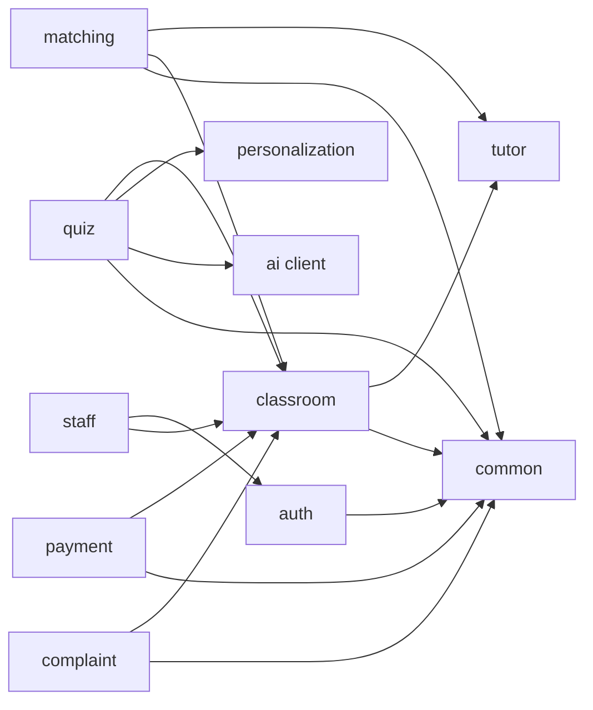
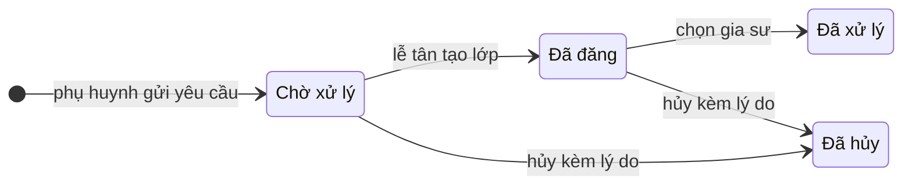
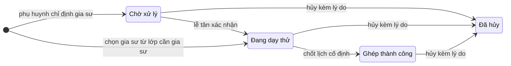
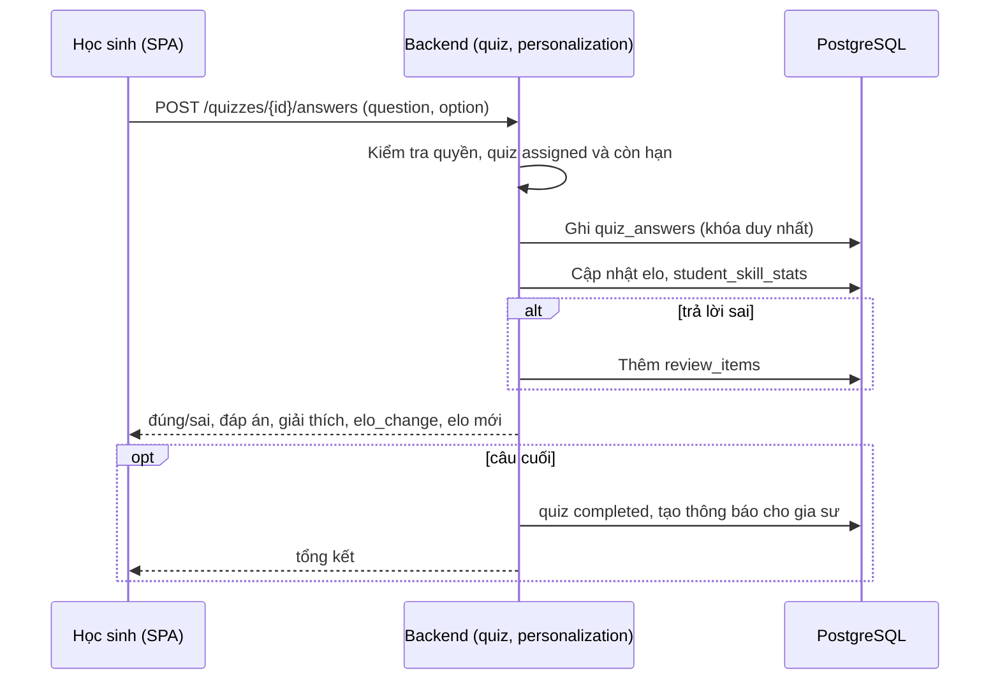
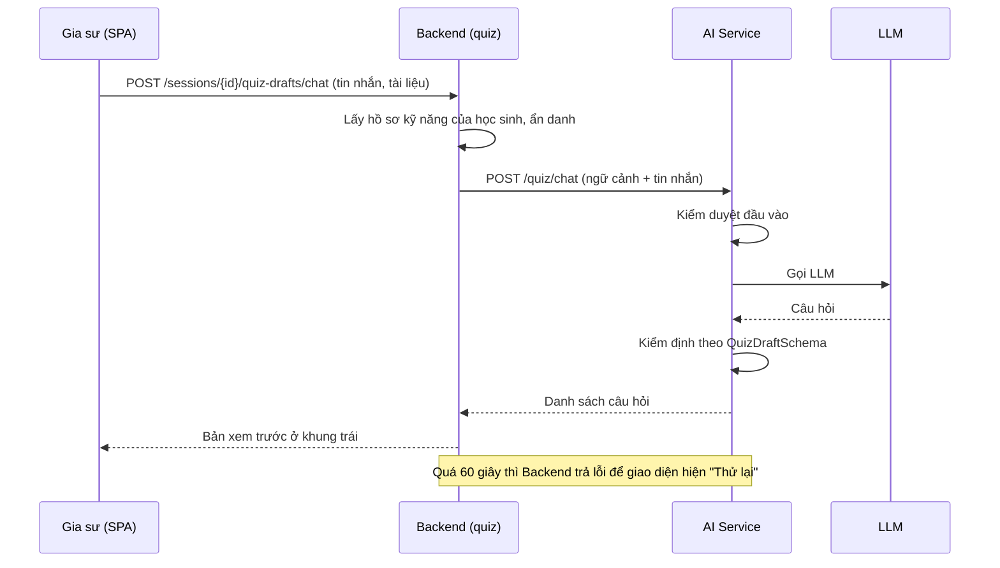
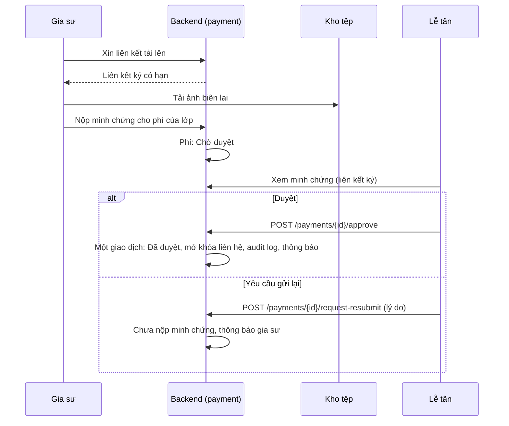

# Kiến trúc hệ thống

Tài liệu mô tả kiến trúc theo PRD v2 và bộ use case. Mã `FR-xx` là yêu cầu trong `prd.md`. Tài liệu có hai phần: **kiến trúc mục tiêu** (các quyết định AD-1 đến AD-10) và **hiện trạng mã nguồn** (mục 9), vì backend và AI Service mới có khung.

## 1. Tổng quan

Hệ thống gồm bốn khối chạy bằng Docker Compose:

| Khối | Công nghệ (theo mã nguồn hiện tại) | Vai trò |
| --- | --- | --- |
| Frontend | React 19, Vite 8, Tailwind CSS v4, React Router 7, Recharts | Một SPA phục vụ 4 cổng: công khai (phụ huynh), Gia sư, Học sinh, Lễ tân/Admin. Phục vụ qua Nginx |
| Backend | Java 17, Spring Boot 3.2, Spring Data JPA, PostgreSQL driver, Actuator | Cổng API duy nhất, toàn bộ nghiệp vụ, phân quyền, Elo, audit log |
| AI Service | Python 3.11, FastAPI, Uvicorn, LangGraph | Sinh quiz theo hội thoại, kiểm định JSON import, kiểm duyệt nội dung. Không lưu trạng thái |
| Dữ liệu | PostgreSQL 16, kho tệp tương thích S3 | Dữ liệu nghiệp vụ (ERD ở `docs/database.mmd`), chứng chỉ, tài liệu, minh chứng chuyển khoản |



Hai ràng buộc cấu trúc xuyên suốt:

1. Trình duyệt **chỉ gọi Backend**. Không có đường nào từ frontend tới AI Service hoặc kho tệp mà không qua Backend.
2. Mọi trạng thái (Elo, hồ sơ kỹ năng, quiz, lớp, phí) nằm ở PostgreSQL do Backend ghi. AI Service chỉ nhận dữ liệu đầu vào và trả kết quả.

## 2. Các cổng và vai trò

| Cổng | Vai trò (`role`) | Ghi chú |
| --- | --- | --- |
| Công khai | Không đăng nhập | Tìm gia sư, xem hồ sơ, đăng ký gia sư chỉ định, gửi yêu cầu tìm gia sư (FR-01 đến FR-04) |
| Gia sư | `TUTOR` | FR-07 đến FR-15 |
| Học sinh | `STUDENT` | FR-16 đến FR-23. **Phụ huynh không có vai trò riêng**: đăng nhập bằng tài khoản của con (FR-05) |
| Lễ tân | `RECEPTIONIST` | FR-24 đến FR-37 |
| Admin | `ADMIN` | Có toàn bộ quyền của `RECEPTIONIST` và thêm FR-38, FR-39 |

Bốn vai trò đăng nhập là `ADMIN`, `RECEPTIONIST`, `TUTOR`, `STUDENT`. Quyền `ADMIN` là **tập cha** của `RECEPTIONIST` (mọi endpoint của lễ tân cũng cho phép admin).

## 3. Cấu trúc Backend: Modular Monolith

Một ứng dụng Spring Boot, chia thành các gói theo nghiệp vụ dưới `com.english.tutor` (gói gốc hiện có của dự án):

| Gói | Chứa | FR |
| --- | --- | --- |
| `auth` | User, đăng nhập JWT, đổi mật khẩu lần đầu, sinh tài khoản theo quy tắc chung | FR-05, FR-06, FR-39 |
| `tutor` | Hồ sơ gia sư và các bảng con (chứng chỉ, chuyên môn, giá, lịch rảnh, khu vực), duyệt hồ sơ, tìm kiếm công khai | FR-01, FR-02, FR-07, FR-31, FR-32 |
| `matching` | Lớp cần gia sư, ứng tuyển, đơn ghép lớp, form của phụ huynh | FR-03, FR-04, FR-08, FR-25 đến FR-30 |
| `classroom` | Lớp học (TRIAL/ACTIVE), lịch dạy thử, lịch cố định, kiểm tra trùng ca, buổi học, tài liệu, nhật ký | FR-09 đến FR-12, FR-19 đến FR-21 |
| `quiz` | Quiz, câu hỏi, câu trả lời, chuyển trạng thái draft/assigned, gọi AI Service, import | FR-13, FR-14, FR-22 |
| `personalization` | Elo, hồ sơ kỹ năng, danh sách ôn tập | FR-22 |
| `payment` | Phí nhận lớp, minh chứng, duyệt hoặc yêu cầu gửi lại, mở khóa liên hệ | FR-15, FR-33 |
| `complaint` | Khiếu nại: tạo, xem và sửa, giải quyết | FR-35 đến FR-37 |
| `staff` | Quản lý học sinh, nhân sự lễ tân, dashboard | FR-24, FR-34, FR-38, FR-39 |
| `common` | Audit log, thông báo, lưu tệp, xử lý lỗi, tiện ích bảo mật | FR-23 và hỗ trợ các gói khác |

Mỗi gói tổ chức `controller`, `service`, `repository`, `entity`, `dto`. Gói khác chỉ gọi **service interface** của nhau, không gọi repository trực tiếp (AD-1).

### Phụ thuộc cho phép giữa các gói



Không cho phép vòng phụ thuộc. `common` không phụ thuộc gói nào khác.

## 4. Quyết định kiến trúc

### AD-1. Modular Monolith cho Backend
- **Quy tắc:** một ứng dụng Spring Boot, chia gói theo mục 3. Gọi chéo gói qua service interface bên trong giao dịch `@Transactional`; cấm gọi repository của gói khác.
- **Lý do:** nhóm 3 người, 5 tuần còn lại. Các nghiệp vụ cần giao dịch chung (duyệt phí rồi mở khóa liên hệ, chọn gia sư rồi tạo đơn và lớp) nên tách dịch vụ sẽ thêm rủi ro mà không có lợi.

### AD-2. AI Service stateless, Backend là cổng duy nhất
- **Quy tắc:** AI Service không có bảng dữ liệu riêng và không gọi ngược Backend. Backend gửi vào: yêu cầu của gia sư, nội dung tài liệu đã trích, hồ sơ kỹ năng đã **ẩn danh**; nhận về: danh sách câu hỏi theo schema (AD-4).
- **Endpoint nội bộ** (tiền tố `/api/v1/ai`, chỉ truy cập trong mạng Docker):

| Endpoint | Việc |
| --- | --- |
| `POST /quiz/chat` | Một lượt hội thoại soạn hoặc sửa quiz, trả về bộ câu hỏi hiện tại |
| `POST /quiz/validate` | Kiểm định JSON gia sư dán từ AI ngoài, trả lỗi theo từng câu |
| `POST /moderate` | Kiểm duyệt nội dung đầu vào và đầu ra |

- **Giới hạn:** Backend đặt timeout **60 giây** cho `/quiz/chat`; quá hạn thì trả lỗi để giao diện hiện nút "Thử lại" (UC-T03). Chi phí LLM có hạn mức hằng tháng ở AI Service.
- **Prompt mẫu cho import** (UC-T03b) do Backend dựng từ hồ sơ kỹ năng của học sinh rồi trả cho frontend; không gọi LLM.

### AD-3. Phân quyền theo vai trò và theo quan hệ lớp học
- **Quy tắc:** Spring Security xác thực JWT, `@PreAuthorize` kiểm tra vai trò. Với dữ liệu gắn với lớp, thêm kiểm tra quan hệ qua `ClassAccessGuard`:
  - Gia sư chỉ truy cập lớp, buổi học, quiz và học sinh có liên kết với mình.
  - Học sinh chỉ truy cập buổi học, quiz, câu trả lời của chính mình (UC-ST-06: buổi không thuộc học sinh thì từ chối và quay lại lịch học).
  - `ADMIN` là tập cha của `RECEPTIONIST`. Các endpoint `staff/receptionists/**` chỉ cho `ADMIN`.
- **Phụ huynh:** không có vai trò riêng, dùng tài khoản học sinh nên đi qua cùng các kiểm tra của `STUDENT`.
- **Công khai:** chỉ các endpoint tìm gia sư, xem hồ sơ đã duyệt, hai form của phụ huynh. Dữ liệu trả về lọc theo trạng thái hồ sơ "Đang hoạt động" và ẩn các mục rỗng.

### AD-4. Một schema quiz cho cả hai đường tạo
- **Quy tắc:** quiz do trợ lý AI sinh (UC-T03) và quiz import (UC-T03b) đều qua `QuizDraftSchema` trước khi lưu:

```json
{
  "questions": [
    {
      "content": "string",
      "options": { "A": "string", "B": "string", "C": "string", "D": "string" },
      "correct": "A | B | C | D",
      "explanation": "string",
      "cefr": "A1 | A2 | B1 | B2 | C1 | C2",
      "skill": "string"
    }
  ]
}
```

- Kiểm định lỗi theo từng câu, ví dụ "thiếu đáp án đúng tại câu 2". Câu hỏi hợp lệ được lưu ở `draft`; gia sư sửa rồi `assigned` kèm hạn nộp.
- Khi lưu, `skill` được ánh xạ về bảng `skills`; `cefr` quy ra độ khó Elo qua bảng quy đổi ở cấu hình (QĐ-2 trong PRD).

### AD-5. Phí nhận lớp và mở khóa liên hệ trong một giao dịch
- **Quy tắc:** thông tin liên hệ phụ huynh trả cho gia sư luôn bị che cho đến khi trung tâm chọn gia sư (QT-3); phần mở khóa gắn với phí được duyệt (QT-4).
- Trạng thái phí: `UNSUBMITTED` → `PENDING` → `APPROVED`. Yêu cầu gửi lại đưa về `UNSUBMITTED` kèm lý do.
- Duyệt phí là **một giao dịch** gồm: đổi trạng thái, mở khóa liên hệ, ghi audit log, tạo thông báo cho gia sư.
- `fee_rate` được kiểm tra trong khoảng **0,35 đến 0,40**, mặc định 0,40; lễ tân có thể chọn mức khác trong khoảng này theo từng lớp khi tạo khoản phí. `amount = tuition_first_month × fee_rate`, làm tròn đến nghìn đồng.
- Lớp online do phụ huynh đóng trước dùng cùng công thức, khoản phí được tạo khi lớp chuyển `ACTIVE`; còn lớp tại nhà thì tạo khi tròn 30 ngày dạy chính thức.

### AD-6. Tệp qua liên kết ký có hạn
- **Quy tắc:** chứng chỉ, video, tài liệu buổi học, ảnh minh chứng và ảnh khiếu nại lưu ở kho tệp tương thích S3 (MinIO khi phát triển). DB chỉ lưu đường dẫn. Tải lên và xem hoặc tải xuống đều qua liên kết ký ngắn hạn do Backend cấp **sau khi kiểm tra quyền** (UC-ST-07: học sinh chỉ lấy được tài liệu của buổi mình).
- **Giới hạn kiểm tra ở Backend:** chứng chỉ PDF/JPG/PNG tối đa 10 MB; video MP4/MOV tối đa 50 MB hoặc liên kết YouTube/Vimeo; tài liệu buổi học PDF, DOCX, âm thanh.

### AD-7. React SPA với route guard theo vai trò
- **Quy tắc:** một SPA, React Router 7. Các tuyến bảo vệ bằng `ProtectedRoute` kiểm tra vai trò trong JWT: `/tutor/**` cho `TUTOR`, `/student/**` cho `STUDENT`, `/receptionist/**` cho `RECEPTIONIST` và `ADMIN`, trang quản lý lễ tân chỉ cho `ADMIN`.
- Tuyến công khai không cần đăng nhập. Học sinh đăng nhập lần đầu bị chuyển cưỡng bức tới màn hình đổi mật khẩu (FR-06).
- Quy ước UI theo `frontend/AGENTS.md` và `frontend/DESIGN.md`. Dùng lại `components/ui/`.

### AD-8. Elo tính trong giao dịch của Backend
- **Quy tắc:** mỗi lượt trả lời quiz là một giao dịch gồm: kiểm tra quiz `assigned` và còn hạn, kiểm tra câu chưa trả lời, ghi `quiz_answers`, cập nhật Elo học sinh, cập nhật `student_skill_stats`, thêm vào `review_items` nếu sai, trả về đúng/sai kèm giải thích.
- Công thức:
  `Expected = 1 / (1 + 10^((difficulty − elo) / 400))`
  `elo_mới = elo_cũ + K × (actual − Expected)`
- `elo_change` lưu trên từng câu trả lời để tổng kết cuối bài bằng phép cộng.
- **Tham số mặc định** (cấu hình trong `application.yml`, có thể đổi mà không sửa mã):

| Tham số | Giá trị |
| --- | --- |
| Elo khởi đầu của học sinh | 1000 |
| Hệ số K | 32 |
| Độ khó theo CEFR | A1 = 800, A2 = 1000, B1 = 1200, B2 = 1400, C1 = 1600, C2 = 1800 |

  Elo làm tròn đến số nguyên khi hiển thị, nhưng lưu số thực để không mất sai số tích lũy.
- Khóa lựa chọn: ràng buộc duy nhất `(quiz_id, question_id, student_id)` ở DB để chọn lại hoặc gửi trùng không đổi Elo hai lần.
- Hoàn thành quiz (trả lời hết câu) chuyển trạng thái `completed` và tạo thông báo cho gia sư trong cùng giao dịch của câu cuối.

### AD-9. Máy trạng thái là một nơi duy nhất cho mỗi đối tượng
- **Quy tắc:** với mỗi đối tượng có trạng thái (hồ sơ gia sư, lớp cần gia sư, đơn ghép lớp, lớp học, phí, khiếu nại, quiz), chỉ cho phép đổi trạng thái qua một phương thức trong service, kiểm tra chuyển đổi hợp lệ theo `prd.md` mục 5 và ghi audit log nếu use case yêu cầu. Cấm `setStatus` rải rác trong controller.
- **Chọn gia sư từ lớp cần gia sư** (UC-REC-03) là một giao dịch: lớp cần gia sư → `Đã xử lý`, tạo đơn ghép lớp `Đang dạy thử`, tạo lớp học `TRIAL`, thông báo gia sư.



Sơ đồ trên là **lớp cần gia sư**. Sơ đồ dưới là **đơn ghép lớp**.



*Ghi chú:* đơn "Ghép thành công" tương ứng lớp học `ACTIVE`. Lớp học bắt đầu `TRIAL` khi đơn sang "Đang dạy thử".

### AD-10. Kiểm tra trùng ca của gia sư chạy trong giao dịch có khóa
- **Quy tắc:** đặt lịch dạy thử (UC-T05) và chốt lịch cố định (UC-T06) đều kiểm tra trùng ca của gia sư trong cùng giao dịch, khóa theo gia sư (khóa mức hàng hoặc `SELECT ... FOR UPDATE` trên hàng gia sư) để hai yêu cầu đồng thời không cùng qua.
- Thông báo lỗi nêu rõ thứ, khung giờ, tên học sinh bị trùng.
- Bản ghi buổi học **chỉ tạo khi gia sư khởi tạo** (QT-5), nên kiểm tra trùng dựa trên lịch cố định và lịch dạy thử, không dựa vào bảng `sessions`.

## 5. Luồng tiêu biểu

### 5.1. Học sinh trả lời một câu quiz



### 5.2. Gia sư soạn quiz với trợ lý AI



### 5.3. Duyệt phí nhận lớp



## 6. Dữ liệu

ERD đầy đủ ở [`docs/database.mmd`](../database.mmd). Nhóm bảng:

| Nhóm | Bảng |
| --- | --- |
| Tài khoản | `users`, `receptionists`, `parents` (chỉ lưu liên hệ, không đăng nhập), `students` |
| Hồ sơ gia sư | `tutor_profiles`, `tutor_certificates`, `tutor_specialties`, `tutor_prices`, `tutor_availabilities`, `tutor_service_areas`, `tutor_achievements` |
| Ghép lớp | `tutor_requests`, `tutor_request_applications`, `match_requests` |
| Lớp và buổi học | `classes`, `class_schedules`, `sessions`, `session_materials` |
| Quiz và Elo | `skills`, `quizzes`, `quiz_questions`, `quiz_answers`, `student_skill_stats`, `review_items`, `ai_chat_messages` |
| Tài chính và khiếu nại | `payments`, `complaints`, `complaint_attachments` |
| Hệ thống | `notifications`, `audit_logs` |

Quy ước:

| Hạng mục | Quy ước |
| --- | --- |
| Tên | Entity PascalCase, bảng snake_case số nhiều, REST kebab-case số nhiều (`/api/v1/tutor-requests`), DTO hậu tố `*Request`, `*Response` |
| Khóa chính | UUID v4 |
| Thời gian | Lưu UTC (`timestamptz`), trả ISO-8601; giao diện hiển thị theo giờ Việt Nam |
| Mã nghiệp vụ | Cột `code` riêng, dễ đọc (mã lớp, mã gia sư, mã khiếu nại, mã nhân viên), tách khỏi khóa chính |
| Lỗi | `{ "code": "...", "message": "...", "timestamp": "...", "errors": [] }` qua `@ControllerAdvice`; map 400, 401, 403, 404, 409, 500 |
| Chuyển trạng thái | Dùng động từ rõ ràng (`/approve`, `/request-resubmit`, `/select-tutor`, `/cancel`) |
| Migration | Flyway, mỗi thay đổi schema là một file; cập nhật `docs/database.mmd` cùng PR |

Chỉ mục cần có: `quiz_answers (quiz_id, question_id, student_id)` duy nhất; `sessions (class_id, session_no)` duy nhất; `class_schedules (class_id, weekday)`; `notifications (user_id, is_read, created_at)`; `tutor_profiles (status)`.

## 7. Bản đồ chức năng đến kiến trúc

| Chức năng (FR) | Backend | Frontend | Quản lý bởi |
| --- | --- | --- | --- |
| Tìm và xem hồ sơ gia sư (FR-01, FR-02) | `tutor` | `pages/guest` | AD-3 |
| Đăng ký gia sư chỉ định, yêu cầu tìm gia sư (FR-03, FR-04) | `matching` | `pages/guest` | AD-3 |
| Đăng nhập, đổi mật khẩu lần đầu (FR-05, FR-06) | `auth` | `LoginPage`, `pages/student` | AD-3, AD-7 |
| Hồ sơ gia sư 5 bước (FR-07) | `tutor`, `common` (tệp) | `pages/tutor` | AD-6 |
| Ứng tuyển lớp (FR-08) | `matching` | `pages/tutor` | AD-3 |
| Lịch dạy thử, lịch cố định (FR-09, FR-10) | `classroom` | `pages/tutor` | AD-9, AD-10 |
| Lịch dạy, buổi học, nhật ký, tài liệu (FR-11, FR-12) | `classroom`, `common` | `pages/tutor` | AD-3, AD-6 |
| Soạn quiz với AI, import (FR-13, FR-14) | `quiz`, AI Service | `pages/tutor` | AD-2, AD-4 |
| Nộp minh chứng, duyệt phí (FR-15, FR-33) | `payment` | `pages/tutor`, `pages/receptionist` | AD-5, AD-6 |
| Học sinh: dashboard, lịch, buổi học, tài liệu (FR-17, FR-19 đến FR-21) | `classroom` | `pages/student` | AD-3, AD-6 |
| Làm quiz, Elo, ôn tập (FR-22) | `quiz`, `personalization` | `pages/student` | AD-8 |
| Thông báo (FR-23) | `common` | `components/layout` | |
| Hồ sơ cá nhân, xem gia sư của học sinh (FR-16, FR-18) | `auth`, `classroom` | `pages/student` | AD-3 |
| Dashboard lễ tân (FR-24) | `staff` | `pages/receptionist` | AD-7 |
| Lớp cần gia sư, chọn gia sư, hủy (FR-25 đến FR-27) | `matching` | `pages/receptionist` | AD-9 |
| Đơn ghép lớp (FR-28 đến FR-30) | `matching` | `pages/receptionist` | AD-9 |
| Hồ sơ gia sư (FR-31, FR-32) | `tutor` | `pages/receptionist` | AD-9 |
| Quản lý học sinh (FR-34) | `staff` | `pages/receptionist` | AD-3 |
| Khiếu nại (FR-35 đến FR-37) | `complaint` | `pages/receptionist` | AD-9 |
| Quản lý và thêm lễ tân (FR-38, FR-39) | `staff`, `auth` | `pages/admin` | AD-3, AD-7 |

## 8. Triển khai và phi chức năng

### 8.1. Môi trường
- `docker-compose.yml` hiện có 5 dịch vụ: `postgres`, `minio`, `backend`, `ai`, `frontend` (Nginx), cùng mạng `app-network`. Biến môi trường trong `.env` (mẫu ở `.env.example`).
- Đã thêm dịch vụ `minio` (kho tệp tương thích S3, cổng 9000, giao diện quản trị 9001) và các biến cấu hình `S3_*`, `AI_SERVICE_URL`, `AI_TIMEOUT_SECONDS`, `LLM_*` trong `docker-compose.yml` và `.env.example`. Bucket `englishpath` cần được Backend tạo khi khởi động nếu chưa có.
- CI: GitHub Actions build backend (Maven, JDK 17) và frontend (Node 20, lint, build); merge vào `dev` yêu cầu CI xanh.

### 8.2. Phi chức năng

| Hạng mục | Mục tiêu | Cách đảm bảo |
| --- | --- | --- |
| Hiệu năng | API thường dưới 500 ms | Chỉ mục ở mục 6, tránh N+1 khi dựng dashboard và lịch |
| AI | Phản hồi tối đa 60 giây, mục tiêu dưới 10 giây | Timeout ở Backend, nút thử lại, đường import không qua LLM của hệ thống |
| Bảo mật | HTTPS, JWT 24 giờ, mật khẩu băm, kiểm tra quyền ở Backend | AD-3, AD-6 |
| Riêng tư với LLM | Không gửi dữ liệu định danh | AD-2: chỉ gửi mã ẩn danh, mô tả bài học, thống kê kỹ năng |
| Chịu lỗi từng phần | Một khu vực dashboard lỗi không hỏng cả trang | Gọi và xử lý lỗi theo từng khối ở frontend |
| Audit | Ghi các thao tác use case yêu cầu: duyệt hoặc từ chối hồ sơ gia sư, duyệt minh chứng, thêm lễ tân, giải quyết khiếu nại | `common.AuditLog`, ghi trong cùng giao dịch; không có giao diện xem |

## 9. Hiện trạng mã nguồn so với kiến trúc (11/10/2026)

| Khối | Đã có | Chưa có |
| --- | --- | --- |
| Backend | `TutorApplication`, `HealthController` (`/api/v1/health`), Actuator, cấu hình datasource, Dockerfile | Toàn bộ gói nghiệp vụ, Spring Security, Flyway, entity |
| AI Service | FastAPI, `/health`, Dockerfile | `/quiz/chat`, `/quiz/validate`, `/moderate`, LangGraph flow, schema Pydantic |
| Cơ sở dữ liệu | PostgreSQL 16 trong Compose, `init.sql` (bật extension) | DDL và migration |
| Frontend | Prototype nhiều trang với dữ liệu giả, design system | Lớp gọi API, `AuthContext`, route guard theo vai trò, dọn các trang ngoài phạm vi (xem `ke-hoach-trien-khai.md` mục 3.4) |
| Hạ tầng | Compose 5 dịch vụ (có `minio`), biến môi trường S3, AI và LLM, CI | Khóa LLM thật (để trống thì chỉ dùng được chế độ import) |

Lưu ý khi dựng backend: dự án đang dùng **Java 17 và Spring Boot 3.2**, và `README` của từng dịch vụ ghi đúng như vậy. Bản kiến trúc cũ ghi Java 21 và Spring Boot 3.4, **không khớp mã nguồn**; nếu nhóm muốn nâng phiên bản thì phải sửa `pom.xml` và Dockerfile cùng lúc.

## 10. Hoãn lại

| Hạng mục | Lý do | Xem lại khi |
| --- | --- | --- |
| Tách microservices | Modular Monolith đủ cho một trung tâm, nhóm nhỏ | Nhiều trung tâm dùng chung hoặc nhiều nhóm phát triển độc lập |
| Cổng thanh toán tự động | Quy trình ảnh biên lai và duyệt tay đủ cho MVP | Số giao dịch lớn, cần đối soát tự động |
| Email, Zalo, SMS | Thông báo trong ứng dụng đáp ứng use case | Mở rộng vận hành |
| Báo cáo doanh thu, xem audit log, đối soát | Không có use case | Khi bổ sung use case cho Admin |
| Lập lịch ôn tập SM-2 | Use case chỉ có danh sách ôn tập từ câu sai | Khi bổ sung use case |
| Tài khoản phụ huynh riêng | Phụ huynh dùng tài khoản của con | Khi có yêu cầu phân quyền riêng cho phụ huynh |
