# EnglishPath — Thiết kế ERD mới

> **Tác giả:** Chuyên gia kiến trúc phần mềm  
> **Ngày tạo:** 12/10/2026  
> **Phiên bản:** 2.4 — bảng `class_requests` bổ sung `sessions_per_week` (số buổi/tuần) và `fee_percentage` (tỷ lệ phí nhận lớp, DEFAULT 40, 0–50, migration V10) + trạng thái `REMATCH` (ghép lại sau khi dạy thử thất bại); `class_applications` thêm trạng thái `TERMINATED` (dạy thử không thành công, loại khỏi danh sách ứng viên); `tutors` thêm `is_open_to_teaching` (migration V10). (2.3: bổ sung `tutors.submitted_at` (V4); làm rõ kế thừa `users` → `tutors`/`employees`/`students`; ghi luồng form công khai) (2.2: bỏ `current_address` khỏi `tutors` — V3; giữ `hometown` — V2)
> **Cơ sở dữ liệu:** PostgreSQL (26 bảng chính + 1 view) + MongoDB (1 collection `ai_chat_messages`)

---

## Mục lục

1. [Tổng quan kiến trúc dữ liệu](#1-tổng-quan-kiến-trúc-dữ-liệu)
2. [Chi tiết các bảng — Thuộc tính, Kiểu dữ liệu & Giải thích](#2-chi-tiết-các-bảng)
   - 2.1 [Nhóm 1: Tài khoản & Người dùng](#21-nhóm-1-tài-khoản--người-dùng)
   - 2.2 [Nhóm 2: Hồ sơ Gia sư](#22-nhóm-2-hồ-sơ-gia-sư)
   - 2.3 [Nhóm 3: Yêu cầu & Ghép lớp](#23-nhóm-3-yêu-cầu--ghép-lớp)
   - 2.4 [Nhóm 4: Lớp học & Buổi học](#24-nhóm-4-lớp-học--buổi-học)
   - 2.5 [Nhóm 5: Quiz, Elo & Student Knowledge Profile](#25-nhóm-5-quiz-elo--student-knowledge-profile)
   - 2.6 [Nhóm 6: Tài chính & Khiếu nại](#26-nhóm-6-tài-chính--khiếu-nại)
   - 2.7 [Nhóm 7: Hệ thống](#27-nhóm-7-hệ-thống)
   - 2.8 [MongoDB Collection](#28-mongodb-collection)
3. [Sơ đồ ERD (Mermaid)](#3-sơ-đồ-erd)
4. [Giải thích mối quan hệ giữa các bảng](#4-giải-thích-mối-quan-hệ-giữa-các-bảng)
5. [Ràng buộc nghiệp vụ quan trọng](#5-ràng-buộc-nghiệp-vụ-quan-trọng)

---

## 1. Tổng quan kiến trúc dữ liệu

Hệ thống EnglishPath chia cơ sở dữ liệu thành **7 nhóm bảng** trong PostgreSQL và **1 collection** trong MongoDB, phục vụ 5 vai trò: **Admin (Quản trị viên)**, **Receptionist (Lễ tân)**, **Accountant (Kế toán)**, **Tutor (Gia sư)** và **Student (Học sinh)** — cùng đối tượng **Parent (Phụ huynh)** không có tài khoản.

```
Nhóm 1  │ Tài khoản & Người dùng          │ users, employees, parents, students
Nhóm 2  │ Hồ sơ Gia sư                    │ tutors, tutor_credentials, tutor_specialties,
        │                                  │ tutor_prices, tutor_availabilities, tutor_service_areas
Nhóm 3  │ Yêu cầu & Ghép lớp             │ class_requests, class_applications
Nhóm 4  │ Lớp học & Buổi học              │ classes, class_schedules, sessions, session_materials
Nhóm 5  │ Quiz, Elo & SKP                 │ skills, quizzes, quiz_questions, quiz_answers
        │                                  │ (SKP là view v_student_skill_stats, không phải bảng)
Nhóm 6  │ Tài chính & Khiếu nại          │ payments, refunds, complaints, complaint_attachments
Nhóm 7  │ Hệ thống                        │ notifications, audit_logs
MongoDB │ Chat AI                          │ ai_chat_messages (MongoDB collection)
```

---

## 2. Chi tiết các bảng

> **Quy ước:**
> - **PK** = Primary Key
> - **FK** = Foreign Key
> - **UQ** = Unique
> - **NN** = Not Null
> - Kiểu dữ liệu theo chuẩn PostgreSQL

### 2.1 Nhóm 1: Tài khoản & Người dùng

#### Bảng `users`

> Bảng đăng nhập chung cho cả 5 vai trò (ADMIN, RECEPTIONIST, ACCOUNTANT, TUTOR, STUDENT). Chỉ chứa thông tin xác thực và thông tin chung. Thông tin riêng từng vai trò nằm ở các bảng con kế thừa từ `users` (khóa chính dùng chung): `employees` (Admin, Lễ tân, Kế toán), `tutors`, `students`.

| Thuộc tính | Kiểu dữ liệu | Ràng buộc | Giải thích |
|---|---|---|---|
| `id` | `BIGSERIAL` | PK | Khóa chính tự tăng, định danh duy nhất cho mỗi tài khoản |
| `username` | `VARCHAR(50)` | UQ, NN | Tên đăng nhập duy nhất, dùng để xác thực khi login (UC-ST-01) |
| `password_hash` | `VARCHAR(255)` | NN | Mật khẩu đã băm (bcrypt/argon2), bảo mật thông tin đăng nhập |
| `full_name` | `VARCHAR(100)` | NN | Họ và tên đầy đủ, hiển thị trên giao diện và trong báo cáo |
| `email` | `VARCHAR(100)` | UQ | Email liên hệ, dùng để gửi thông báo và khôi phục mật khẩu |
| `phone` | `VARCHAR(15)` | UQ | Số điện thoại liên hệ, dùng trong tư vấn và xác thực |
| `date_of_birth` | `DATE` | | Ngày sinh, hiển thị trong hồ sơ học sinh (UC-REC-10, UC-ST-02) và hồ sơ gia sư (UC-T01 bước 1) |
| `gender` | `VARCHAR(10)` | | Giới tính: `MALE`, `FEMALE`, `OTHER`. Phụ huynh có thể lọc gia sư theo giới tính (UC-PA-01) |
| `avatar_url` | `VARCHAR(500)` | | Đường dẫn ảnh đại diện (lưu trên S3), học sinh có thể tự cập nhật (UC-ST-02) |
| `role` | `VARCHAR(20)` | NN | Vai trò người dùng: `ADMIN`, `RECEPTIONIST`, `ACCOUNTANT`, `TUTOR`, `STUDENT`. Quyết định phân quyền truy cập API và giao diện |
| `status` | `VARCHAR(20)` | NN | Trạng thái tài khoản: `ACTIVE` (Đang hoạt động), `INACTIVE` (Ngưng hoạt động). Lễ tân/Admin có thể thay đổi (UC-REC-08, UC-REC-09) |
| `must_change_password` | `BOOLEAN` | NN, DEFAULT TRUE | Cờ bắt buộc đổi mật khẩu lần đăng nhập đầu: tài khoản mới được tạo bởi Admin sẽ yêu cầu đổi mật khẩu (UC-ST-01 bước 5, UC-REC-12) |
| `created_at` | `TIMESTAMPTZ` | NN, DEFAULT NOW() | Thời điểm tạo tài khoản, dùng cho báo cáo và audit |
| `updated_at` | `TIMESTAMPTZ` | NN, DEFAULT NOW() | Thời điểm cập nhật gần nhất |

---

#### Bảng `employees`

> Hồ sơ nhân sự nội bộ trung tâm (Admin, Lễ tân, Kế toán). **Kế thừa từ `users`** theo kiểu khóa chính dùng chung: `employees.id` chính là `users.id` (role = `ADMIN`, `RECEPTIONIST` hoặc `ACCOUNTANT`). Admin tạo tài khoản nhân sự (UC-ADM-02). Tách khỏi `users` để bảng đăng nhập chung không chứa cột chỉ dành cho nhân sự.

| Thuộc tính | Kiểu dữ liệu | Ràng buộc | Giải thích |
|---|---|---|---|
| `id` | `BIGINT` | PK, FK → users.id | Khóa chính đồng thời là khóa ngoại tới `users` (1-1, dùng chung id) |
| `employee_code` | `VARCHAR(20)` | UQ, NN | Mã nhân viên. Hiển thị trên Dashboard Lễ tân (UC-REC-01) và Dashboard Kế toán (UC-ACC-01) |
| `hired_date` | `DATE` | | Ngày vào làm (UC-ADM-01, UC-ADM-02) |

---


#### Bảng `parents`

> Lưu thông tin liên hệ phụ huynh. **Phụ huynh KHÔNG có tài khoản** trên hệ thống (Quy định nền tảng: phụ huynh xem thông tin qua tài khoản học sinh). Cần bảng riêng vì phụ huynh gửi yêu cầu khi chưa có học sinh nào trong hệ thống (UC-PA-03, UC-PA-04).

| Thuộc tính | Kiểu dữ liệu | Ràng buộc | Giải thích |
|---|---|---|---|
| `id` | `BIGSERIAL` | PK | Khóa chính tự tăng |
| `full_name` | `VARCHAR(100)` | NN | Họ tên phụ huynh, nhập khi gửi yêu cầu tìm gia sư (UC-PA-03, UC-PA-04) |
| `phone` | `VARCHAR(15)` | NN | SĐT phụ huynh — kênh liên lạc chính giữa trung tâm và phụ huynh. Cũng dùng để gia sư liên hệ sau khi nhận lớp (Quy định nền tảng mục I.3) |
| `email` | `VARCHAR(100)` | | Email phụ huynh (tùy chọn), dùng để gửi thông tin bổ sung |
| `address` | `VARCHAR(500)` | | Địa chỉ phụ huynh, dùng cho lớp dạy tại nhà |
| `created_at` | `TIMESTAMPTZ` | NN, DEFAULT NOW() | Thời điểm tạo bản ghi phụ huynh |
| `updated_at` | `TIMESTAMPTZ` | NN, DEFAULT NOW() | Thời điểm cập nhật gần nhất |

---

#### Bảng `students`

> Hồ sơ học sinh, tách khỏi `users` vì chứa dữ liệu học tập (trường, lớp, mục tiêu, điểm Elo) mà các vai trò khác không có. Kế thừa từ `users` (role = STUDENT), khóa chính dùng chung: `students.id` = `users.id`.

| Thuộc tính | Kiểu dữ liệu | Ràng buộc | Giải thích |
|---|---|---|---|
| `id` | `BIGINT` | PK, FK → users.id | Khóa chính đồng thời là khóa ngoại tới `users` (1-1, dùng chung id), mỗi học sinh chỉ có 1 account |
| `parent_id` | `BIGINT` | FK → parents.id, NN | FK tới phụ huynh, một phụ huynh có thể có nhiều con (UC-PA-03, UC-PA-04) |
| `school` | `VARCHAR(200)` | | Trường đang theo học, giúp gia sư nắm bối cảnh học tập (UC-ST-02) |
| `grade` | `VARCHAR(20)` | | Lớp/Khối đang học (lớp 6, lớp 10...), dùng để gợi ý gia sư phù hợp |
| `learning_goal` | `TEXT` | | Mục tiêu học tập (IELTS, giao tiếp, phổ thông...). Đầu vào cho SKP Goals và AI sinh bài tập (UC-ST-02) |
| `elo` | `INTEGER` | NN, DEFAULT 1000 | Điểm Elo tổng của học sinh (không tính riêng theo kỹ năng), cập nhật theo thuật toán Elo Rating sau mỗi câu trả lời quiz. Hiển thị trên Dashboard HS (UC-ST-03) |
| `updated_at` | `TIMESTAMPTZ` | NN, DEFAULT NOW() | Thời điểm cập nhật gần nhất |

### 2.2 Nhóm 2: Hồ sơ Gia sư

#### Bảng `tutors`

> Kế thừa từ `users` (role = TUTOR), khóa chính dùng chung: `tutors.id` = `users.id`. Tạo khi gia sư đăng ký lần đầu (UC-T01). Chứa thông tin cá nhân, trình độ, trạng thái duyệt hồ sơ. Là bảng trung tâm của nhóm hồ sơ gia sư.

| Thuộc tính | Kiểu dữ liệu | Ràng buộc | Giải thích |
|---|---|---|---|
| `id` | `BIGINT` | PK, FK → users.id | Khóa chính đồng thời là khóa ngoại tới `users` (1-1, dùng chung id) |
| `address` | `VARCHAR(500)` | | Địa chỉ cư trú (tóm tắt nhanh, build từ `serviceAreas[0]` lúc submit). Hiển thị tham khảo cho phụ huynh |
| `hometown` | `VARCHAR(100)` | | Quê quán, text tự do. Nhập ở form gia sư, optional. Index phục vụ filter theo quê quán (VD admin lọc gia sư cùng tỉnh) |
| `university` | `VARCHAR(200)` | | Trường đại học/chuyên ngành (UC-T01 bước 2) |
| `education_status` | `VARCHAR(30)` | | Trạng thái: `STUDENT` (Sinh viên), `GRADUATED` (Đã tốt nghiệp), `LECTURER` (Giảng viên) |
| `experience_years` | `SMALLINT` | | Số năm kinh nghiệm gia sư, dùng hiển thị và lọc tìm kiếm (UC-PA-01) |
| `bio` | `TEXT` | | Bài giới thiệu bản thân, hiển thị trên hồ sơ công khai (UC-PA-02) |
| `video_url` | `VARCHAR(500)` | | Đường dẫn video giới thiệu (Youtube). Hồ sơ có video được ưu tiên khi ghép lớp (Quy định nền tảng I.2) |
| `is_open_to_teaching` | `BOOLEAN` | NN, DEFAULT TRUE | Cờ "đang mở sẵn sàng nhận lớp" (migration V10): gia sư tự bật/tắt trên hồ sơ. Chỉ gia sư `is_open_to_teaching = TRUE` mới thấy đơn ghép lớp đăng tuyển (`class_requests` `OPEN`) và được ứng tuyển; gia sư tắt vẫn giữ được các lớp đang dạy, chỉ không nhận đơn mới |
| `profile_status` | `VARCHAR(20)` | NN | Trạng thái hồ sơ: `INCOMPLETE` (Chưa hoàn thiện), `PENDING` (Chờ duyệt), `ACTIVE` (Đang hoạt động), `INACTIVE` (Ngưng hoạt động), `REJECTED` (Bị từ chối). Chuyển đổi bởi Lễ tân (UC-REC-07, UC-REC-08) |
| `rejection_reason` | `TEXT` | | Lý do từ chối hồ sơ, chỉ có giá trị khi `profile_status = REJECTED` |
| `reviewed_by` | `BIGINT` | FK → users.id | ID của Lễ tân/Admin đã duyệt hồ sơ, ghi nhận trách nhiệm duyệt (UC-REC-07) |
| `reviewed_at` | `TIMESTAMPTZ` | | Thời điểm duyệt hồ sơ |
| `submitted_at` | `TIMESTAMPTZ` | | Thời điểm gia sư gửi hồ sơ để duyệt lần gần nhất (migration V4). Set mỗi lần chuyển sang `PENDING`; dùng sắp xếp hàng chờ duyệt (hồ sơ chờ lâu nhất lên đầu) |
| `updated_at` | `TIMESTAMPTZ` | NN, DEFAULT NOW() | Thời điểm cập nhật gần nhất |

> **Vì sao `tutors` không lặp lại các cột của `users`?** Đây là kế thừa theo kiểu *bảng con – khóa chính dùng chung*: `tutors.id` vừa là PK vừa là FK tới `users.id`. Họ tên, email, SĐT, ngày sinh, giới tính, ảnh đại diện... chỉ lưu **một nơi** ở `users`; `tutors` (và `employees`, `students`) chỉ chứa cột riêng của vai trò, muốn lấy thông tin chung thì JOIN theo `id`. Cách này tránh trùng dữ liệu và không bị lệch giữa hai bảng.

---

#### Bảng `tutor_credentials`

> Chứng chỉ và thành tích của gia sư (IELTS, TOEIC, VSTEP, HSG, giải thưởng...). Gộp từ `tutor_certificates` và `tutor_achievements` vì cùng cấu trúc: một mục kèm file minh chứng và trạng thái xác thực. Mỗi gia sư có nhiều mục (UC-T01 bước 2, UC-PA-01, UC-PA-02).

| Thuộc tính | Kiểu dữ liệu | Ràng buộc | Giải thích |
|---|---|---|---|
| `id` | `BIGSERIAL` | PK | Khóa chính tự tăng |
| `tutor_id` | `BIGINT` | FK → tutors.id, NN | FK tới hồ sơ gia sư sở hữu |
| `credential_type` | `VARCHAR(20)` | NN | Loại mục: `CERTIFICATE` (Chứng chỉ), `ACHIEVEMENT` (Thành tích) |
| `title` | `VARCHAR(200)` | NN | Tên mục: chứng chỉ (`IELTS`, `TOEIC`, `VSTEP`, `TOEFL`, `CAMBRIDGE`...) hoặc thành tích (ví dụ: "HSG Quốc gia Tiếng Anh 2023"). Dùng làm bộ lọc cho phụ huynh |
| `score` | `VARCHAR(20)` | | Điểm số/Overall (ví dụ: "7.5", "850"). Chỉ dùng cho `CERTIFICATE`, NULL với thành tích |
| `description` | `TEXT` | | Mô tả chi tiết, chủ yếu cho thành tích |
| `issued_at` | `DATE` | | Ngày cấp/đạt. Thành tích chỉ biết năm thì ghi ngày 01/01 của năm đó |
| `file_url` | `VARCHAR(500)` | NN | Đường dẫn file scan minh chứng (PDF/JPG/PNG trên S3). Lễ tân dùng để xác thực khi duyệt (UC-REC-07) |
| `is_verified` | `BOOLEAN` | NN, DEFAULT FALSE | Cờ xác thực: chỉ mục đã xác thực mới hiển thị công khai (UC-PA-02) |
| `verified_by` | `BIGINT` | FK → users.id | Lễ tân/Admin xác thực |
| `verified_at` | `TIMESTAMPTZ` | | Thời điểm xác thực |
| `created_at` | `TIMESTAMPTZ` | NN, DEFAULT NOW() | Thời điểm tải lên |

#### Bảng `tutor_specialties`

> Chuyên môn giảng dạy tiếng Anh theo cấp lớp/chương trình. Tách bảng để hỗ trợ lọc "chuyên môn + cấp lớp" khi phụ huynh tìm kiếm (UC-PA-01).

| Thuộc tính | Kiểu dữ liệu | Ràng buộc | Giải thích |
|---|---|---|---|
| `id` | `BIGSERIAL` | PK | Khóa chính tự tăng |
| `tutor_id` | `BIGINT` | FK → tutors.id, NN | FK tới hồ sơ gia sư |
| `specialty` | `VARCHAR(100)` | NN | Tên chuyên môn: `IELTS Speaking`, `Ngữ pháp THPT`, `Tiếng Anh Giao tiếp`, `Luyện thi TOEIC`... (UC-T01 bước 3) |
| `grade_level` | `VARCHAR(50)` | | Cấp lớp/trình độ tương ứng: `Tiểu học`, `THCS`, `THPT`, `Đại học`, `Người đi làm` |
| `credential_id` | `BIGINT` | FK → tutor_credentials.id | Chứng chỉ/thành tích dùng làm minh chứng cho chuyên môn này. Nullable vì có chuyên môn không có giấy tờ |
| `is_verified` | `BOOLEAN` | NN, DEFAULT FALSE | Cờ xác thực: chỉ chuyên môn đã xác thực mới hiển thị công khai và dùng để lọc (UC-PA-01). Tự động đúng khi `credential_id` trỏ tới chứng chỉ đã xác thực, hoặc Lễ tân xác nhận thủ công (VD: qua phỏng vấn) |
| `verified_by` | `BIGINT` | FK → users.id | Lễ tân/Admin xác thực chuyên môn (khi xác nhận thủ công) |
| `verified_at` | `TIMESTAMPTZ` | | Thời điểm xác thực |

---

#### Bảng `tutor_prices`

> Bảng giá học phí của gia sư theo hình thức dạy. Mỗi hình thức (Online/Tại nhà) có mức giá riêng (UC-T01 bước 4, Quy định nền tảng I.6).

| Thuộc tính | Kiểu dữ liệu | Ràng buộc | Giải thích |
|---|---|---|---|
| `id` | `BIGSERIAL` | PK | Khóa chính tự tăng |
| `tutor_id` | `BIGINT` | FK → tutors.id, NN | FK tới hồ sơ gia sư |
| `teaching_mode` | `VARCHAR(20)` | NN | Hình thức dạy: `ONLINE`, `AT_HOME` (Tại nhà). Phụ huynh lọc theo hình thức (UC-PA-01) |
| `price_per_session` | `DECIMAL(12,0)` | NN | Học phí mỗi buổi (VNĐ). Dùng để tính học phí tháng và phí nhận lớp (Quy định nền tảng I.6) |
| `program` | `VARCHAR(100)` | | Chương trình cụ thể (luyện thi IELTS, giao tiếp, phổ thông...) nếu giá khác nhau theo chương trình |

---

#### Bảng `tutor_availabilities`

> Lịch **rảnh** tham khảo (thứ, ca) hiển thị trên hồ sơ công khai. **Khác** với `class_schedules` là lịch dạy cố định thực tế.

| Thuộc tính | Kiểu dữ liệu | Ràng buộc | Giải thích |
|---|---|---|---|
| `id` | `BIGSERIAL` | PK | Khóa chính tự tăng |
| `tutor_id` | `BIGINT` | FK → tutors.id, NN | FK tới hồ sơ gia sư |
| `day_of_week` | `SMALLINT` | NN | Ngày trong tuần (1=Thứ 2 ... 7=Chủ nhật). Dùng để Lễ tân gợi ý ghép lớp (UC-T01 bước 5) |
| `time_slot` | `VARCHAR(20)` | NN | Ca rảnh: `MORNING` (Sáng), `AFTERNOON` (Chiều), `EVENING` (Tối) |

---

#### Bảng `tutor_service_areas`

> Khu vực địa lý gia sư nhận dạy tại nhà. Tách bảng riêng để phục vụ bộ lọc tỉnh/quận khi tìm kiếm (UC-PA-01).

| Thuộc tính | Kiểu dữ liệu | Ràng buộc | Giải thích |
|---|---|---|---|
| `id` | `BIGSERIAL` | PK | Khóa chính tự tăng |
| `tutor_id` | `BIGINT` | FK → tutors.id, NN | FK tới hồ sơ gia sư |
| `province` | `VARCHAR(100)` | NN | Tỉnh/Thành phố nhận dạy (UC-PA-01: lọc tỉnh/thành) |
| `district` | `VARCHAR(100)` | | Quận/Huyện cụ thể (UC-PA-01: lọc quận/huyện) |

---

### 2.3 Nhóm 3: Yêu cầu & Ghép lớp

#### Bảng `class_requests`

> **Đơn yêu cầu lớp** — lưu nhu cầu học của phụ huynh và trạng thái ghép với gia sư. Phục vụ 2 luồng: (1) phụ huynh **chỉ đích danh** gia sư (`requested_tutor_id` có giá trị); (2) phụ huynh chưa chọn gia sư, Lễ tân đăng đơn cho gia sư ứng tuyển (`requested_tutor_id` = NULL). Đơn được tạo ngay khi phụ huynh để lại tên + SĐT, thông tin học sinh được bổ sung dần sau khi Lễ tân gọi lại (UC-REC-01/02/03/04, UC-PA-03, UC-PA-04).

| Thuộc tính | Kiểu dữ liệu | Ràng buộc | Giải thích |
|---|---|---|---|
| `id` | `BIGSERIAL` | PK | Khóa chính tự tăng |
| `parent_id` | `BIGINT` | FK → parents.id, NN | FK tới phụ huynh gửi yêu cầu. Tên + SĐT lấy từ `parents`, không snapshot lại |
| `requested_tutor_id` | `BIGINT` | FK → tutors.id | Gia sư phụ huynh chỉ định. NULL = luồng đăng tuyển. Thay cho cột `source_type` cũ |
| `student_id` | `BIGINT` | FK → students.id | Học sinh của đơn. **NULL** cho đến khi Lễ tân gọi lại, tạo tài khoản + hồ sơ học sinh rồi gán vào |
| `class_requirement` | `TEXT` | | Yêu cầu lớp học: mục tiêu, trình độ hiện tại... Lễ tân điền sau cuộc gọi (UC-REC-01 form tạo lớp). Bắt buộc trước khi đăng (`OPEN`) hoặc tạo lớp |
| `teaching_mode` | `VARCHAR(20)` | | Hình thức học: `ONLINE`, `AT_HOME` |
| `price_per_session` | `DECIMAL(12,0)` | | Mức phí mong muốn mỗi buổi (VNĐ) |
| `sessions_per_week` | `SMALLINT` | | Số buổi học trong tuần (migration V10), dùng tính phí nhận lớp: `fee_percentage × sessions_per_week × 4 × price_per_session` (Quy định nền tảng I.6) |
| `fee_percentage` | `DECIMAL(5,2)` | NN, DEFAULT 40 | Tỷ lệ phí nhận lớp (0–50%, mặc định 40% — cùng chuẩn với `payments.fee_percentage`, migration V9/V10). Lễ tân/Admin chỉnh trước khi có minh chứng |
| `preferred_schedule` | `TEXT` | | Số buổi/tuần và thời gian mong muốn, ghi tự do (ví dụ: "2 buổi/tuần, tối T3-T5 19h-21h"). Chỉ là nguyện vọng ban đầu; số buổi/tuần thực tế suy ra từ số dòng `class_schedules` của lớp |
| `tutor_requirement` | `TEXT` | | Yêu cầu về gia sư (giới tính, kinh nghiệm, chuyên môn...) |
| `status` | `VARCHAR(20)` | NN | `NEW` (Mới tiếp nhận, chờ gọi lại), `OPEN` (Đã đăng cho gia sư ứng tuyển), `MATCHED` (Đã ghép, đã có lớp), `REMATCH` (Đang ghép lại — lớp đang dạy thử thất bại và phụ huynh muốn trung tâm tìm gia sư khác; ở trạng thái này đơn chờ ghép lại với gia sư mới, khi ghép xong chuyển `MATCHED`; migration V10), `CANCELLED` (Đã hủy — hủy đơn, hoặc khi dạy thử thất bại phụ huynh không muốn nhờ trung tâm tìm gia sư nữa; trạng thái cuối) |
| `cancel_reason` | `TEXT` | | Lý do hủy, nhập khi Lễ tân hủy (UC-REC-03, UC-REC-06) |
| `created_by` | `BIGINT` | FK → users.id | Lễ tân tạo đơn. NULL nếu đơn do phụ huynh tự gửi qua form |
| `handled_by` | `BIGINT` | FK → users.id | Lễ tân phụ trách xử lý đơn (UC-REC-04, UC-REC-05) |
| `created_at` | `TIMESTAMPTZ` | NN, DEFAULT NOW() | Thời điểm tạo đơn |
| `updated_at` | `TIMESTAMPTZ` | NN, DEFAULT NOW() | Thời điểm cập nhật gần nhất |

> **Form công khai (khách chưa đăng nhập):** "Nhận tư vấn tìm gia sư" và "Liên hệ gia sư" chỉ thu **họ tên + SĐT phụ huynh** (và id gia sư với form liên hệ). Backend `POST /api/v1/public/class-requests` tìm `parents` theo SĐT (chưa có thì tạo), rồi tạo `class_requests` `status = NEW`, `requested_tutor_id` = id gia sư hoặc NULL, `created_by` = NULL. Gửi lặp cùng một yêu cầu đang `NEW` không tạo thêm đơn. Không có bảng riêng cho yêu cầu tư vấn.
>
> **Luồng 1 (chỉ đích danh):** `NEW` (có `requested_tutor_id`) → Lễ tân gọi, bổ sung `student_id` → tạo `classes` (`TRIAL`) → `MATCHED`.
> **Luồng 2 (đăng tuyển):** `NEW` → Lễ tân gọi, bổ sung `student_id` + yêu cầu → `OPEN` → gia sư ứng tuyển (`class_applications`) → Lễ tân chọn → tạo `classes` (`TRIAL`) → `MATCHED`.
> **Ghép lại (dạy thử thất bại):** khi lớp đang `TRIAL` thất bại, đơn (đang `MATCHED`) đi theo một trong hai hướng: (1) phụ huynh không muốn nhờ trung tâm tìm gia sư nữa → đơn về `CANCELLED`; (2) phụ huynh muốn tìm gia sư khác → đơn về `REMATCH`, gia sư cũ bị loại khỏi danh sách ứng viên (lượt `SELECTED` của đơn chuyển `TERMINATED`), Lễ tân ghép lại gia sư mới → `MATCHED`.

---

#### Bảng `class_applications`

> Bảng nối N-N giữa đơn yêu cầu lớp và gia sư. Mỗi gia sư ứng tuyển vào một đơn `OPEN` là 1 dòng (UC-REC-02). Chỉ dùng cho luồng đăng tuyển.

| Thuộc tính | Kiểu dữ liệu | Ràng buộc | Giải thích |
|---|---|---|---|
| `id` | `BIGSERIAL` | PK | Khóa chính tự tăng |
| `class_request_id` | `BIGINT` | FK → class_requests.id, NN | FK tới đơn yêu cầu lớp mà gia sư ứng tuyển |
| `tutor_id` | `BIGINT` | FK → tutors.id, NN | FK tới hồ sơ gia sư ứng tuyển |
| `message` | `TEXT` | | Lời nhắn của gia sư gửi kèm khi đăng ký (UC-REC-02: "Lời nhắn của GS") |
| `status` | `VARCHAR(20)` | NN, DEFAULT 'APPLIED' | `APPLIED` (Đã ứng tuyển), `SELECTED` (Được chọn), `REJECTED` (Không được chọn), `TERMINATED` (Đã loại — gia sư đã được chọn nhưng dạy thử không thành công, bị loại khỏi đơn khi đơn chuyển `REMATCH`; do UNIQUE (`class_request_id`, `tutor_id`) (C-01) nên không thể ứng tuyển lại đơn đó) |
| `applied_at` | `TIMESTAMPTZ` | NN, DEFAULT NOW() | Thời gian ứng tuyển, hiển thị cho Lễ tân sắp xếp (UC-REC-02) |

> **Ràng buộc:** UNIQUE (`class_request_id`, `tutor_id`) — mỗi gia sư chỉ ứng tuyển 1 lần cho mỗi đơn.

---

### 2.4 Nhóm 4: Lớp học & Buổi học

#### Bảng `classes`

> Quan hệ dạy học 1 gia sư — 1 học sinh. Mỗi cặp là 1 lớp riêng. Buổi dạy thử không lưu trong bảng này mà là 1 dòng `sessions` có `is_trial = TRUE` (UC-T05, UC-T06).

| Thuộc tính | Kiểu dữ liệu | Ràng buộc | Giải thích |
|---|---|---|---|
| `id` | `BIGSERIAL` | PK | Khóa chính tự tăng |
| `class_request_id` | `BIGINT` | FK → class_requests.id, NN | FK tới đơn yêu cầu lớp đã sinh ra lớp này. Một đơn có thể có nhiều lớp theo thời gian (ghép lại khi lớp cũ bị hủy), nhưng tối đa 1 lớp đang `TRIAL`/`ACTIVE` (partial unique index) |
| `tutor_id` | `BIGINT` | FK → tutors.id, NN | FK tới gia sư phụ trách lớp |
| `student_id` | `BIGINT` | FK → students.id, NN | FK tới học sinh tham gia lớp |
| `class_name` | `VARCHAR(200)` | | Tên hiển thị của lớp |
| `status` | `VARCHAR(20)` | NN | Trạng thái lớp: `TRIAL` (Đang dạy thử — UC-T05), `ACTIVE` (Đang hoạt động — UC-T06), `COMPLETED` (Kết thúc), `CANCELLED` (Đã hủy) |
| `teaching_mode` | `VARCHAR(20)` | NN | Hình thức: `ONLINE`, `AT_HOME` |
| `active_from` | `DATE` | | Ngày bắt đầu dạy chính thức, khi lớp chuyển sang ACTIVE (UC-T06 bước 3) |
| `price_per_session` | `DECIMAL(12,0)` | | Học phí mỗi buổi thực tế đã thỏa thuận |
| `tutor_note` | `TEXT` | | Ghi chú riêng của gia sư về học sinh (tính cách, thói quen). Chỉ gia sư và trung tâm thấy (mô tả đề tài: "Ghi chú riêng về học sinh") |
| `created_at` | `TIMESTAMPTZ` | NN, DEFAULT NOW() | Thời điểm tạo lớp |
| `updated_at` | `TIMESTAMPTZ` | NN, DEFAULT NOW() | Thời điểm cập nhật gần nhất |

---

#### Bảng `class_schedules`

> **Mẫu lịch dạy hằng tuần** (thứ, giờ) chốt giữa phụ huynh và gia sư. Dùng để hệ thống **sinh trước các `sessions`** cho tuần/tháng tiếp theo, và để kiểm tra trùng ca (UC-T06). Không phải lịch thực tế: buổi nào đổi giờ, hình thức hay địa điểm thì sửa trực tiếp trên `sessions`, không ảnh hưởng mẫu. Hình thức, link và địa chỉ nằm ở `sessions`; khi sinh buổi, `teaching_mode` lấy mặc định từ `classes.teaching_mode`.

| Thuộc tính | Kiểu dữ liệu | Ràng buộc | Giải thích |
|---|---|---|---|
| `id` | `BIGSERIAL` | PK | Khóa chính tự tăng |
| `class_id` | `BIGINT` | FK → classes.id, NN | FK tới lớp học sở hữu lịch |
| `day_of_week` | `SMALLINT` | NN | Ngày trong tuần (1=Thứ 2 ... 7=Chủ nhật). Gia sư chốt khi thiết lập lịch cố định (UC-T06 bước 3) |
| `start_time` | `TIME` | NN | Giờ bắt đầu ca dạy (VD: 19:30) |
| `end_time` | `TIME` | NN | Giờ kết thúc ca dạy (VD: 21:00) |

---

#### Bảng `sessions`

> Một **buổi dạy thực tế**, được sinh trước từ `class_schedules` (theo tuần/tháng) hoặc gia sư tạo thủ công, và có thể sửa ngày, giờ, hình thức, địa điểm riêng từng buổi. Chứa nhật ký dạy học hiển thị cho cả gia sư, học sinh và phụ huynh (UC-T02, UC-ST-06).

| Thuộc tính | Kiểu dữ liệu | Ràng buộc | Giải thích |
|---|---|---|---|
| `id` | `BIGSERIAL` | PK | Khóa chính tự tăng |
| `class_id` | `BIGINT` | FK → classes.id, NN | FK tới lớp học mà buổi dạy thuộc về |
| `title` | `VARCHAR(200)` | | Tiêu đề buổi học, gia sư đặt tên (UC-T02 bước 4) |
| `session_date` | `DATE` | NN | Ngày dạy thực tế. Bắt buộc vì số thứ tự buổi (Buổi 1, 2... N) không lưu mà tính theo ngày: `ROW_NUMBER() OVER (PARTITION BY class_id ORDER BY session_date, start_time)` — UC-T02 bước 2 |
| `start_time` | `TIME` | NN | Giờ bắt đầu |
| `end_time` | `TIME` | NN | Giờ kết thúc. Thời lượng suy ra = `end_time - start_time`. Thứ trong tuần không lưu, suy ra từ `session_date` (`EXTRACT(ISODOW FROM session_date)`) |
| `is_trial` | `BOOLEAN` | NN, DEFAULT FALSE | Đánh dấu buổi dạy thử (UC-T05). Mỗi lớp tối đa 1 buổi thử (partial unique index `class_id` WHERE `is_trial`). Buổi thử vẫn đi qua các trạng thái như buổi thường |
| `teaching_mode` | `VARCHAR(20)` | | Hình thức của buổi này: `ONLINE`, `AT_HOME`. Buổi thử có thể khác hình thức chính thức |
| `meeting_url` | `VARCHAR(500)` | | Link phòng học online (Zoom/Meet) nếu buổi học online |
| `location` | `VARCHAR(500)` | | Địa chỉ dạy nếu buổi học tại nhà |
| `status` | `VARCHAR(20)` | NN, DEFAULT 'SCHEDULED' | Trạng thái: `SCHEDULED` (Sắp diễn ra), `IN_PROGRESS` (Đang diễn ra), `COMPLETED` (Đã học), `ABSENT` (Vắng), `CANCELLED` (Hủy). Đổi lịch thì xóa buổi cũ rồi tạo buổi mới, không có trạng thái đổi lịch. Hiển thị trên lịch HS (UC-ST-05) |
| `log_knowledge` | `TEXT` | | Nhật ký: kiến thức trọng tâm đã dạy trong buổi. Công khai cho HS, PH xem (UC-T02 bước 7, UC-ST-06) |
| `log_homework` | `TEXT` | | Nhật ký: dặn dò, bài tập cần làm. Công khai cho HS, PH xem (UC-T02 bước 7) |
| `created_at` | `TIMESTAMPTZ` | NN, DEFAULT NOW() | Thời điểm gia sư khởi tạo buổi học |
| `updated_at` | `TIMESTAMPTZ` | NN, DEFAULT NOW() | Thời điểm cập nhật gần nhất |

---

#### Bảng `session_materials`

> Tài liệu đính kèm buổi học (PDF, DOCX, hình ảnh, âm thanh). Gia sư tải lên cho HS xem và tải về (UC-T02 bước 6, UC-ST-07).

| Thuộc tính | Kiểu dữ liệu | Ràng buộc | Giải thích |
|---|---|---|---|
| `id` | `BIGSERIAL` | PK | Khóa chính tự tăng |
| `session_id` | `BIGINT` | FK → sessions.id, NN | FK tới buổi học chứa tài liệu |
| `uploaded_by` | `BIGINT` | FK → users.id, NN | ID người tải lên (gia sư). Ghi nhận ai đã upload (UC-T02 bước 6) |
| `file_name` | `VARCHAR(255)` | NN | Tên file hiển thị cho HS (UC-ST-06: "danh sách tệp kèm tên tệp") |
| `file_url` | `VARCHAR(500)` | NN | Đường dẫn file trên S3 (liên kết tải an toàn — UC-ST-07) |
| `file_type` | `VARCHAR(20)` | | Loại file: `PDF`, `DOCX`, `IMAGE`, `AUDIO`. Hệ thống quyết định xem trực tiếp hay chỉ tải về (UC-ST-07) |
| `file_size` | `BIGINT` | | Dung lượng file (bytes) |
| `created_at` | `TIMESTAMPTZ` | NN, DEFAULT NOW() | Thời điểm tải lên |

---

### 2.5 Nhóm 5: Quiz, Elo & Student Knowledge Profile

#### Bảng `skills`

> Danh mục thẻ kỹ năng (micro-skill) dùng chung. Ví dụ: `past_simple`, `third_person_s`, `travel_vocabulary`. Tránh ghi trùng tên khi gắn thẻ cho câu hỏi và thống kê SKP (Mô tả đề tài mục 3.1).

| Thuộc tính | Kiểu dữ liệu | Ràng buộc | Giải thích |
|---|---|---|---|
| `id` | `BIGSERIAL` | PK | Khóa chính tự tăng |
| `skill_code` | `VARCHAR(50)` | UQ, NN | Mã kỹ năng duy nhất (ví dụ: `past_simple`). Dùng trong prompt AI và API |
| `skill_name` | `VARCHAR(100)` | NN | Tên hiển thị tiếng Việt/Anh (ví dụ: "Thì quá khứ đơn / Past Simple") |
| `category` | `VARCHAR(50)` | | Nhóm kỹ năng: `GRAMMAR`, `VOCABULARY`, `PRONUNCIATION`, `READING`, `WRITING`, `LISTENING`, `SPEAKING` |
| `description` | `TEXT` | | Mô tả chi tiết kỹ năng, dùng trong báo cáo SKP cho gia sư |

---

#### Bảng `quizzes`

> Bài quiz trắc nghiệm gắn với một buổi học. Gia sư tạo qua AI trực tiếp (UC-T03) hoặc import từ bên ngoài (UC-T03b).

| Thuộc tính | Kiểu dữ liệu | Ràng buộc | Giải thích |
|---|---|---|---|
| `id` | `BIGSERIAL` | PK | Khóa chính tự tăng |
| `session_id` | `BIGINT` | FK → sessions.id, NN | FK tới buổi học. Suy ra gia sư/HS qua `sessions → classes`, tránh dữ liệu lệch |
| `title` | `VARCHAR(200)` | | Tiêu đề quiz |
| `status` | `VARCHAR(20)` | NN | Trạng thái: `DRAFT` (Bản nháp), `ASSIGNED` (Đã giao), `COMPLETED` (Đã hoàn thành), `EXPIRED` (Hết hạn). Chuyển đổi theo UC-T03 và UC-ST-08 |
| `source` | `VARCHAR(20)` | NN | Nguồn tạo: `AI_DIRECT` (Option A — sinh trực tiếp), `IMPORTED` (Option B — import file). Phục vụ thống kê chi phí Dual-Mode |
| `deadline` | `TIMESTAMPTZ` | | Hạn nộp bài, gia sư thiết lập khi giao (UC-T03 bước 8). HS làm quá hạn thì quiz chuyển EXPIRED |
| `total_questions` | `SMALLINT` | | Tổng số câu hỏi, cache để hiển thị nhanh (UC-ST-08 bước 2) |
| `created_at` | `TIMESTAMPTZ` | NN, DEFAULT NOW() | Thời điểm tạo quiz |
| `updated_at` | `TIMESTAMPTZ` | NN, DEFAULT NOW() | Thời điểm cập nhật |

---

#### Bảng `quiz_questions`

> Từng câu hỏi trắc nghiệm A/B/C/D trong quiz. Chứa đáp án đúng, lời giải thích, cấp độ CEFR và thẻ kỹ năng (UC-T03, UC-ST-08, Mô tả đề tài mục 3.1).

| Thuộc tính | Kiểu dữ liệu | Ràng buộc | Giải thích |
|---|---|---|---|
| `id` | `BIGSERIAL` | PK | Khóa chính tự tăng |
| `quiz_id` | `BIGINT` | FK → quizzes.id, NN | FK tới quiz chứa câu hỏi |
| `question_number` | `SMALLINT` | NN | Số thứ tự câu trong quiz (1, 2, 3...) |
| `question_text` | `TEXT` | NN | Nội dung câu hỏi (UC-T03: hiển thị bên trái) |
| `option_a` | `VARCHAR(500)` | NN | Phương án A |
| `option_b` | `VARCHAR(500)` | NN | Phương án B |
| `option_c` | `VARCHAR(500)` | NN | Phương án C |
| `option_d` | `VARCHAR(500)` | NN | Phương án D |
| `correct_answer` | `CHAR(1)` | NN | Đáp án đúng: `A`, `B`, `C` hoặc `D` (UC-ST-08 bước 5: đối chiếu đáp án) |
| `explanation` | `TEXT` | | Lời giải thích chi tiết do AI soạn. Hiển thị ngay sau khi HS trả lời (UC-ST-08 bước 5) |
| `cefr_level` | `VARCHAR(5)` | | Cấp độ CEFR tham khảo: `A1`, `A2`, `B1`, `B2`, `C1`, `C2` (UC-T03: "độ khó CEFR") |
| `skill_id` | `BIGINT` | FK → skills.id | FK tới kỹ năng. Là điểm nối giữa câu hỏi và SKP hồ sơ HS (Mô tả đề tài mục 3.1: Skill Mastery) |
| `created_at` | `TIMESTAMPTZ` | NN, DEFAULT NOW() | Thời điểm tạo câu hỏi |

---

#### Bảng `quiz_answers`

> Câu trả lời từng câu hỏi của học sinh. Là nguồn gốc tính điểm Elo và danh sách ôn tập Spaced Repetition (UC-ST-08, Mô tả đề tài mục 3.2).

| Thuộc tính | Kiểu dữ liệu | Ràng buộc | Giải thích |
|---|---|---|---|
| `id` | `BIGSERIAL` | PK | Khóa chính tự tăng |
| `question_id` | `BIGINT` | FK → quiz_questions.id, NN | FK tới câu hỏi được trả lời |
| `student_id` | `BIGINT` | FK → students.id, NN | FK tới học sinh trả lời |
| `selected_answer` | `CHAR(1)` | NN | Đáp án HS đã chọn: `A`, `B`, `C` hoặc `D` (UC-ST-08 bước 4) |
| `is_correct` | `BOOLEAN` | NN | Kết quả đúng/sai, tính tự động khi so sánh với `correct_answer`. Câu sai (`is_correct = false`) tự động vào danh sách ôn tập (UC-ST-08 bước 6) |
| `elo_before` | `INTEGER` | | Điểm Elo của HS trước khi trả lời câu này |
| `elo_after` | `INTEGER` | | Điểm Elo sau khi cập nhật theo thuật toán Elo Rating (Mô tả đề tài mục 3.1) |
| `elo_change` | `INTEGER` | | Mức thay đổi Elo = `elo_after - elo_before`. Hiển thị tổng kết cuối quiz (UC-ST-08 bước 8) |
| `next_review` | `TIMESTAMPTZ` | | Thời điểm ôn tập tiếp theo theo thuật toán SM-2 (Mô tả đề tài mục 3.2). NULL nếu trả lời đúng lần đầu |
| `review_count` | `SMALLINT` | DEFAULT 0 | Số lần đã ôn tập câu này (SM-2: quyết định khoảng cách ôn tiếp theo) |
| `easiness_factor` | `DECIMAL(3,2)` | DEFAULT 2.50 | Hệ số dễ của SM-2 (1.30 – 2.50), cập nhật sau mỗi lần ôn |
| `answered_at` | `TIMESTAMPTZ` | NN, DEFAULT NOW() | Thời điểm HS trả lời câu này |

> **Ràng buộc:** UNIQUE (`student_id`, `question_id`) — mỗi HS chỉ trả lời 1 lần mỗi câu.

---

#### View `v_student_skill_stats` (không phải bảng)

> **Student Knowledge Profile (SKP)** — hồ sơ kỹ năng theo từng skill của học sinh. **Không lưu thành bảng**: mọi số liệu đều tính được từ `quiz_answers` nối `quiz_questions` (qua `skill_id`), nên dùng view để không bị lệch dữ liệu. Elo chỉ tính chung cho học sinh (`students.elo`, lịch sử ở `quiz_answers.elo_*`), không tính riêng theo kỹ năng. Là đầu vào cho AI sinh bài cá nhân hóa (Mô tả đề tài mục 3.1, 3.3) và bảng "Thống kê Hồ sơ Học sinh" của gia sư (UC-T03).

| Cột của view | Cách tính |
|---|---|
| `student_id`, `skill_id` | `GROUP BY` từ `quiz_answers` nối `quiz_questions` |
| `total_correct`, `total_incorrect`, `total_attempts` | `COUNT` có điều kiện trên `is_correct` |
| `error_rate` | `total_incorrect / total_attempts`, dùng sắp xếp bảng kỹ năng (UC-T03) |
| `last_practiced_at` | `MAX(answered_at)` |
| `mastery_score`, `confidence_score` | Công thức ở backend: mastery = tỷ lệ đúng có trọng số cấp độ CEFR và độ mới; confidence theo số lần thử, độ đa dạng câu hỏi, độ mới của kết quả (Mô tả đề tài mục 3.1) |

> **Lưu ý:** `last_reviewed_at` của SM-2 không còn lưu vì `quiz_answers` chỉ giữ 1 lần trả lời mỗi câu (UNIQUE `student_id`, `question_id`).

---

### 2.6 Nhóm 6: Tài chính & Khiếu nại

#### Bảng `payments`

> Khoản thu của trung tâm: phí nhận lớp của gia sư (mặc định 40% học phí tháng đầu) hoặc học phí phụ huynh đóng trước cho lớp online. Hệ thống tạo khoản phí khi gia sư chốt lịch cố định (UC-T06). Gia sư nộp minh chứng (UC-T08) hoặc Lễ tân thu hộ tại quầy (UC-REC-10), **Kế toán đối chiếu số tiền thực nhận và xác nhận** (UC-ACC-03). Lễ tân hoặc Admin chỉnh tỷ lệ phí khi khoản phí chưa có minh chứng; Kế toán không được chỉnh.

| Thuộc tính | Kiểu dữ liệu | Ràng buộc | Giải thích |
|---|---|---|---|
| `id` | `BIGSERIAL` | PK | Khóa chính tự tăng |
| `class_id` | `BIGINT` | FK → classes.id, NN | FK tới lớp học, phí gắn với lớp |
| `payer_type` | `VARCHAR(20)` | NN | Người nộp phí: `TUTOR` (gia sư nộp phí nhận lớp), `PARENT` (phụ huynh nộp học phí trước cho lớp online — Quy định nền tảng I.4, II.6) |
| `fee_percentage` | `DECIMAL(5,2)` | | Tỷ lệ phí nhận lớp, trong khoảng 0-50%, mặc định 40% (Quy định nền tảng I.6). Lễ tân hoặc Admin được chỉnh khi `status = NOT_SUBMITTED`, Kế toán không được chỉnh |
| `amount` | `DECIMAL(12,0)` | NN | Số tiền phải nộp (VNĐ), lưu cố định. Backend tính = `fee_percentage * COUNT(class_schedules của lớp) * 4 * price_per_session`, làm tròn đến nghìn đồng. Chỉ tính lại khi Lễ tân hoặc Admin đổi `fee_percentage` lúc chưa có minh chứng |
| `payment_method` | `VARCHAR(20)` | | Cách nộp: `BANK_TRANSFER` (chuyển khoản, kèm ảnh biên lai), `CASH` (tiền mặt tại quầy, Lễ tân thu hộ — UC-REC-10). Ghi khi nộp minh chứng |
| `proof_url` | `VARCHAR(500)` | | Đường dẫn ảnh biên lai chuyển khoản (QR Proof) hoặc ảnh phiếu thu tiền mặt trên S3 |
| `received_amount` | `DECIMAL(12,0)` | | Số tiền **thực nhận** do Kế toán nhập sau khi đối chiếu sao kê ngân hàng hoặc quỹ tiền mặt (UC-ACC-03). Chỉ xác nhận được khi `received_amount >= amount`; thiếu thì yêu cầu nộp lại. Là nguồn số liệu doanh thu (UC-ACC-05) |
| `status` | `VARCHAR(20)` | NN | Trạng thái: `NOT_SUBMITTED` (Chưa nộp minh chứng), `SUBMITTED` (Chờ Kế toán xác nhận), `APPROVED` (Đã xác nhận), `RESUBMIT_REQUIRED` (Yêu cầu gửi lại) |
| `reject_reason` | `TEXT` | | Lý do Kế toán yêu cầu gửi lại minh chứng: ảnh không hợp lệ, số tiền thực nhận thiếu, chưa thấy tiền về tài khoản (UC-ACC-03) |
| `uploaded_by` | `BIGINT` | FK → users.id | ID người tải minh chứng (gia sư, hoặc Lễ tân thu hộ) |
| `uploaded_at` | `TIMESTAMPTZ` | | Thời điểm nộp minh chứng |
| `reviewed_by` | `BIGINT` | FK → users.id | ID **Kế toán** xác nhận hoặc yêu cầu gửi lại. **Phải khác `uploaded_by`** (kiểm soát chéo — C-04) |
| `reviewed_at` | `TIMESTAMPTZ` | | Thời điểm xác nhận. Doanh thu được ghi nhận theo ngày này (UC-ACC-05) |
| `created_at` | `TIMESTAMPTZ` | NN, DEFAULT NOW() | Thời điểm tạo khoản phí |
| `updated_at` | `TIMESTAMPTZ` | NN, DEFAULT NOW() | Thời điểm cập nhật |

---

#### Bảng `complaints`

> Đơn khiếu nại tại quầy. Lễ tân tiếp nhận, ghi nhận thông tin người khiếu nại (có thể là phụ huynh không có tài khoản) và xử lý (UC-REC-12, UC-REC-13, UC-REC-14). Khiếu nại `REFUND` được Lễ tân chuyển sang Kế toán bằng một yêu cầu hoàn tiền (`refunds`); đơn tự đóng khi Kế toán hoàn tiền xong (UC-ACC-04).

| Thuộc tính | Kiểu dữ liệu | Ràng buộc | Giải thích |
|---|---|---|---|
| `id` | `BIGSERIAL` | PK | Khóa chính tự tăng |
| `class_id` | `BIGINT` | FK → classes.id, NN | FK tới lớp học liên quan. Khiếu nại phát sinh sau khi lớp được ghép (UC-REC-12: "Mã lớp đang tham gia") |
| `complainant_name` | `VARCHAR(100)` | NN | Tên người khiếu nại — ghi trực tiếp vì có thể là PH không có tài khoản (UC-REC-12 form) |
| `complainant_phone` | `VARCHAR(15)` | NN | SĐT người khiếu nại (UC-REC-12 form) |
| `complainant_role` | `VARCHAR(20)` | NN | Vai trò: `PARENT`, `TUTOR`, `STUDENT` (UC-REC-12: "Role") |
| `complaint_type` | `VARCHAR(30)` | NN | Loại khiếu nại: `REFUND` (Hoàn tiền), `REMATCH` (Ghép lại lớp) — UC-REC-12, UC-REC-13 |
| `complaint_content` | `TEXT` | NN | Nội dung chi tiết lý do khiếu nại (UC-REC-12: "Lí do khiếu nại") |
| `status` | `VARCHAR(20)` | NN | Trạng thái: `PENDING` (Chờ xử lý), `PROCESSING` (Chờ Kế toán hoàn tiền), `RESOLVED` (Đã xử lý), `CANCELLED` (Đã hủy) — UC-REC-14, UC-ACC-04 |
| `resolution` | `TEXT` | | Kết quả xử lý chi tiết (UC-REC-14: "Kết quả xử lý & Ghi chú"). Với `REFUND`, hệ thống tự ghi khi Kế toán hoàn tiền xong |
| `received_by` | `BIGINT` | FK → users.id, NN | ID Lễ tân tiếp nhận khiếu nại (UC-REC-12) |
| `resolved_by` | `BIGINT` | FK → users.id | ID người đóng đơn: Lễ tân (`REMATCH`, UC-REC-14) hoặc Kế toán đã hoàn tiền (`REFUND`, UC-ACC-04) |
| `resolved_at` | `TIMESTAMPTZ` | | Thời điểm giải quyết xong |
| `created_at` | `TIMESTAMPTZ` | NN, DEFAULT NOW() | Thời điểm tiếp nhận khiếu nại |
| `updated_at` | `TIMESTAMPTZ` | NN, DEFAULT NOW() | Thời điểm cập nhật |

---

#### Bảng `complaint_attachments`

> Ảnh minh chứng khi giải quyết khiếu nại. Một đơn có thể có nhiều ảnh (UC-REC-14: "Đính kèm minh chứng").

| Thuộc tính | Kiểu dữ liệu | Ràng buộc | Giải thích |
|---|---|---|---|
| `id` | `BIGSERIAL` | PK | Khóa chính tự tăng |
| `complaint_id` | `BIGINT` | FK → complaints.id, NN | FK tới đơn khiếu nại |
| `file_url` | `VARCHAR(500)` | NN | Đường dẫn ảnh minh chứng trên S3 |
| `file_name` | `VARCHAR(255)` | | Tên file hiển thị |
| `uploaded_by` | `BIGINT` | FK → users.id, NN | ID Lễ tân tải minh chứng |
| `created_at` | `TIMESTAMPTZ` | NN, DEFAULT NOW() | Thời điểm tải lên |

---

#### Bảng `refunds`

> Yêu cầu hoàn tiền phát sinh từ khiếu nại `REFUND`. Lễ tân tạo yêu cầu kèm số tiền đề xuất và tài khoản nhận (UC-REC-14), **Kế toán duyệt số tiền, chuyển khoản và tải biên lai** hoặc từ chối kèm lý do (UC-ACC-04). Tách khỏi `complaints` vì có vòng đời và người xử lý riêng, và một khiếu nại có thể phải gửi lại yêu cầu sau khi bị từ chối.

| Thuộc tính | Kiểu dữ liệu | Ràng buộc | Giải thích |
|---|---|---|---|
| `id` | `BIGSERIAL` | PK | Khóa chính tự tăng |
| `complaint_id` | `BIGINT` | FK → complaints.id, NN | Khiếu nại `REFUND` sinh ra yêu cầu này. Một khiếu nại có tối đa 1 yêu cầu đang `PENDING` hoặc đã `PAID` (C-12) |
| `payment_id` | `BIGINT` | FK → payments.id, NN | Khoản đã thu bị hoàn (phí nhận lớp của gia sư hoặc học phí phụ huynh đóng trước). Khoản này phải ở `APPROVED` và cùng lớp với khiếu nại |
| `requested_amount` | `DECIMAL(12,0)` | NN | Số tiền Lễ tân đề xuất hoàn sau khi thống nhất với người khiếu nại |
| `approved_amount` | `DECIMAL(12,0)` | | Số tiền Kế toán chốt hoàn. Không vượt quá `payments.received_amount` trừ các lần đã hoàn trước của cùng khoản (C-10). Là nguồn số liệu tiền hoàn trong thống kê (UC-ACC-05) |
| `recipient_name` | `VARCHAR(100)` | NN | Tên chủ tài khoản nhận tiền hoàn |
| `bank_name` | `VARCHAR(100)` | NN | Ngân hàng nhận tiền hoàn |
| `bank_account_number` | `VARCHAR(30)` | NN | Số tài khoản nhận tiền hoàn |
| `status` | `VARCHAR(20)` | NN, DEFAULT 'PENDING' | `PENDING` (Chờ Kế toán xử lý), `PAID` (Đã hoàn tiền), `REJECTED` (Kế toán từ chối) |
| `reject_reason` | `TEXT` | | Lý do Kế toán từ chối (số tiền vượt khoản đã thu, sai thông tin tài khoản...). Khiếu nại quay về `PENDING` để Lễ tân xử lý lại |
| `proof_url` | `VARCHAR(500)` | | Ảnh biên lai chuyển khoản hoàn tiền trên S3, bắt buộc khi chuyển `PAID` |
| `requested_by` | `BIGINT` | FK → users.id, NN | Lễ tân tạo yêu cầu |
| `processed_by` | `BIGINT` | FK → users.id | Kế toán xử lý. **Phải khác `requested_by`** (C-11) |
| `processed_at` | `TIMESTAMPTZ` | | Thời điểm hoàn tiền hoặc từ chối. Tiền hoàn được ghi nhận theo ngày này (UC-ACC-05) |
| `created_at` | `TIMESTAMPTZ` | NN, DEFAULT NOW() | Thời điểm tạo yêu cầu |
| `updated_at` | `TIMESTAMPTZ` | NN, DEFAULT NOW() | Thời điểm cập nhật |

> **Thống kê tài chính (UC-ACC-05) không cần bảng riêng.** Số liệu tính trực tiếp từ hai bảng trên theo khoảng thời gian chọn:
> - Tiền thu = `SUM(payments.received_amount)` với `status = 'APPROVED'`, lọc theo `reviewed_at`.
> - Tiền hoàn = `SUM(refunds.approved_amount)` với `status = 'PAID'`, lọc theo `processed_at`.
> - Doanh thu thuần = Tiền thu − Tiền hoàn.
> - Công nợ = `SUM(payments.amount)` với `status IN ('NOT_SUBMITTED','RESUBMIT_REQUIRED')`.
> - Chia nhỏ theo tháng, `payer_type`, gia sư (`classes.tutor_id`) hoặc hình thức dạy (`classes.teaching_mode`).

---

### 2.7 Nhóm 7: Hệ thống

#### Bảng `notifications`

> Thông báo chuông cho người dùng. Phụ huynh không có tài khoản nên thông báo cho PH đi qua tài khoản HS (UC-ST-09).

| Thuộc tính | Kiểu dữ liệu | Ràng buộc | Giải thích |
|---|---|---|---|
| `id` | `BIGSERIAL` | PK | Khóa chính tự tăng |
| `user_id` | `BIGINT` | FK → users.id, NN | ID người nhận thông báo |
| `title` | `VARCHAR(200)` | NN | Tiêu đề thông báo (UC-ST-09: hiển thị trong danh sách) |
| `content` | `TEXT` | | Nội dung tóm tắt thông báo |
| `link_url` | `VARCHAR(500)` | | Đường dẫn điều hướng khi click thông báo (UC-ST-09 bước 5: "liên kết buổi học, bài tập") |
| `link_entity_type` | `VARCHAR(30)` | | Loại đối tượng liên kết: `SESSION`, `QUIZ`, `CLASS`, `PAYMENT`, `COMPLAINT`... |
| `link_entity_id` | `BIGINT` | | ID đối tượng liên kết |
| `is_read` | `BOOLEAN` | NN, DEFAULT FALSE | Cờ đã đọc, cập nhật khi HS mở thông báo (UC-ST-09 bước 4) |
| `created_at` | `TIMESTAMPTZ` | NN, DEFAULT NOW() | Thời điểm gửi thông báo |

---

#### Bảng `audit_logs`

> Nhật ký hệ thống ghi ngầm các thao tác quan trọng (duyệt hồ sơ, xác nhận phí, hoàn tiền, xuất báo cáo tài chính, thêm nhân sự, giải quyết khiếu nại...). Sử dụng `entity_type` + `entity_id` thay vì FK cứng để ghi cho mọi loại đối tượng.

| Thuộc tính | Kiểu dữ liệu | Ràng buộc | Giải thích |
|---|---|---|---|
| `id` | `BIGSERIAL` | PK | Khóa chính tự tăng |
| `user_id` | `BIGINT` | FK → users.id, NN | ID người thực hiện thao tác (Lễ tân, Admin) |
| `action` | `VARCHAR(50)` | NN | Hành động: `APPROVE_TUTOR`, `REJECT_TUTOR`, `COLLECT_PAYMENT_PROOF`, `UPDATE_FEE_RATE`, `APPROVE_PAYMENT`, `REQUEST_PAYMENT_RESUBMIT`, `REQUEST_REFUND`, `PAY_REFUND`, `REJECT_REFUND`, `EXPORT_FINANCE_REPORT`, `CREATE_EMPLOYEE`, `RESOLVE_COMPLAINT`... |
| `entity_type` | `VARCHAR(30)` | NN | Loại đối tượng bị tác động: `TUTOR`, `PAYMENT`, `REFUND`, `COMPLAINT`, `USER`... |
| `entity_id` | `BIGINT` | NN | ID đối tượng bị tác động |
| `details` | `JSONB` | | Chi tiết thay đổi (old value -> new value), lưu linh hoạt dạng JSON |
| `ip_address` | `VARCHAR(45)` | | Địa chỉ IP người thực hiện, bảo mật và truy vết |
| `created_at` | `TIMESTAMPTZ` | NN, DEFAULT NOW() | Thời điểm ghi nhật ký |

---

### 2.8 MongoDB Collection

#### Collection `ai_chat_messages`

> Lịch sử hội thoại giữa gia sư và Chatbot AI (UC-T03). Lưu ở MongoDB vì dữ liệu dạng văn bản tự do, không cần join SQL, tách khỏi PostgreSQL để tránh phình bảng quan hệ. Liên kết mềm qua `session_id`.

| Thuộc tính | Kiểu dữ liệu | Giải thích |
|---|---|---|
| `_id` | `ObjectId` | Khóa chính MongoDB tự sinh |
| `session_id` | `Long` | ID buổi học PostgreSQL, liên kết mềm (không FK thật) |
| `tutor_id` | `Long` | ID user (gia sư), backend kiểm tra quyền |
| `role` | `String` | Vai trò trong hội thoại: `user` (gia sư) hoặc `assistant` (AI) |
| `content` | `String` | Nội dung tin nhắn |
| `attachments` | `Array<Object>` | Tài liệu đính kèm (file_url, file_name) nếu gia sư gửi kèm |
| `created_at` | `DateTime` | Thời điểm gửi tin nhắn |

---

## 3. Sơ đồ ERD

```mermaid
erDiagram
    %% ====== NHOM 1 - TAI KHOAN VA NGUOI DUNG ======
    users {
        BIGSERIAL id PK
        VARCHAR username
        VARCHAR password_hash
        VARCHAR full_name
        VARCHAR email
        VARCHAR phone
        DATE date_of_birth
        VARCHAR gender
        VARCHAR avatar_url
        VARCHAR role
        VARCHAR status
        BOOLEAN must_change_password
        TIMESTAMPTZ created_at
        TIMESTAMPTZ updated_at
    }

    employees {
        BIGINT id PK, FK
        VARCHAR employee_code
        DATE hired_date
    }

    parents {
        BIGSERIAL id PK
        VARCHAR full_name
        VARCHAR phone
        VARCHAR email
        VARCHAR address
        TIMESTAMPTZ created_at
        TIMESTAMPTZ updated_at
    }

    students {
        BIGINT id PK, FK
        BIGINT parent_id FK
        VARCHAR school
        VARCHAR grade
        TEXT learning_goal
        INTEGER elo
        TIMESTAMPTZ updated_at
    }

    %% ====== NHOM 2 - HO SO GIA SU ======
    tutors {
        BIGINT id PK, FK
        VARCHAR address
        VARCHAR hometown
        VARCHAR university
        VARCHAR education_status
        SMALLINT experience_years
        TEXT bio
        VARCHAR video_url
        BOOLEAN is_open_to_teaching
        VARCHAR profile_status
        TEXT rejection_reason
        BIGINT reviewed_by FK
        TIMESTAMPTZ reviewed_at
        TIMESTAMPTZ submitted_at
        TIMESTAMPTZ updated_at
    }

    tutor_credentials {
        BIGSERIAL id PK
        BIGINT tutor_id FK
        VARCHAR credential_type
        VARCHAR title
        VARCHAR score
        TEXT description
        DATE issued_at
        VARCHAR file_url
        BOOLEAN is_verified
        BIGINT verified_by FK
        TIMESTAMPTZ verified_at
        TIMESTAMPTZ created_at
    }

    tutor_specialties {
        BIGSERIAL id PK
        BIGINT tutor_id FK
        VARCHAR specialty
        VARCHAR grade_level
        BIGINT credential_id FK
        BOOLEAN is_verified
        BIGINT verified_by FK
        TIMESTAMPTZ verified_at
    }

    tutor_prices {
        BIGSERIAL id PK
        BIGINT tutor_id FK
        VARCHAR teaching_mode
        DECIMAL price_per_session
        VARCHAR program
    }

    tutor_availabilities {
        BIGSERIAL id PK
        BIGINT tutor_id FK
        SMALLINT day_of_week
        VARCHAR time_slot
    }

    tutor_service_areas {
        BIGSERIAL id PK
        BIGINT tutor_id FK
        VARCHAR province
        VARCHAR district
    }

    %% ====== NHOM 3 - YEU CAU VA GHEP LOP ======
    class_requests {
        BIGSERIAL id PK
        BIGINT parent_id FK
        BIGINT requested_tutor_id FK
        BIGINT student_id FK
        TEXT class_requirement
        VARCHAR teaching_mode
        DECIMAL price_per_session
        SMALLINT sessions_per_week
        DECIMAL fee_percentage
        TEXT preferred_schedule
        TEXT tutor_requirement
        VARCHAR status
        TEXT cancel_reason
        BIGINT created_by FK
        BIGINT handled_by FK
        TIMESTAMPTZ created_at
        TIMESTAMPTZ updated_at
    }

    class_applications {
        BIGSERIAL id PK
        BIGINT class_request_id FK
        BIGINT tutor_id FK
        TEXT message
        VARCHAR status
        TIMESTAMPTZ applied_at
    }

    %% ====== NHOM 4 - LOP HOC VA BUOI HOC ======
    classes {
        BIGSERIAL id PK
        BIGINT class_request_id FK
        BIGINT tutor_id FK
        BIGINT student_id FK
        VARCHAR class_name
        VARCHAR status
        VARCHAR teaching_mode
        DATE active_from
        DECIMAL price_per_session
        TEXT tutor_note
        TIMESTAMPTZ created_at
        TIMESTAMPTZ updated_at
    }

    class_schedules {
        BIGSERIAL id PK
        BIGINT class_id FK
        SMALLINT day_of_week
        TIME start_time
        TIME end_time
    }

    sessions {
        BIGSERIAL id PK
        BIGINT class_id FK
        VARCHAR title
        DATE session_date
        TIME start_time
        TIME end_time
        BOOLEAN is_trial
        VARCHAR teaching_mode
        VARCHAR meeting_url
        VARCHAR location
        VARCHAR status
        TEXT log_knowledge
        TEXT log_homework
        TIMESTAMPTZ created_at
        TIMESTAMPTZ updated_at
    }

    session_materials {
        BIGSERIAL id PK
        BIGINT session_id FK
        BIGINT uploaded_by FK
        VARCHAR file_name
        VARCHAR file_url
        VARCHAR file_type
        BIGINT file_size
        TIMESTAMPTZ created_at
    }

    %% ====== NHOM 5 - QUIZ VA ELO VA SKP ======
    skills {
        BIGSERIAL id PK
        VARCHAR skill_code
        VARCHAR skill_name
        VARCHAR category
        TEXT description
    }

    quizzes {
        BIGSERIAL id PK
        BIGINT session_id FK
        VARCHAR title
        VARCHAR status
        VARCHAR source
        TIMESTAMPTZ deadline
        SMALLINT total_questions
        TIMESTAMPTZ created_at
        TIMESTAMPTZ updated_at
    }

    quiz_questions {
        BIGSERIAL id PK
        BIGINT quiz_id FK
        SMALLINT question_number
        TEXT question_text
        VARCHAR option_a
        VARCHAR option_b
        VARCHAR option_c
        VARCHAR option_d
        CHAR correct_answer
        TEXT explanation
        VARCHAR cefr_level
        BIGINT skill_id FK
        TIMESTAMPTZ created_at
    }

    quiz_answers {
        BIGSERIAL id PK
        BIGINT question_id FK
        BIGINT student_id FK
        CHAR selected_answer
        BOOLEAN is_correct
        INTEGER elo_before
        INTEGER elo_after
        INTEGER elo_change
        TIMESTAMPTZ next_review
        SMALLINT review_count
        DECIMAL easiness_factor
        TIMESTAMPTZ answered_at
    }

    %% ====== NHOM 6 - TAI CHINH VA KHIEU NAI ======
    payments {
        BIGSERIAL id PK
        BIGINT class_id FK
        VARCHAR payer_type
        DECIMAL fee_percentage
        DECIMAL amount
        VARCHAR payment_method
        VARCHAR proof_url
        DECIMAL received_amount
        VARCHAR status
        TEXT reject_reason
        BIGINT uploaded_by FK
        TIMESTAMPTZ uploaded_at
        BIGINT reviewed_by FK
        TIMESTAMPTZ reviewed_at
        TIMESTAMPTZ created_at
        TIMESTAMPTZ updated_at
    }

    complaints {
        BIGSERIAL id PK
        BIGINT class_id FK
        VARCHAR complainant_name
        VARCHAR complainant_phone
        VARCHAR complainant_role
        VARCHAR complaint_type
        TEXT complaint_content
        VARCHAR status
        TEXT resolution
        BIGINT received_by FK
        BIGINT resolved_by FK
        TIMESTAMPTZ resolved_at
        TIMESTAMPTZ created_at
        TIMESTAMPTZ updated_at
    }

    complaint_attachments {
        BIGSERIAL id PK
        BIGINT complaint_id FK
        VARCHAR file_url
        VARCHAR file_name
        BIGINT uploaded_by FK
        TIMESTAMPTZ created_at
    }

    refunds {
        BIGSERIAL id PK
        BIGINT complaint_id FK
        BIGINT payment_id FK
        DECIMAL requested_amount
        DECIMAL approved_amount
        VARCHAR recipient_name
        VARCHAR bank_name
        VARCHAR bank_account_number
        VARCHAR status
        TEXT reject_reason
        VARCHAR proof_url
        BIGINT requested_by FK
        BIGINT processed_by FK
        TIMESTAMPTZ processed_at
        TIMESTAMPTZ created_at
        TIMESTAMPTZ updated_at
    }

    %% ====== NHOM 7 - HE THONG ======
    notifications {
        BIGSERIAL id PK
        BIGINT user_id FK
        VARCHAR title
        TEXT content
        VARCHAR link_url
        VARCHAR link_entity_type
        BIGINT link_entity_id
        BOOLEAN is_read
        TIMESTAMPTZ created_at
    }

    audit_logs {
        BIGSERIAL id PK
        BIGINT user_id FK
        VARCHAR action
        VARCHAR entity_type
        BIGINT entity_id
        JSONB details
        VARCHAR ip_address
        TIMESTAMPTZ created_at
    }

    %% ====== QUAN HE ======
    users ||--o| employees : "is employee"
    users ||--o| tutors : "is tutor"
    users ||--o| students : "is student"
    parents ||--o{ students : "has children"

    tutors ||--o{ tutor_specialties : "has"
    tutors ||--o{ tutor_prices : "has"
    tutors ||--o{ tutor_availabilities : "has"
    tutors ||--o{ tutor_service_areas : "serves"
    tutors ||--o{ tutor_credentials : "has"
    users ||--o{ tutors : "reviews"

    parents ||--o{ class_requests : "submits"
    students ||--o{ class_requests : "for student"
    tutors ||--o{ class_requests : "requested"
    users ||--o{ class_requests : "creates or handles"
    class_requests ||--o{ class_applications : "receives"
    tutors ||--o{ class_applications : "applies"
    users ||--o{ tutor_credentials : "verifies"
    users ||--o{ tutor_specialties : "verifies"
    tutor_credentials ||--o{ tutor_specialties : "proves"

    class_requests ||--o{ classes : "creates"
    tutors ||--o{ classes : "teaches"
    students ||--o{ classes : "enrolls"
    classes ||--o{ class_schedules : "has schedule"
    classes ||--o{ sessions : "has sessions"
    sessions ||--o{ session_materials : "has materials"
    users ||--o{ session_materials : "uploads"

    sessions ||--o{ quizzes : "has quizzes"
    quizzes ||--|{ quiz_questions : "contains"
    skills ||--o{ quiz_questions : "tagged"
    quiz_questions ||--o{ quiz_answers : "answered"
    students ||--o{ quiz_answers : "submits"

    classes ||--o{ payments : "has fees"
    users ||--o{ payments : "uploads or reviews"
    classes ||--o{ complaints : "has complaints"
    users ||--o{ complaints : "receives or resolves"
    complaints ||--o{ complaint_attachments : "has attachments"
    users ||--o{ complaint_attachments : "uploads"
    complaints ||--o{ refunds : "requests refund"
    payments ||--o{ refunds : "refunded by"
    users ||--o{ refunds : "requests or processes"

    users ||--o{ notifications : "receives"
    users ||--o{ audit_logs : "generates"
```



---

## 4. Giải thích mối quan hệ giữa các bảng

### 4.1 Nhóm Tài khoản và Người dùng

| Mã | Bảng trái | Bảng phải | Kiểu | Giải thích chi tiết |
|---|---|---|---|---|
| R-01 | `users` | `tutors` | 1 : 0..1 | Kế thừa: một tài khoản (role=TUTOR) có đúng 1 hồ sơ gia sư, **khóa chính dùng chung** (`tutors.id` = `users.id`, đồng thời là FK → `users.id`). |
| R-02 | `users` | `students` | 1 : 0..1 | Kế thừa: một tài khoản (role=STUDENT) có đúng 1 hồ sơ học sinh, **khóa chính dùng chung** (`students.id` = `users.id`, đồng thời là FK → `users.id`). |
| R-32 | `users` | `employees` | 1 : 0..1 | Kế thừa: một tài khoản (role=ADMIN, RECEPTIONIST hoặc ACCOUNTANT) có đúng 1 hồ sơ nhân sự, **khóa chính dùng chung** (`employees.id` = `users.id`). Chứa `employee_code`, `hired_date`. |
| R-03 | `parents` | `students` | 1 : 0..* | Một phụ huynh có thể có nhiều con (học sinh). Phụ huynh không có tài khoản riêng — xem thông tin qua tài khoản con (Quy định nền tảng). FK: `students.parent_id → parents.id`. |

### 4.2 Nhóm Hồ sơ Gia sư

| Mã | Bảng trái | Bảng phải | Kiểu | Giải thích chi tiết |
|---|---|---|---|---|
| R-04 | `tutors` | `tutor_credentials` | 1 : 0..* | Một gia sư có nhiều chứng chỉ và thành tích (IELTS, TOEIC, HSG...), mỗi mục có file minh chứng và trạng thái xác thực riêng. Tách bảng vì số lượng không cố định và cần lọc SQL. |
| R-05 | `tutors` | `tutor_specialties` | 1 : 0..* | Một gia sư có nhiều chuyên môn theo cấp lớp. Tách bảng để phục vụ bộ lọc "chuyên môn + cấp lớp" khi phụ huynh tìm kiếm. |
| R-06 | `tutors` | `tutor_prices` | 1 : 0..* | Một gia sư có nhiều mức giá theo hình thức dạy (Online/Tại nhà) và chương trình. |
| R-07 | `tutors` | `tutor_availabilities` | 1 : 0..* | Một gia sư có nhiều ca rảnh trong tuần. Đây là lịch **tham khảo**, khác với `class_schedules` là lịch **dạy thực tế**. |
| R-08 | `tutors` | `tutor_service_areas` | 1 : 0..* | Một gia sư nhận dạy tại nhiều khu vực (tỉnh/quận). Tách bảng để lọc theo khu vực địa lý. |
| R-09 | `tutor_credentials` | `tutor_specialties` | 1 : 0..* | Một chứng chỉ/thành tích có thể làm minh chứng cho nhiều chuyên môn (`credential_id` nullable). Ví dụ chứng chỉ IELTS chứng minh "IELTS Speaking". |
| R-10 | `users` | `tutors` | 1 : 0..* | Quan hệ **Lễ tân duyệt hồ sơ**: cột `reviewed_by` ghi ID Lễ tân đã duyệt. Một Lễ tân có thể duyệt nhiều hồ sơ. |

### 4.3 Nhóm Yêu cầu và Ghép lớp

| Mã | Bảng trái | Bảng phải | Kiểu | Giải thích chi tiết |
|---|---|---|---|---|
| R-11 | `parents` | `class_requests` | 1 : 0..* | Một phụ huynh có thể gửi nhiều đơn yêu cầu lớp (cho nhiều con hoặc nhiều lần). Phụ huynh chỉ cần để lại tên + SĐT là tạo được đơn. |
| R-12 | `students` | `class_requests` | 1 : 0..* | Học sinh của đơn. FK `student_id` **nullable**: để trống cho tới khi Lễ tân gọi lại, tạo hồ sơ học sinh rồi gán vào. |
| R-13 | `tutors` | `class_requests` | 1 : 0..* | Gia sư được phụ huynh chỉ đích danh (`requested_tutor_id`). NULL = đơn đăng tuyển. |
| R-14 | `users` | `class_requests` | 1 : 0..* | Lễ tân tạo đơn (`created_by`) và phụ trách xử lý (`handled_by`). |
| R-15 | `class_requests` | `class_applications` | 1 : 0..* | Một đơn `OPEN` nhận nhiều lượt ứng tuyển từ gia sư. |
| R-16 | `tutors` | `class_applications` | 1 : 0..* | Một gia sư ứng tuyển nhiều đơn. Cặp (`class_request_id`, `tutor_id`) duy nhất → **bảng nối N-N**. |
| R-17 | `users` | `tutor_credentials` | 1 : 0..* | Lễ tân xác thực chứng chỉ/thành tích (`verified_by`). |
| R-18 | `users` | `tutor_specialties` | 1 : 0..* | Lễ tân xác thực chuyên môn không có giấy tờ (`verified_by`). |

### 4.4 Nhóm Lớp học và Buổi học

| Mã | Bảng trái | Bảng phải | Kiểu | Giải thích chi tiết |
|---|---|---|---|---|
| R-19 | `class_requests` | `classes` | 1 : 0..* | Một đơn sinh ra lớp khi đã xác định gia sư (chỉ định hoặc được Lễ tân chọn). `0..*` vì khi lớp bị hủy và ghép lại sẽ có lớp mới; tối đa 1 lớp `TRIAL`/`ACTIVE` mỗi đơn. |
| R-20 | `tutors` | `classes` | 1 : 0..* | Một gia sư dạy nhiều lớp (nhiều HS khác nhau). Mỗi cặp gia sư — HS là 1 lớp riêng. |
| R-21 | `students` | `classes` | 1 : 0..* | Một học sinh có thể học nhiều gia sư (nhiều lớp). Mỗi lớp = 1 quan hệ 1-1 riêng biệt. |
| R-22 | `classes` | `class_schedules` | 1 : 0..* | Lịch cố định là "kế hoạch tuần" — một lớp có nhiều ca dạy mỗi tuần (VD: T2 + T5). Dùng để sinh trước `sessions` cho các tuần/tháng tiếp theo; buổi thực tế vẫn sửa được độc lập. |
| R-23 | `classes` | `sessions` | 1 : 0..* | `sessions` là "buổi học thực tế đã diễn ra" — một lớp có nhiều buổi theo thời gian. |
| R-24 | `sessions` | `session_materials` | 1 : 0..* | Một buổi học có nhiều tài liệu đính kèm (PDF, Word, audio...). |
| R-25 | `users` | `session_materials` | 1 : 0..* | Ghi nhận người tải lên tài liệu (gia sư). |

### 4.5 Nhóm Quiz, Elo và SKP

| Mã | Bảng trái | Bảng phải | Kiểu | Giải thích chi tiết |
|---|---|---|---|---|
| R-26 | `sessions` | `quizzes` | 1 : 0..* | Một buổi học có thể có nhiều quiz (bài tập + ôn tập). Không nối quiz trực tiếp với gia sư/HS vì suy ra được qua `sessions → classes`. |
| R-27 | `quizzes` | `quiz_questions` | 1 : 1..* | Quiz phải có ít nhất 1 câu hỏi. Mỗi câu có đáp án A/B/C/D, lời giải thích và cấp độ CEFR. |
| R-28 | `skills` | `quiz_questions` | 1 : 0..* | Mỗi câu hỏi gắn 1 thẻ kỹ năng. Kỹ năng là **điểm nối** giữa câu hỏi và hồ sơ HS (SKP). |
| R-29 | `quiz_questions` | `quiz_answers` | 1 : 0..* | Mỗi câu hỏi nhận câu trả lời từ HS. Ràng buộc UNIQUE (`student_id`, `question_id`): mỗi HS trả lời 1 lần. |
| R-30 | `students` | `quiz_answers` | 1 : 0..* | Lịch sử trả lời quiz của HS. Là nguồn gốc tính Elo và danh sách ôn tập (các dòng `is_correct = false`). |
| R-31 | `quiz_answers` + `quiz_questions` | `v_student_skill_stats` | view | SKP không phải bảng: view nhóm câu trả lời theo (`student_id`, `skill_id`) để ra mastery, confidence, số đúng/sai và dạng lỗi. Xem mục 2.5. |

### 4.6 Nhóm Tài chính và Khiếu nại

| Mã | Bảng trái | Bảng phải | Kiểu | Giải thích chi tiết |
|---|---|---|---|---|
| R-33 | `classes` | `payments` | 1 : 0..* | Khoản thu gắn với lớp: phí nhận lớp của gia sư, và học phí đóng trước của phụ huynh nếu lớp online. Yêu cầu gửi lại minh chứng cập nhật trên cùng bản ghi. |
| R-34 | `users` | `payments` | 1 : 0..* | Hai vai trò: (1) `uploaded_by` = gia sư hoặc Lễ tân thu hộ tải minh chứng; (2) `reviewed_by` = Kế toán xác nhận số tiền thực nhận. **Phải khác nhau** (kiểm soát chéo). |
| R-35 | `classes` | `complaints` | 1 : 0..* | Khiếu nại bắt buộc gắn lớp (phát sinh sau ghép lớp). |
| R-36 | `users` | `complaints` | 1 : 0..* | Lễ tân tiếp nhận (`received_by`); Lễ tân hoặc Kế toán đóng đơn (`resolved_by`). |
| R-37 | `complaints` | `complaint_attachments` | 1 : 0..* | Một đơn khiếu nại có nhiều ảnh minh chứng khi giải quyết. |
| R-41 | `complaints` | `refunds` | 1 : 0..* | Khiếu nại `REFUND` sinh yêu cầu hoàn tiền. `0..*` vì yêu cầu bị Kế toán từ chối thì Lễ tân gửi lại yêu cầu mới; tối đa 1 yêu cầu `PENDING` hoặc `PAID` (C-12). |
| R-42 | `payments` | `refunds` | 1 : 0..* | Yêu cầu hoàn tiền chỉ ra khoản đã thu bị hoàn. Tổng tiền hoàn của một khoản không vượt số tiền thực nhận (C-10). |
| R-43 | `users` | `refunds` | 1 : 0..* | Hai vai trò: (1) `requested_by` = Lễ tân tạo yêu cầu; (2) `processed_by` = Kế toán hoàn tiền hoặc từ chối. **Phải khác nhau** (C-11). |

### 4.7 Nhóm Hệ thống

| Mã | Bảng trái | Bảng phải | Kiểu | Giải thích chi tiết |
|---|---|---|---|---|
| R-38 | `users` | `notifications` | 1 : 0..* | Mỗi thông báo thuộc về 1 người dùng (người nhận). |
| R-39 | `users` | `audit_logs` | 1 : 0..* | Mỗi dòng nhật ký ghi nhận 1 người thực hiện thao tác. Dùng `entity_type` + `entity_id` thay FK cứng để ghi cho mọi loại đối tượng. |

### 4.8 Liên kết MongoDB

| Mã | Bảng trái | Collection phải | Kiểu | Giải thích chi tiết |
|---|---|---|---|---|
| R-40 | `sessions` (PG) | `ai_chat_messages` (Mongo) | 1 : 0..* (soft link) | Liên kết mềm qua `session_id`. Không có FK thật giữa PostgreSQL và MongoDB. Backend kiểm tra quyền truy cập bằng `tutor_id`. |

---

## 5. Ràng buộc nghiệp vụ quan trọng

| # | Ràng buộc | Bảng | Mô tả |
|---|---|---|---|
| C-01 | UNIQUE (`class_request_id`, `tutor_id`) | `class_applications` | Mỗi gia sư chỉ ứng tuyển 1 lần cho mỗi đơn yêu cầu lớp |
| C-03 | UNIQUE (`student_id`, `question_id`) | `quiz_answers` | Mỗi HS chỉ trả lời 1 lần mỗi câu hỏi (không đổi đáp án) |
| C-04 | `reviewed_by != uploaded_by`; `reviewed_by` có role `ACCOUNTANT` hoặc `ADMIN`; chỉ `APPROVED` khi `received_amount >= amount` | `payments` | Người xác nhận phải khác người nộp minh chứng, và là Kế toán (hoặc Admin) — kiểm soát chéo, kiểm tra ở backend |
| C-05 | `employees.employee_code` UNIQUE, NOT NULL; `employees.id` chỉ tồn tại khi `users.role IN ('ADMIN','RECEPTIONIST','ACCOUNTANT')` | `employees` | Mã nhân viên chỉ dùng cho nhân sự nội bộ trung tâm. Tương tự: `tutors.id` chỉ khi role=TUTOR, `students.id` chỉ khi role=STUDENT (kiểm tra ở backend hoặc trigger) |
| C-06 | `profile_status` transitions | `tutors` | INCOMPLETE -> PENDING -> ACTIVE hoặc REJECTED; ACTIVE <-> INACTIVE. Không được quay lại INCOMPLETE |
| C-07 | `class status` transitions | `classes` | TRIAL -> ACTIVE -> COMPLETED hoặc CANCELLED. Không nhảy trạng thái |
| C-08 | `class_requests.student_id`, `requested_tutor_id` nullable | `class_requests` | `requested_tutor_id` NULL = luồng đăng tuyển. `student_id` NULL cho tới khi có hồ sơ học sinh; bắt buộc NOT NULL trước khi chuyển `OPEN` hoặc tạo `classes` (kiểm tra ở backend) |
| C-09 | Partial UNIQUE (`class_request_id`) WHERE `status IN ('TRIAL','ACTIVE')` | `classes` | Mỗi đơn chỉ có tối đa 1 lớp đang hoạt động |
| C-10 | `SUM(approved_amount)` của các `refunds` `PAID` cùng `payment_id` ≤ `payments.received_amount` | `refunds` | Không hoàn quá số tiền trung tâm đã thực nhận, kiểm tra ở backend khi Kế toán chốt hoàn |
| C-11 | `processed_by != requested_by`; `processed_by` có role `ACCOUNTANT` hoặc `ADMIN`; `proof_url` NOT NULL khi `status = 'PAID'` | `refunds` | Lễ tân đề xuất, Kế toán chi tiền — kiểm soát chéo |
| C-12 | Partial UNIQUE (`complaint_id`) WHERE `status IN ('PENDING','PAID')` | `refunds` | Mỗi khiếu nại chỉ có 1 yêu cầu hoàn tiền đang chờ hoặc đã chi. `refunds` `PAID` thì khiếu nại chuyển `RESOLVED`; `REJECTED` thì khiếu nại quay về `PENDING` |
| C-13 | `fee_percentage` BETWEEN 0 AND 50 (V9); `amount >= 0`; chỉ sửa khi `status = 'NOT_SUBMITTED'` | `payments` | Lễ tân hoặc Admin chỉnh tỷ lệ phí trước khi có minh chứng, `amount` tính lại theo công thức |
| C-14 | `class_requests.status` transitions (V10): `NEW → OPEN / MATCHED / CANCELLED`; `OPEN → MATCHED / CANCELLED`; `MATCHED → REMATCH / CANCELLED` (lớp `TRIAL` thất bại: phụ huynh muốn tìm gia sư khác → `REMATCH`, không muốn → `CANCELLED`); `REMATCH → MATCHED / CANCELLED`. `CANCELLED` là trạng thái cuối | `class_requests` | Khi `REMATCH`, lượt ứng tuyển `SELECTED` cũ chuyển `TERMINATED` (gia sư cũ bị loại khỏi đơn); kiểm tra ở backend |

---

### Chuỗi quan hệ chính — Luồng nghiệp vụ End-to-End

```
                      ┌──────────────────────────────────────────────────────────────┐
                      │                    LUỒNG "ĐĂNG TUYỂN"                       │
                      │   parents ──→ class_requests ──→ class_applications         │
                      │   (requested_tutor_id = NULL)        │ Lễ tân chọn 1        │
                      └──────────────────────────────────────┼──────────────────────┘
                      ┌──────────────────────────────────────┼──────────────────────┐
                      │          LUỒNG "CHỈ ĐÍCH DANH GIA SƯ"│                      │
                      │   parents ──→ class_requests ────────┤                      │
                      │   (requested_tutor_id có giá trị)    │                      │
                      └──────────────────────────────────────┼──────────────────────┘
                                                                     ▼
                                                              ┌─── classes ───┐
                                                              │      │        │
                                                    class_schedules  │   payments ──┐ (Kế toán xác nhận)
                                                              sessions  complaints ─┴─→ refunds (Kế toán hoàn tiền)
                                                              │    │     └── complaint_attachments
                                                    session_materials │
                                                              quizzes
                                                              │
                                                      quiz_questions
                                                              │
                                                       quiz_answers
                                                              │
                                                              │
                                                    v_student_skill_stats (SKP, view)
                                                    [Spaced Repetition + AI Sinh bài]
```

> **Đọc từ trên xuống:** Phụ huynh gửi yêu cầu → Lễ tân gọi lại, hoàn thiện đơn yêu cầu lớp → chọn/chỉ định gia sư và tạo lớp → Tạo buổi học → Giao quiz → HS làm bài → Cập nhật SKP → Ôn tập ngắt quãng → AI sinh bài mới. Nhánh tài chính: gia sư chốt lịch → hệ thống tạo `payments` → gia sư nộp hoặc Lễ tân thu hộ minh chứng → Kế toán đối chiếu và xác nhận; khiếu nại `REFUND` → Lễ tân tạo `refunds` → Kế toán hoàn tiền → khiếu nại tự đóng.
