# EnglishPath — Class Diagram

## 1. Mô tả đề tài

EnglishPath là hệ thống quản lý và hỗ trợ giảng dạy gia sư tiếng Anh 1-1 của một trung tâm. Phụ huynh để lại thông tin hoặc chỉ định gia sư; Lễ tân tiếp nhận, duyệt hồ sơ gia sư và ghép lớp giữa một gia sư với một học sinh. Gia sư dạy từng buổi, ghi nhật ký, đính kèm tài liệu và giao quiz do AI sinh; điểm Elo và hồ sơ kỹ năng của học sinh được cập nhật sau mỗi câu trả lời. Kế toán đối chiếu phí nhận lớp, học phí và hoàn tiền; Lễ tân xử lý khiếu nại. Hệ thống có 5 vai trò có tài khoản (Admin, Lễ tân, Kế toán, Gia sư, Học sinh), còn phụ huynh không có tài khoản.

## 2. Các danh từ và thực thể

### 2.1 Danh từ liên quan đến đề tài

| Loại | Danh từ |
|---|---|
| **Người** | Người dùng, Quản trị viên (Admin), Lễ tân, Kế toán, Nhân sự trung tâm, Gia sư, Học sinh, Phụ huynh, Người khiếu nại |
| **Vật / đối tượng** | Đơn yêu cầu lớp, Lượt ứng tuyển, Lớp học, Lịch dạy cố định, Buổi học, Tài liệu buổi học, Chứng chỉ, Thành tích, Chuyên môn, Bảng giá, Lịch rảnh, Khu vực dạy, Kỹ năng, Quiz, Câu hỏi, Câu trả lời, Khoản thanh toán (phí nhận lớp, học phí), Khiếu nại, Minh chứng khiếu nại, Yêu cầu hoàn tiền, Thông báo, Nhật ký hệ thống, Hồ sơ kỹ năng (SKP), Tin nhắn chat AI |
| **Thông tin** | Tên đăng nhập, mật khẩu, họ tên, email, số điện thoại, ngày sinh, giới tính, địa chỉ, ảnh đại diện, vai trò, trạng thái, mã nhân viên, ngày vào làm, trường học, khối lớp, mục tiêu học tập, điểm Elo, trường đại học, trình độ, số năm kinh nghiệm, giới thiệu, video, trạng thái hồ sơ, lý do từ chối, điểm chứng chỉ, giá mỗi buổi, hình thức dạy, thứ, giờ bắt đầu, giờ kết thúc, link học online, địa điểm, nhật ký kiến thức, bài tập về nhà, đáp án, lời giải thích, cấp độ CEFR, hạn nộp, tỷ lệ phí, số tiền, số tiền thực nhận, biên lai, ngân hàng, số tài khoản, nội dung khiếu nại, kết quả xử lý, nội dung thông báo, địa chỉ IP, tuổi, thời lượng, số thứ tự buổi, tỷ lệ sai, mastery |

### 2.2 Lựa chọn danh từ làm lớp thực thể hoặc thuộc tính

| Danh từ | Lựa chọn | Thành | Lý do |
|---|---|---|---|
| Người dùng | Lớp thực thể | `users` | Có tài khoản, dùng chung cho mọi vai trò |
| Admin, Lễ tân, Kế toán, Nhân sự | Lớp thực thể | `employees` | Hồ sơ nhân sự riêng; vai trò phân biệt bằng thuộc tính `users.role` |
| Gia sư | Lớp thực thể | `tutors` | Có hồ sơ, trạng thái duyệt riêng |
| Học sinh | Lớp thực thể | `students` | Có dữ liệu học tập (trường, khối, Elo) |
| Phụ huynh | Lớp thực thể | `parents` | Không có tài khoản nhưng gửi đơn và có thông tin liên hệ riêng |
| Người khiếu nại | Thuộc tính | `complaints.complainant_name`, `complainant_phone`, `complainant_role` | Có thể là phụ huynh không có tài khoản, chỉ cần ghi thông tin |
| Chứng chỉ, Thành tích | Lớp thực thể (gộp) | `tutor_credentials` | Cùng cấu trúc, phân biệt bằng `credential_type` |
| Chuyên môn | Lớp thực thể | `tutor_specialties` | Một gia sư có nhiều chuyên môn |
| Bảng giá | Lớp thực thể | `tutor_prices` | Một gia sư có nhiều mức giá theo hình thức dạy |
| Lịch rảnh | Lớp thực thể | `tutor_availabilities` | Một gia sư có nhiều ca rảnh |
| Khu vực dạy | Lớp thực thể | `tutor_service_areas` | Một gia sư dạy nhiều khu vực |
| Đơn yêu cầu lớp | Lớp thực thể | `class_requests` | Có vòng đời trạng thái riêng |
| Lượt ứng tuyển | Lớp thực thể | `class_applications` | Quan hệ N-N gia sư — đơn yêu cầu, có thuộc tính riêng (lời nhắn, trạng thái) |
| Lớp học | Lớp thực thể | `classes` | Quan hệ dạy học 1 gia sư — 1 học sinh |
| Lịch dạy cố định | Lớp thực thể | `class_schedules` | Một lớp có nhiều ca mỗi tuần |
| Buổi học | Lớp thực thể | `sessions` | Có nhật ký, tài liệu, quiz riêng |
| Tài liệu buổi học | Lớp thực thể | `session_materials` | Một buổi có nhiều tài liệu |
| Kỹ năng | Lớp thực thể | `skills` | Danh mục dùng chung, gắn với câu hỏi |
| Quiz, Câu hỏi, Câu trả lời | Lớp thực thể | `quizzes`, `quiz_questions`, `quiz_answers` | Mỗi loại có số lượng nhiều và thuộc tính riêng |
| Khoản thanh toán | Lớp thực thể | `payments` | Có trạng thái và người xác nhận |
| Khiếu nại, Minh chứng khiếu nại, Yêu cầu hoàn tiền | Lớp thực thể | `complaints`, `complaint_attachments`, `refunds` | Vòng đời và người xử lý riêng |
| Thông báo, Nhật ký hệ thống | Lớp thực thể | `notifications`, `audit_logs` | Dữ liệu hệ thống |
| Hồ sơ kỹ năng (SKP) | Lớp thực thể (view) | `v_student_skill_stats` | Toàn bộ số liệu là dẫn suất từ câu trả lời |
| Tin nhắn chat AI | Lớp thực thể (MongoDB) | `ai_chat_messages` | Lưu ở MongoDB, không vẽ trong sơ đồ quan hệ |
| Tên đăng nhập, mật khẩu, họ tên, email, SĐT, ngày sinh, giới tính, ảnh đại diện, vai trò, trạng thái | Thuộc tính | `users` | Thông tin mô tả người dùng |
| Mã nhân viên, ngày vào làm | Thuộc tính | `employees` | Thông tin riêng của nhân sự |
| Trường học, khối lớp, mục tiêu học tập, điểm Elo | Thuộc tính | `students` | Thông tin riêng của học sinh |
| Trường đại học, trình độ, kinh nghiệm, giới thiệu, video, trạng thái hồ sơ | Thuộc tính | `tutors` | Thông tin riêng của gia sư |
| Giá mỗi buổi, hình thức dạy, thứ, giờ, link, địa điểm | Thuộc tính | `tutor_prices`, `classes`, `class_schedules`, `sessions` | Thông tin mô tả bảng tương ứng |
| Nhật ký kiến thức, bài tập về nhà | Thuộc tính | `sessions.log_knowledge`, `log_homework` | Mô tả buổi học |
| Đáp án, lời giải thích, cấp độ CEFR | Thuộc tính | `quiz_questions` | Mô tả câu hỏi |
| Tỷ lệ phí, số tiền, số tiền thực nhận, biên lai | Thuộc tính | `payments` | Mô tả khoản thanh toán |
| Ngân hàng, số tài khoản | Thuộc tính | `refunds` | Mô tả nơi nhận tiền hoàn |
| Địa chỉ IP | Thuộc tính | `audit_logs` | Mô tả thao tác |
| Tuổi, thời lượng, số thứ tự buổi, tỷ lệ sai, mastery | Thuộc tính dẫn suất | Xem mục 3.4 | Tính được từ thuộc tính khác, không lưu |

## 3. Quan hệ số lượng giữa các thực thể

### 3.1 Quan hệ kế thừa

Các lớp con dùng chung khóa chính với `users` (`id` của lớp con chính là `users.id`), nên là quan hệ kế thừa chứ không phải quan hệ số lượng.

| Lớp cha | Lớp con | Điều kiện (`users.role`) |
|---|---|---|
| `users` | `employees` | `ADMIN`, `RECEPTIONIST`, `ACCOUNTANT` |
| `users` | `tutors` | `TUTOR` |
| `users` | `students` | `STUDENT` |

### 3.2 Bảng quan hệ số lượng

| Thực thể A | Số lượng (A : B) | Thực thể B | Ý nghĩa |
|---|---|---|---|
| `parents` | 1 : 0..* | `students` | Một phụ huynh có nhiều con |
| `tutors` | 1 : 0..* | `tutor_specialties` | Một gia sư có nhiều chuyên môn |
| `tutors` | 1 : 0..* | `tutor_prices` | Một gia sư có nhiều mức giá |
| `tutors` | 1 : 0..* | `tutor_availabilities` | Một gia sư có nhiều ca rảnh |
| `tutors` | 1 : 0..* | `tutor_service_areas` | Một gia sư dạy nhiều khu vực |
| `tutors` | 1 : 0..* | `tutor_credentials` | Một gia sư có nhiều chứng chỉ, thành tích |
| `users` | 1 : 0..* | `tutors` | Một Lễ tân duyệt nhiều hồ sơ gia sư |
| `parents` | 1 : 0..* | `class_requests` | Một phụ huynh gửi nhiều đơn |
| `students` | 1 : 0..* | `class_requests` | Một học sinh có thể có nhiều đơn |
| `tutors` | 1 : 0..* | `class_requests` | Một gia sư có thể được chỉ định trong nhiều đơn |
| `users` | 1 : 0..* | `class_requests` | Một Lễ tân tạo hoặc xử lý nhiều đơn |
| `class_requests` | 1 : 0..* | `class_applications` | Một đơn nhận nhiều lượt ứng tuyển |
| `tutors` | 1 : 0..* | `class_applications` | Một gia sư ứng tuyển nhiều đơn |
| `users` | 1 : 0..* | `tutor_credentials` | Một Lễ tân xác thực nhiều chứng chỉ |
| `users` | 1 : 0..* | `tutor_specialties` | Một Lễ tân xác thực nhiều chuyên môn |
| `tutor_credentials` | 1 : 0..* | `tutor_specialties` | Một chứng chỉ minh chứng cho nhiều chuyên môn |
| `class_requests` | 1 : 0..* | `classes` | Một đơn sinh ra nhiều lớp theo thời gian (ghép lại) |
| `tutors` | 1 : 0..* | `classes` | Một gia sư dạy nhiều lớp |
| `students` | 1 : 0..* | `classes` | Một học sinh học nhiều lớp |
| `classes` | 1 : 0..* | `class_schedules` | Một lớp có nhiều ca dạy mỗi tuần |
| `classes` | 1 : 0..* | `sessions` | Một lớp có nhiều buổi học |
| `sessions` | 1 : 0..* | `session_materials` | Một buổi có nhiều tài liệu |
| `users` | 1 : 0..* | `session_materials` | Một người dùng tải lên nhiều tài liệu |
| `sessions` | 1 : 0..* | `quizzes` | Một buổi có nhiều quiz |
| `quizzes` | 1 : 1..* | `quiz_questions` | Một quiz có ít nhất một câu hỏi |
| `skills` | 1 : 0..* | `quiz_questions` | Một kỹ năng gắn với nhiều câu hỏi |
| `quiz_questions` | 1 : 0..* | `quiz_answers` | Một câu hỏi nhận nhiều câu trả lời |
| `students` | 1 : 0..* | `quiz_answers` | Một học sinh có nhiều câu trả lời |
| `classes` | 1 : 0..* | `payments` | Một lớp có nhiều khoản phí |
| `users` | 1 : 0..* | `payments` | Một người dùng nộp hoặc xác nhận nhiều khoản |
| `classes` | 1 : 0..* | `complaints` | Một lớp có nhiều khiếu nại |
| `users` | 1 : 0..* | `complaints` | Một người dùng tiếp nhận hoặc giải quyết nhiều khiếu nại |
| `complaints` | 1 : 0..* | `complaint_attachments` | Một khiếu nại có nhiều minh chứng |
| `users` | 1 : 0..* | `complaint_attachments` | Một Lễ tân tải lên nhiều minh chứng |
| `complaints` | 1 : 0..* | `refunds` | Một khiếu nại có thể có nhiều yêu cầu hoàn tiền (gửi lại khi bị từ chối) |
| `payments` | 1 : 0..* | `refunds` | Một khoản thu có thể được hoàn nhiều lần |
| `users` | 1 : 0..* | `refunds` | Một người dùng tạo hoặc xử lý nhiều yêu cầu hoàn tiền |
| `users` | 1 : 0..* | `notifications` | Một người dùng nhận nhiều thông báo |
| `users` | 1 : 0..* | `audit_logs` | Một người dùng sinh nhiều dòng nhật ký |
| `students` | 1 : 0..* | `v_student_skill_stats` | Một học sinh có số liệu theo từng kỹ năng |
| `skills` | 1 : 0..* | `v_student_skill_stats` | Một kỹ năng được thống kê cho nhiều học sinh |

### 3.3 Sơ đồ lớp

Giữ nguyên tên thực thể, thuộc tính, quan hệ và bội số của sơ đồ ERD trong [ERD.md](ERD.md); bỏ kiểu dữ liệu. Ba quan hệ `users` — `employees`, `tutors`, `students` vẽ là kế thừa (`<|--`). `PK`, `FK` đánh dấu khóa chính, khóa ngoại. Thuộc tính có dấu `/` là thuộc tính dẫn suất.

```mermaid
classDiagram
    direction LR
    %% ====== NHOM 1 - TAI KHOAN VA NGUOI DUNG ======
    class users {
        id PK
        username
        password_hash
        full_name
        email
        phone
        date_of_birth
        gender
        avatar_url
        role
        status
        must_change_password
        created_at
        updated_at
        /age
    }

    class employees {
        id PK FK
        employee_code
        hired_date
    }

    class parents {
        id PK
        full_name
        phone
        email
        address
        created_at
        updated_at
    }

    class students {
        id PK FK
        parent_id FK
        school
        grade
        learning_goal
        elo
        updated_at
    }

    %% ====== NHOM 2 - HO SO GIA SU ======
    class tutors {
        id PK FK
        address
        university
        education_status
        experience_years
        bio
        video_url
        profile_status
        rejection_reason
        reviewed_by FK
        reviewed_at
        updated_at
    }

    class tutor_credentials {
        id PK
        tutor_id FK
        credential_type
        title
        score
        description
        issued_at
        file_url
        is_verified
        verified_by FK
        verified_at
        created_at
    }

    class tutor_specialties {
        id PK
        tutor_id FK
        specialty
        grade_level
        credential_id FK
        is_verified
        verified_by FK
        verified_at
    }

    class tutor_prices {
        id PK
        tutor_id FK
        teaching_mode
        price_per_session
        program
    }

    class tutor_availabilities {
        id PK
        tutor_id FK
        day_of_week
        time_slot
    }

    class tutor_service_areas {
        id PK
        tutor_id FK
        province
        district
    }

    %% ====== NHOM 3 - YEU CAU VA GHEP LOP ======
    class class_requests {
        id PK
        parent_id FK
        requested_tutor_id FK
        student_id FK
        class_requirement
        teaching_mode
        price_per_session
        preferred_schedule
        tutor_requirement
        status
        cancel_reason
        created_by FK
        handled_by FK
        created_at
        updated_at
    }

    class class_applications {
        id PK
        class_request_id FK
        tutor_id FK
        message
        status
        applied_at
    }

    %% ====== NHOM 4 - LOP HOC VA BUOI HOC ======
    class classes {
        id PK
        class_request_id FK
        tutor_id FK
        student_id FK
        class_name
        status
        teaching_mode
        active_from
        price_per_session
        tutor_note
        created_at
        updated_at
        /sessions_per_week
    }

    class class_schedules {
        id PK
        class_id FK
        day_of_week
        start_time
        end_time
    }

    class sessions {
        id PK
        class_id FK
        title
        session_date
        start_time
        end_time
        is_trial
        teaching_mode
        meeting_url
        location
        status
        log_knowledge
        log_homework
        created_at
        updated_at
        /session_number
        /duration
        /day_of_week
    }

    class session_materials {
        id PK
        session_id FK
        uploaded_by FK
        file_name
        file_url
        file_type
        file_size
        created_at
    }

    %% ====== NHOM 5 - QUIZ VA ELO VA SKP ======
    class skills {
        id PK
        skill_code
        skill_name
        category
        description
    }

    class quizzes {
        id PK
        session_id FK
        title
        status
        source
        deadline
        total_questions
        created_at
        updated_at
    }

    class quiz_questions {
        id PK
        quiz_id FK
        question_number
        question_text
        option_a
        option_b
        option_c
        option_d
        correct_answer
        explanation
        cefr_level
        skill_id FK
        created_at
    }

    class quiz_answers {
        id PK
        question_id FK
        student_id FK
        selected_answer
        is_correct
        elo_before
        elo_after
        elo_change
        next_review
        review_count
        easiness_factor
        answered_at
    }

    %% ====== NHOM 6 - TAI CHINH VA KHIEU NAI ======
    class payments {
        id PK
        class_id FK
        payer_type
        fee_percentage
        amount
        payment_method
        proof_url
        received_amount
        status
        reject_reason
        uploaded_by FK
        uploaded_at
        reviewed_by FK
        reviewed_at
        created_at
        updated_at
        /total_refunded
    }

    class complaints {
        id PK
        class_id FK
        complainant_name
        complainant_phone
        complainant_role
        complaint_type
        complaint_content
        status
        resolution
        received_by FK
        resolved_by FK
        resolved_at
        created_at
        updated_at
    }

    class complaint_attachments {
        id PK
        complaint_id FK
        file_url
        file_name
        uploaded_by FK
        created_at
    }

    class refunds {
        id PK
        complaint_id FK
        payment_id FK
        requested_amount
        approved_amount
        recipient_name
        bank_name
        bank_account_number
        status
        reject_reason
        proof_url
        requested_by FK
        processed_by FK
        processed_at
        created_at
        updated_at
    }

    %% ====== NHOM 7 - HE THONG ======
    class notifications {
        id PK
        user_id FK
        title
        content
        link_url
        link_entity_type
        link_entity_id
        is_read
        created_at
    }

    class audit_logs {
        id PK
        user_id FK
        action
        entity_type
        entity_id
        details
        ip_address
        created_at
    }

    %% ====== QUAN HE ======
    users <|-- employees
    users <|-- tutors
    users <|-- students
    parents "1" -- "0..*" students : has children

    tutors "1" -- "0..*" tutor_specialties : has
    tutors "1" -- "0..*" tutor_prices : has
    tutors "1" -- "0..*" tutor_availabilities : has
    tutors "1" -- "0..*" tutor_service_areas : serves
    tutors "1" -- "0..*" tutor_credentials : has
    users "1" -- "0..*" tutors : reviews

    parents "1" -- "0..*" class_requests : submits
    students "1" -- "0..*" class_requests : for student
    tutors "1" -- "0..*" class_requests : requested
    users "1" -- "0..*" class_requests : creates or handles
    class_requests "1" -- "0..*" class_applications : receives
    tutors "1" -- "0..*" class_applications : applies
    users "1" -- "0..*" tutor_credentials : verifies
    users "1" -- "0..*" tutor_specialties : verifies
    tutor_credentials "1" -- "0..*" tutor_specialties : proves

    class_requests "1" -- "0..*" classes : creates
    tutors "1" -- "0..*" classes : teaches
    students "1" -- "0..*" classes : enrolls
    classes "1" -- "0..*" class_schedules : has schedule
    classes "1" -- "0..*" sessions : has sessions
    sessions "1" -- "0..*" session_materials : has materials
    users "1" -- "0..*" session_materials : uploads

    sessions "1" -- "0..*" quizzes : has quizzes
    quizzes "1" -- "1..*" quiz_questions : contains
    skills "1" -- "0..*" quiz_questions : tagged
    quiz_questions "1" -- "0..*" quiz_answers : answered
    students "1" -- "0..*" quiz_answers : submits

    classes "1" -- "0..*" payments : has fees
    users "1" -- "0..*" payments : uploads or reviews
    classes "1" -- "0..*" complaints : has complaints
    users "1" -- "0..*" complaints : receives or resolves
    complaints "1" -- "0..*" complaint_attachments : has attachments
    users "1" -- "0..*" complaint_attachments : uploads
    complaints "1" -- "0..*" refunds : requests refund
    payments "1" -- "0..*" refunds : refunded by
    users "1" -- "0..*" refunds : requests or processes

    users "1" -- "0..*" notifications : receives
    users "1" -- "0..*" audit_logs : generates


    %% ====== VIEW SKP (thuoc tinh dan xuat) ======
    class v_student_skill_stats {
        <<view>>
        student_id
        skill_id
        /total_correct
        /total_incorrect
        /total_attempts
        /error_rate
        /last_practiced_at
        /mastery_score
        /confidence_score
    }
    students "1" -- "0..*" v_student_skill_stats : has skill stats
    skills "1" -- "0..*" v_student_skill_stats : measured by
```

### 3.4 Thuộc tính dẫn suất

| Lớp | Thuộc tính dẫn suất | Cách tính |
|---|---|---|
| `users` | `/age` | Tuổi, tính từ `date_of_birth` và ngày hiện tại |
| `classes` | `/sessions_per_week` | Số buổi/tuần = `COUNT(class_schedules)` của lớp |
| `sessions` | `/session_number` | Số thứ tự buổi (Buổi 1, 2... N) = `ROW_NUMBER() OVER (PARTITION BY class_id ORDER BY session_date, start_time)` |
| `sessions` | `/duration` | Thời lượng = `end_time - start_time` |
| `sessions` | `/day_of_week` | Thứ trong tuần, suy ra từ `session_date` (`EXTRACT(ISODOW FROM session_date)`) |
| `payments` | `/total_refunded` | Tổng tiền đã hoàn của khoản = `SUM(refunds.approved_amount)` với `status = 'PAID'` |
| `v_student_skill_stats` | `/total_correct`, `/total_incorrect`, `/total_attempts` | `COUNT` có điều kiện trên `quiz_answers.is_correct`, nhóm theo (`student_id`, `skill_id`) |
| `v_student_skill_stats` | `/error_rate` | `total_incorrect / total_attempts` |
| `v_student_skill_stats` | `/last_practiced_at` | `MAX(quiz_answers.answered_at)` |
| `v_student_skill_stats` | `/mastery_score`, `/confidence_score` | Công thức ở backend (xem mục 2.5 trong ERD.md) |
