# EnglishPath — Biểu đồ lớp pha phân tích

## 1. Trích các lớp thực thể hệ thống

**Bước 1: Mô tả hệ thống**   
Hệ thống EnglishPath là một nền tảng web quản lý và hỗ trợ giảng dạy gia sư tiếng Anh 1-1 của một trung tâm gia sư. Hệ thống chia cơ sở dữ liệu thành 7 nhóm bảng trong PostgreSQL (26 bảng thực thể chính) và 1 collection trong MongoDB, phục vụ 5 vai trò có tài khoản: Admin (Quản trị viên), Receptionist (Lễ tân), Accountant (Kế toán), Tutor (Gia sư), Student (Học sinh) — cùng đối tượng Parent (Phụ huynh) không có tài khoản. Trong đó, phụ huynh được phép để lại thông tin liên hệ (tên, số điện thoại, email, địa chỉ) để yêu cầu tìm gia sư cho con, có thể chỉ đích danh gia sư hoặc để trung tâm đăng tuyển; xem thông tin lớp học và tiến độ học tập của con thông qua tài khoản học sinh. Lễ tân tiếp nhận đơn yêu cầu lớp từ phụ huynh, gọi lại bổ sung thông tin, tạo tài khoản và hồ sơ học sinh, duyệt hồ sơ gia sư (xác thực chứng chỉ IELTS/TOEIC/VSTEP, thành tích, chuyên môn), ghép lớp giữa một gia sư với một học sinh, xử lý khiếu nại (ghép lại lớp hoặc tạo yêu cầu hoàn tiền), thu hộ tiền mặt tại quầy. Gia sư đăng ký hồ sơ với thông tin cá nhân (trường đại học, quê quán, trình độ, kinh nghiệm, giới thiệu, video), khai báo chứng chỉ và thành tích kèm file minh chứng, chuyên môn theo cấp lớp, bảng giá theo hình thức dạy (Online/Tại nhà), lịch rảnh và khu vực dạy; ứng tuyển các đơn yêu cầu lớp đang mở; dạy từng buổi, ghi nhật ký kiến thức trọng tâm và bài tập về nhà, đính kèm tài liệu (PDF, Word, hình ảnh, audio), tạo và giao quiz trắc nghiệm A/B/C/D do AI sinh hoặc import từ bên ngoài với đáp án, lời giải thích, cấp độ CEFR và thẻ kỹ năng; nộp phí nhận lớp (35-40% học phí tháng đầu) kèm biên lai chuyển khoản. Học sinh được tạo tài khoản bởi Lễ tân, xem lịch học, làm quiz, xem kết quả và lời giải thích từng câu; điểm Elo và lịch sử làm bài được cập nhật tự động sau mỗi câu trả lời theo thuật toán Elo Rating; câu sai tự động vào danh sách ôn tập theo thuật toán Spaced Repetition (SM-2); xem tài liệu buổi học, nhận thông báo. Kế toán đối chiếu số tiền thực nhận từ phí nhận lớp và học phí đóng trước, xác nhận hoặc yêu cầu gửi lại minh chứng, chỉnh tỷ lệ phí, xử lý yêu cầu hoàn tiền (duyệt số tiền, chuyển khoản và tải biên lai), xem thống kê doanh thu theo tháng/ngày. Admin quản lý nhân sự (tạo tài khoản Lễ tân, Kế toán), quản lý toàn bộ hệ thống. Hệ thống ghi nhật ký (audit log) các thao tác quan trọng và gửi thông báo chuông cho người dùng. Ngoài ra, hệ thống có tính năng chat AI giữa gia sư và Chatbot để hỗ trợ sinh quiz, lưu trong MongoDB.

**Bước 2: Trích các danh từ xuất hiện trong đoạn**   

Các danh từ liên quan đến người:   
\- Người dùng, Quản trị viên (Admin), Lễ tân, Kế toán, Nhân sự trung tâm, Gia sư, Học sinh, Phụ huynh, Người khiếu nại

Các danh từ liên quan đến vật:   
\- Đơn yêu cầu lớp, Lượt ứng tuyển, Lớp học, Lịch dạy cố định, Buổi học, Tài liệu buổi học, Chứng chỉ, Thành tích, Chuyên môn, Bảng giá, Lịch rảnh, Khu vực dạy, Kỹ năng, Quiz, Câu hỏi, Câu trả lời, Khoản thanh toán (phí nhận lớp, học phí), Khiếu nại, Minh chứng khiếu nại, Yêu cầu hoàn tiền, Thông báo, Nhật ký hệ thống, Tin nhắn chat AI

Các danh từ liên quan đến thông tin:   
\- Tên đăng nhập, mật khẩu, họ tên, email, số điện thoại, ngày sinh, giới tính, địa chỉ, ảnh đại diện, vai trò, trạng thái, mã nhân viên, ngày vào làm, trường học, khối lớp, mục tiêu học tập, điểm Elo, trường đại học, quê quán, trình độ, số năm kinh nghiệm, giới thiệu, video, trạng thái hồ sơ, lý do từ chối, điểm chứng chỉ, loại chứng chỉ, giá mỗi buổi, hình thức dạy, chương trình, thứ, ca rảnh, giờ bắt đầu, giờ kết thúc, tỉnh/thành phố, quận/huyện, yêu cầu lớp học, lịch mong muốn, yêu cầu gia sư, lý do hủy, lời nhắn ứng tuyển, tên lớp, ngày bắt đầu dạy, ghi chú gia sư, link học online, địa điểm, buổi dạy thử, nhật ký kiến thức, bài tập về nhà, tiêu đề quiz, nguồn tạo quiz, hạn nộp, đáp án, lời giải thích, cấp độ CEFR, mã kỹ năng, nhóm kỹ năng, đáp án đã chọn, đúng/sai, hệ số dễ, lần ôn tập, loại người nộp phí, tỷ lệ phí, số tiền, phương thức thanh toán, biên lai, số tiền thực nhận, lý do từ chối thanh toán, tên người khiếu nại, SĐT người khiếu nại, vai trò người khiếu nại, loại khiếu nại, nội dung khiếu nại, kết quả xử lý, số tiền đề xuất hoàn, số tiền được duyệt hoàn, tên chủ tài khoản, ngân hàng, số tài khoản, biên lai hoàn tiền, nội dung thông báo, liên kết thông báo, loại đối tượng liên kết, trạng thái đã đọc, hành động, loại đối tượng, chi tiết thay đổi, địa chỉ IP

**Bước 3: Đánh giá và lựa chọn các danh từ làm lớp thực thể hoặc thuộc tính**   

Các danh từ trừu tượng: Hệ thống, trung tâm, nền tảng web, thống kê, doanh thu, lợi nhuận, công nợ → loại bỏ (hoặc tính toán qua báo cáo, không đề xuất lớp riêng)

Các danh từ liên quan đến người:   
\- Người dùng → lớp **users**: username, password_hash, full_name, email, phone, date_of_birth, gender, avatar_url, role, status, must_change_password — Bảng đăng nhập chung cho cả 5 vai trò (ADMIN, RECEPTIONIST, ACCOUNTANT, TUTOR, STUDENT)   
\- Admin, Lễ tân, Kế toán, Nhân sự → lớp **employees**: employee_code, hired_date — Là lớp con kế thừa users (khóa chính dùng chung: employees.id = users.id), vai trò phân biệt bằng users.role   
\- Gia sư → lớp **tutors**: address, hometown, university, education_status, experience_years, bio, video_url, profile_status, rejection_reason, reviewed_by, reviewed_at — Là lớp con kế thừa users (tutors.id = users.id), chứa thông tin cá nhân, trình độ, trạng thái duyệt hồ sơ   
\- Học sinh → lớp **students**: parent_id, school, grade, learning_goal, elo — Là lớp con kế thừa users (students.id = users.id), chứa dữ liệu học tập   
\- Phụ huynh → lớp **parents**: full_name, phone, email, address — Không có tài khoản nhưng gửi đơn yêu cầu lớp và có thông tin liên hệ riêng, xem thông tin qua tài khoản con   
\- Người khiếu nại → thuộc tính của complaints: complainant_name, complainant_phone, complainant_role — Có thể là phụ huynh không có tài khoản, chỉ cần ghi thông tin liên hệ

Các danh từ liên quan đến vật:   
\- Chứng chỉ, Thành tích → lớp **tutor_credentials** (gộp): tutor_id, credential_type, title, score, description, issued_at, file_url, is_verified, verified_by, verified_at — Cùng cấu trúc (một mục kèm file minh chứng và trạng thái xác thực), phân biệt bằng credential_type (CERTIFICATE hoặc ACHIEVEMENT)   
\- Chuyên môn → lớp **tutor_specialties**: tutor_id, specialty, grade_level, credential_id, is_verified, verified_by, verified_at — Chuyên môn giảng dạy theo cấp lớp/chương trình, tách bảng để hỗ trợ lọc "chuyên môn + cấp lớp" khi phụ huynh tìm kiếm   
\- Bảng giá → lớp **tutor_prices**: tutor_id, teaching_mode, price_per_session, program — Mỗi hình thức dạy (Online/Tại nhà) có mức giá riêng   
\- Lịch rảnh → lớp **tutor_availabilities**: tutor_id, day_of_week, time_slot — Lịch rảnh tham khảo, khác với class_schedules là lịch dạy cố định thực tế   
\- Khu vực dạy → lớp **tutor_service_areas**: tutor_id, province, district — Khu vực địa lý gia sư nhận dạy tại nhà, phục vụ bộ lọc tỉnh/quận   
\- Đơn yêu cầu lớp → lớp **class_requests**: parent_id, requested_tutor_id, student_id, class_requirement, teaching_mode, price_per_session, preferred_schedule, tutor_requirement, status, cancel_reason, created_by, handled_by — Có vòng đời trạng thái riêng (NEW → OPEN → MATCHED hoặc CANCELLED)   
\- Lượt ứng tuyển → lớp **class_applications**: class_request_id, tutor_id, message, status, applied_at — Bảng nối N-N giữa gia sư và đơn yêu cầu, có thuộc tính riêng (lời nhắn, trạng thái). UNIQUE (class_request_id, tutor_id)   
\- Lớp học → lớp **classes**: class_request_id, tutor_id, student_id, class_name, status, teaching_mode, active_from, price_per_session, tutor_note — Quan hệ dạy học 1 gia sư — 1 học sinh   
\- Lịch dạy cố định → lớp **class_schedules**: class_id, day_of_week, start_time, end_time — Mẫu lịch dạy hằng tuần, dùng để sinh trước các sessions   
\- Buổi học → lớp **sessions**: class_id, title, session_date, start_time, end_time, is_trial, teaching_mode, meeting_url, location, status, log_knowledge, log_homework — Buổi dạy thực tế, có nhật ký dạy học công khai cho HS và PH xem   
\- Tài liệu buổi học → lớp **session_materials**: session_id, uploaded_by, file_name, file_url, file_type, file_size — Tài liệu đính kèm (PDF, DOCX, hình ảnh, âm thanh)   
\- Kỹ năng → lớp **skills**: skill_code, skill_name, category, description — Danh mục thẻ kỹ năng (micro-skill) dùng chung, gắn với câu hỏi để phân loại kiến thức   
\- Quiz → lớp **quizzes**: session_id, title, status, source, deadline, total_questions — Bài quiz trắc nghiệm gắn với một buổi học, tạo qua AI hoặc import   
\- Câu hỏi → lớp **quiz_questions**: quiz_id, question_number, question_text, option_a, option_b, option_c, option_d, correct_answer, explanation, cefr_level, skill_id — Câu hỏi trắc nghiệm A/B/C/D với đáp án, lời giải thích, cấp độ CEFR và thẻ kỹ năng   
\- Câu trả lời → lớp **quiz_answers**: question_id, student_id, selected_answer, is_correct, elo_before, elo_after, elo_change, next_review, review_count, easiness_factor, answered_at — Nguồn gốc tính điểm Elo và danh sách ôn tập Spaced Repetition. UNIQUE (student_id, question_id)   
\- Khoản thanh toán → lớp **payments**: class_id, payer_type, fee_percentage, amount, payment_method, proof_url, received_amount, status, reject_reason, uploaded_by, uploaded_at, reviewed_by, reviewed_at — Khoản thu của trung tâm (phí nhận lớp hoặc học phí đóng trước)   
\- Khiếu nại → lớp **complaints**: class_id, complainant_name, complainant_phone, complainant_role, complaint_type, complaint_content, status, resolution, received_by, resolved_by, resolved_at — Đơn khiếu nại tại quầy, Lễ tân tiếp nhận và xử lý   
\- Minh chứng khiếu nại → lớp **complaint_attachments**: complaint_id, file_url, file_name, uploaded_by — Ảnh minh chứng khi giải quyết khiếu nại   
\- Yêu cầu hoàn tiền → lớp **refunds**: complaint_id, payment_id, requested_amount, approved_amount, recipient_name, bank_name, bank_account_number, status, reject_reason, proof_url, requested_by, processed_by, processed_at — Phát sinh từ khiếu nại REFUND, Lễ tân tạo và Kế toán xử lý   
\- Thông báo → lớp **notifications**: user_id, title, content, link_url, link_entity_type, link_entity_id, is_read — Thông báo chuông cho người dùng   
\- Nhật ký hệ thống → lớp **audit_logs**: user_id, action, entity_type, entity_id, details, ip_address — Ghi ngầm các thao tác quan trọng, dùng entity_type + entity_id thay FK cứng   
\- Tin nhắn chat AI → lớp **ai_chat_messages** (MongoDB collection): session_id, tutor_id, role, content, attachments — Lưu ở MongoDB, liên kết mềm qua session_id, không vẽ trong sơ đồ quan hệ

Các danh từ thông tin:   
\- Tên đăng nhập, mật khẩu, họ tên, email, SĐT, ngày sinh, giới tính, ảnh đại diện, vai trò, trạng thái, cờ buộc đổi mật khẩu → thuộc tính của users   
\- Mã nhân viên, ngày vào làm → thuộc tính của employees   
\- Quê quán, trường đại học, trình độ, kinh nghiệm, giới thiệu, video, trạng thái hồ sơ, lý do từ chối → thuộc tính của tutors   
\- Trường học, khối lớp, mục tiêu học tập, điểm Elo → thuộc tính của students   
\- Họ tên, SĐT, email, địa chỉ → thuộc tính của parents   
\- Loại chứng chỉ, tên mục, điểm số, ngày cấp, file minh chứng, cờ xác thực → thuộc tính của tutor_credentials   
\- Tên chuyên môn, cấp lớp, cờ xác thực → thuộc tính của tutor_specialties   
\- Hình thức dạy, giá mỗi buổi, chương trình → thuộc tính của tutor_prices   
\- Thứ, ca rảnh → thuộc tính của tutor_availabilities   
\- Tỉnh/thành phố, quận/huyện → thuộc tính của tutor_service_areas   
\- Yêu cầu lớp học, hình thức, giá mong muốn, lịch mong muốn, yêu cầu gia sư, trạng thái, lý do hủy → thuộc tính của class_requests   
\- Lời nhắn ứng tuyển, trạng thái → thuộc tính của class_applications   
\- Tên lớp, trạng thái, hình thức, ngày bắt đầu dạy, giá mỗi buổi, ghi chú gia sư → thuộc tính của classes   
\- Thứ, giờ bắt đầu, giờ kết thúc → thuộc tính của class_schedules   
\- Tiêu đề, ngày dạy, giờ, buổi dạy thử, hình thức, link online, địa điểm, trạng thái, nhật ký kiến thức, bài tập về nhà → thuộc tính của sessions   
\- Tên file, đường dẫn file, loại file, dung lượng → thuộc tính của session_materials   
\- Mã kỹ năng, tên kỹ năng, nhóm kỹ năng, mô tả → thuộc tính của skills   
\- Tiêu đề quiz, trạng thái, nguồn tạo, hạn nộp, tổng số câu → thuộc tính của quizzes   
\- Số thứ tự câu, nội dung câu hỏi, phương án A/B/C/D, đáp án đúng, lời giải thích, cấp độ CEFR → thuộc tính của quiz_questions   
\- Đáp án đã chọn, kết quả đúng/sai, Elo trước/sau/thay đổi, thời điểm ôn tập tiếp, số lần ôn, hệ số dễ → thuộc tính của quiz_answers   
\- Loại người nộp, tỷ lệ phí, số tiền, phương thức thanh toán, biên lai, số tiền thực nhận, trạng thái, lý do từ chối → thuộc tính của payments   
\- Tên người khiếu nại, SĐT, vai trò, loại khiếu nại, nội dung, trạng thái, kết quả xử lý → thuộc tính của complaints   
\- Đường dẫn file, tên file → thuộc tính của complaint_attachments   
\- Số tiền đề xuất hoàn, số tiền được duyệt, tên chủ tài khoản, ngân hàng, số tài khoản, trạng thái, lý do từ chối, biên lai hoàn tiền → thuộc tính của refunds   
\- Tiêu đề, nội dung, liên kết, loại đối tượng liên kết, ID đối tượng, cờ đã đọc → thuộc tính của notifications   
\- Hành động, loại đối tượng, ID đối tượng, chi tiết thay đổi, địa chỉ IP → thuộc tính của audit_logs

**Bước 4: Xác định quan hệ số lượng giữa các thực thể**   

Quan hệ kế thừa:   
Các lớp con dùng chung khóa chính với users (id của lớp con chính là users.id), nên là quan hệ kế thừa chứ không phải quan hệ số lượng.   
\- users là lớp cha của employees (điều kiện: users.role = ADMIN, RECEPTIONIST, ACCOUNTANT)   
\- users là lớp cha của tutors (điều kiện: users.role = TUTOR)   
\- users là lớp cha của students (điều kiện: users.role = STUDENT)

Quan hệ 1-n (một-nhiều):   
\- parents có nhiều students → parents - students là 1-n (một phụ huynh có nhiều con, FK: students.parent_id → parents.id)   
\- tutors có nhiều tutor_specialties → tutors - tutor_specialties là 1-n (một gia sư có nhiều chuyên môn)   
\- tutors có nhiều tutor_prices → tutors - tutor_prices là 1-n (một gia sư có nhiều mức giá)   
\- tutors có nhiều tutor_availabilities → tutors - tutor_availabilities là 1-n (một gia sư có nhiều ca rảnh)   
\- tutors có nhiều tutor_service_areas → tutors - tutor_service_areas là 1-n (một gia sư dạy nhiều khu vực)   
\- tutors có nhiều tutor_credentials → tutors - tutor_credentials là 1-n (một gia sư có nhiều chứng chỉ, thành tích)   
\- users có nhiều tutors (thông qua reviewed_by) → users - tutors là 1-n (một Lễ tân duyệt nhiều hồ sơ gia sư)   
\- parents có nhiều class_requests → parents - class_requests là 1-n (một phụ huynh gửi nhiều đơn)   
\- students có nhiều class_requests → students - class_requests là 1-n (một học sinh có thể có nhiều đơn, FK nullable)   
\- tutors có nhiều class_requests (thông qua requested_tutor_id) → tutors - class_requests là 1-n (gia sư được chỉ đích danh, NULL = đơn đăng tuyển)   
\- users có nhiều class_requests (thông qua created_by, handled_by) → users - class_requests là 1-n (Lễ tân tạo hoặc xử lý nhiều đơn)   
\- class_requests có nhiều class_applications → class_requests - class_applications là 1-n (một đơn OPEN nhận nhiều lượt ứng tuyển)   
\- tutors có nhiều class_applications → tutors - class_applications là 1-n (một gia sư ứng tuyển nhiều đơn)   
\- users có nhiều tutor_credentials (thông qua verified_by) → users - tutor_credentials là 1-n (một Lễ tân xác thực nhiều chứng chỉ)   
\- users có nhiều tutor_specialties (thông qua verified_by) → users - tutor_specialties là 1-n (một Lễ tân xác thực nhiều chuyên môn)   
\- tutor_credentials có nhiều tutor_specialties (thông qua credential_id) → tutor_credentials - tutor_specialties là 1-n (một chứng chỉ minh chứng cho nhiều chuyên môn, FK nullable)   
\- class_requests có nhiều classes → class_requests - classes là 1-n (một đơn sinh ra nhiều lớp theo thời gian khi ghép lại, tối đa 1 lớp TRIAL/ACTIVE)   
\- tutors có nhiều classes → tutors - classes là 1-n (một gia sư dạy nhiều lớp)   
\- students có nhiều classes → students - classes là 1-n (một học sinh học nhiều lớp)   
\- classes có nhiều class_schedules → classes - class_schedules là 1-n (một lớp có nhiều ca dạy mỗi tuần)   
\- classes có nhiều sessions → classes - sessions là 1-n (một lớp có nhiều buổi học)   
\- sessions có nhiều session_materials → sessions - session_materials là 1-n (một buổi có nhiều tài liệu)   
\- users có nhiều session_materials (thông qua uploaded_by) → users - session_materials là 1-n (một người dùng tải lên nhiều tài liệu)   
\- sessions có nhiều quizzes → sessions - quizzes là 1-n (một buổi có nhiều quiz)   
\- quizzes có nhiều quiz_questions → quizzes - quiz_questions là 1-n (một quiz có ít nhất một câu hỏi)   
\- skills có nhiều quiz_questions → skills - quiz_questions là 1-n (một kỹ năng gắn với nhiều câu hỏi)   
\- quiz_questions có nhiều quiz_answers → quiz_questions - quiz_answers là 1-n (một câu hỏi nhận nhiều câu trả lời từ HS)   
\- students có nhiều quiz_answers → students - quiz_answers là 1-n (một học sinh có nhiều câu trả lời)   
\- classes có nhiều payments → classes - payments là 1-n (một lớp có nhiều khoản phí: phí nhận lớp + học phí)   
\- users có nhiều payments (thông qua uploaded_by, reviewed_by) → users - payments là 1-n (uploaded_by = người nộp minh chứng, reviewed_by = Kế toán xác nhận, phải khác nhau)   
\- classes có nhiều complaints → classes - complaints là 1-n (một lớp có nhiều khiếu nại)   
\- users có nhiều complaints (thông qua received_by, resolved_by) → users - complaints là 1-n (Lễ tân tiếp nhận, Lễ tân/Kế toán đóng đơn)   
\- complaints có nhiều complaint_attachments → complaints - complaint_attachments là 1-n (một khiếu nại có nhiều minh chứng)   
\- users có nhiều complaint_attachments (thông qua uploaded_by) → users - complaint_attachments là 1-n (Lễ tân tải lên nhiều minh chứng)   
\- complaints có nhiều refunds → complaints - refunds là 1-n (một khiếu nại REFUND có thể gửi lại yêu cầu khi bị từ chối, tối đa 1 PENDING/PAID)   
\- payments có nhiều refunds → payments - refunds là 1-n (một khoản thu có thể được hoàn nhiều lần, tổng không vượt received_amount)   
\- users có nhiều refunds (thông qua requested_by, processed_by) → users - refunds là 1-n (Lễ tân đề xuất, Kế toán xử lý, phải khác nhau)   
\- users có nhiều notifications → users - notifications là 1-n (một người dùng nhận nhiều thông báo)   
\- users có nhiều audit_logs → users - audit_logs là 1-n (một người dùng sinh nhiều dòng nhật ký)

Quan hệ liên kết mềm (MongoDB):   
\- sessions (PostgreSQL) có nhiều ai_chat_messages (MongoDB) → sessions - ai_chat_messages là 1-n (liên kết mềm qua session_id, không FK thật)

**Bước 5: Xác định quan hệ đối tượng giữa các thực thể**   

Quan hệ thành phần (Composition):   
\- tutor_credentials là thành phần của tutors   
\- tutor_specialties là thành phần của tutors   
\- tutor_prices là thành phần của tutors   
\- tutor_availabilities là thành phần của tutors   
\- tutor_service_areas là thành phần của tutors   
\- class_schedules là thành phần của classes   
\- sessions là thành phần của classes   
\- session_materials là thành phần của sessions   
\- quiz_questions là thành phần của quizzes   
\- complaint_attachments là thành phần của complaints   
\- class_applications liên kết tutors và class_requests tạo ra một lượt ứng tuyển duy nhất (UNIQUE: class_request_id + tutor_id)   
\- quiz_answers liên kết students và quiz_questions tạo ra một câu trả lời duy nhất (UNIQUE: student_id + question_id)

Quan hệ tham chiếu (Reference):   
\- tutors tham chiếu đến users (reviewed_by — Lễ tân duyệt hồ sơ)   
\- tutor_credentials tham chiếu đến users (verified_by — Lễ tân xác thực)   
\- tutor_specialties tham chiếu đến users (verified_by) và tutor_credentials (credential_id — chứng chỉ minh chứng cho chuyên môn)   
\- class_requests tham chiếu đến parents (parent_id), students (student_id, nullable), tutors (requested_tutor_id, nullable), users (created_by, handled_by)   
\- class_applications tham chiếu đến class_requests (class_request_id) và tutors (tutor_id)   
\- classes tham chiếu đến class_requests (class_request_id), tutors (tutor_id), students (student_id)   
\- sessions tham chiếu đến classes (class_id)   
\- session_materials tham chiếu đến sessions (session_id) và users (uploaded_by)   
\- quizzes tham chiếu đến sessions (session_id)   
\- quiz_questions tham chiếu đến quizzes (quiz_id) và skills (skill_id)   
\- quiz_answers tham chiếu đến quiz_questions (question_id) và students (student_id)   
\- payments tham chiếu đến classes (class_id) và users (uploaded_by, reviewed_by — phải khác nhau, kiểm soát chéo)   
\- complaints tham chiếu đến classes (class_id) và users (received_by, resolved_by)   
\- complaint_attachments tham chiếu đến complaints (complaint_id) và users (uploaded_by)   
\- refunds tham chiếu đến complaints (complaint_id), payments (payment_id), users (requested_by, processed_by — phải khác nhau, kiểm soát chéo)   
\- notifications tham chiếu đến users (user_id)   
\- audit_logs tham chiếu đến users (user_id)   
\- students tham chiếu đến parents (parent_id)

Thông tin nằm trong:   
\- Thông tin tài khoản và xác thực nằm trong users   
\- Thông tin nhân sự nội bộ nằm trong employees   
\- Thông tin học tập và điểm Elo nằm trong students   
\- Thông tin hồ sơ gia sư (cá nhân, trình độ, quê quán, duyệt hồ sơ) nằm trong tutors   
\- Thông tin chứng chỉ, thành tích và file minh chứng nằm trong tutor_credentials   
\- Thông tin chuyên môn theo cấp lớp nằm trong tutor_specialties   
\- Thông tin giá và chương trình dạy nằm trong tutor_prices   
\- Thông tin lịch rảnh nằm trong tutor_availabilities   
\- Thông tin khu vực dạy nằm trong tutor_service_areas   
\- Thông tin yêu cầu lớp và ứng tuyển nằm trong class_requests, class_applications   
\- Thông tin lớp học, lịch cố định và buổi dạy nằm trong classes, class_schedules, sessions   
\- Thông tin tài liệu buổi học nằm trong session_materials   
\- Thông tin quiz, câu hỏi và câu trả lời nằm trong quizzes, quiz_questions, quiz_answers   
\- Thông tin kỹ năng nằm trong skills   
\- Thông tin tài chính (thu phí, xác nhận) nằm trong payments   
\- Thông tin khiếu nại và minh chứng nằm trong complaints, complaint_attachments   
\- Thông tin hoàn tiền nằm trong refunds   
\- Thông tin thông báo nằm trong notifications   
\- Thông tin nhật ký hệ thống nằm trong audit_logs   
\- Thông tin thời gian nằm trong các thực thể (created_at, updated_at, answered_at, reviewed_at, processed_at...)

**Bước 6:**   
Biểu đồ lớp pha phân tích   
Giữ nguyên tên thực thể, thuộc tính, quan hệ và bội số của sơ đồ ERD trong [ERD.md](ERD.md); bỏ kiểu dữ liệu. Ba quan hệ users — employees, tutors, students vẽ là kế thừa (`<|--`). `PK`, `FK` đánh dấu khóa chính, khóa ngoại.

```mermaid
classDiagram
    direction LR
    %% ====== NHOM 1 - TAI KHOAN VA NGUOI DUNG ======
    class users {
        id PK
        username
        password_hash
        full_name
        email
        phone
        date_of_birth
        gender
        avatar_url
        role
        status
        must_change_password
        created_at
        updated_at
    }

    class employees {
        id PK FK
        employee_code
        hired_date
    }

    class parents {
        id PK
        full_name
        phone
        email
        address
        created_at
        updated_at
    }

    class students {
        id PK FK
        parent_id FK
        school
        grade
        learning_goal
        elo
        updated_at
    }

    %% ====== NHOM 2 - HO SO GIA SU ======
    class tutors {
        id PK FK
        address
        hometown
        university
        education_status
        experience_years
        bio
        video_url
        profile_status
        rejection_reason
        reviewed_by FK
        reviewed_at
        updated_at
    }

    class tutor_credentials {
        id PK
        tutor_id FK
        credential_type
        title
        score
        description
        issued_at
        file_url
        is_verified
        verified_by FK
        verified_at
        created_at
    }

    class tutor_specialties {
        id PK
        tutor_id FK
        specialty
        grade_level
        credential_id FK
        is_verified
        verified_by FK
        verified_at
    }

    class tutor_prices {
        id PK
        tutor_id FK
        teaching_mode
        price_per_session
        program
    }

    class tutor_availabilities {
        id PK
        tutor_id FK
        day_of_week
        time_slot
    }

    class tutor_service_areas {
        id PK
        tutor_id FK
        province
        district
    }

    %% ====== NHOM 3 - YEU CAU VA GHEP LOP ======
    class class_requests {
        id PK
        parent_id FK
        requested_tutor_id FK
        student_id FK
        class_requirement
        teaching_mode
        price_per_session
        preferred_schedule
        tutor_requirement
        status
        cancel_reason
        created_by FK
        handled_by FK
        created_at
        updated_at
    }

    class class_applications {
        id PK
        class_request_id FK
        tutor_id FK
        message
        status
        applied_at
    }

    %% ====== NHOM 4 - LOP HOC VA BUOI HOC ======
    class classes {
        id PK
        class_request_id FK
        tutor_id FK
        student_id FK
        class_name
        status
        teaching_mode
        active_from
        price_per_session
        tutor_note
        created_at
        updated_at
    }

    class class_schedules {
        id PK
        class_id FK
        day_of_week
        start_time
        end_time
    }

    class sessions {
        id PK
        class_id FK
        title
        session_date
        start_time
        end_time
        is_trial
        teaching_mode
        meeting_url
        location
        status
        log_knowledge
        log_homework
        created_at
        updated_at
    }

    class session_materials {
        id PK
        session_id FK
        uploaded_by FK
        file_name
        file_url
        file_type
        file_size
        created_at
    }

    %% ====== NHOM 5 - QUIZ VA ELO ======
    class skills {
        id PK
        skill_code
        skill_name
        category
        description
    }

    class quizzes {
        id PK
        session_id FK
        title
        status
        source
        deadline
        total_questions
        created_at
        updated_at
    }

    class quiz_questions {
        id PK
        quiz_id FK
        question_number
        question_text
        option_a
        option_b
        option_c
        option_d
        correct_answer
        explanation
        cefr_level
        skill_id FK
        created_at
    }

    class quiz_answers {
        id PK
        question_id FK
        student_id FK
        selected_answer
        is_correct
        elo_before
        elo_after
        elo_change
        next_review
        review_count
        easiness_factor
        answered_at
    }

    %% ====== NHOM 6 - TAI CHINH VA KHIEU NAI ======
    class payments {
        id PK
        class_id FK
        payer_type
        fee_percentage
        amount
        payment_method
        proof_url
        received_amount
        status
        reject_reason
        uploaded_by FK
        uploaded_at
        reviewed_by FK
        reviewed_at
        created_at
        updated_at
    }

    class complaints {
        id PK
        class_id FK
        complainant_name
        complainant_phone
        complainant_role
        complaint_type
        complaint_content
        status
        resolution
        received_by FK
        resolved_by FK
        resolved_at
        created_at
        updated_at
    }

    class complaint_attachments {
        id PK
        complaint_id FK
        file_url
        file_name
        uploaded_by FK
        created_at
    }

    class refunds {
        id PK
        complaint_id FK
        payment_id FK
        requested_amount
        approved_amount
        recipient_name
        bank_name
        bank_account_number
        status
        reject_reason
        proof_url
        requested_by FK
        processed_by FK
        processed_at
        created_at
        updated_at
    }

    %% ====== NHOM 7 - HE THONG ======
    class notifications {
        id PK
        user_id FK
        title
        content
        link_url
        link_entity_type
        link_entity_id
        is_read
        created_at
    }

    class audit_logs {
        id PK
        user_id FK
        action
        entity_type
        entity_id
        details
        ip_address
        created_at
    }

    %% ====== QUAN HE ======
    users <|-- employees
    users <|-- tutors
    users <|-- students
    parents "1" -- "0..*" students : has children

    tutors "1" -- "0..*" tutor_specialties : has
    tutors "1" -- "0..*" tutor_prices : has
    tutors "1" -- "0..*" tutor_availabilities : has
    tutors "1" -- "0..*" tutor_service_areas : serves
    tutors "1" -- "0..*" tutor_credentials : has
    users "1" -- "0..*" tutors : reviews

    parents "1" -- "0..*" class_requests : submits
    students "1" -- "0..*" class_requests : for student
    tutors "1" -- "0..*" class_requests : requested
    users "1" -- "0..*" class_requests : creates or handles
    class_requests "1" -- "0..*" class_applications : receives
    tutors "1" -- "0..*" class_applications : applies
    users "1" -- "0..*" tutor_credentials : verifies
    users "1" -- "0..*" tutor_specialties : verifies
    tutor_credentials "1" -- "0..*" tutor_specialties : proves

    class_requests "1" -- "0..*" classes : creates
    tutors "1" -- "0..*" classes : teaches
    students "1" -- "0..*" classes : enrolls
    classes "1" -- "0..*" class_schedules : has schedule
    classes "1" -- "0..*" sessions : has sessions
    sessions "1" -- "0..*" session_materials : has materials
    users "1" -- "0..*" session_materials : uploads

    sessions "1" -- "0..*" quizzes : has quizzes
    quizzes "1" -- "1..*" quiz_questions : contains
    skills "1" -- "0..*" quiz_questions : tagged
    quiz_questions "1" -- "0..*" quiz_answers : answered
    students "1" -- "0..*" quiz_answers : submits

    classes "1" -- "0..*" payments : has fees
    users "1" -- "0..*" payments : uploads or reviews
    classes "1" -- "0..*" complaints : has complaints
    users "1" -- "0..*" complaints : receives or resolves
    complaints "1" -- "0..*" complaint_attachments : has attachments
    users "1" -- "0..*" complaint_attachments : uploads
    complaints "1" -- "0..*" refunds : requests refund
    payments "1" -- "0..*" refunds : refunded by
    users "1" -- "0..*" refunds : requests or processes

    users "1" -- "0..*" notifications : receives
    users "1" -- "0..*" audit_logs : generates
```

