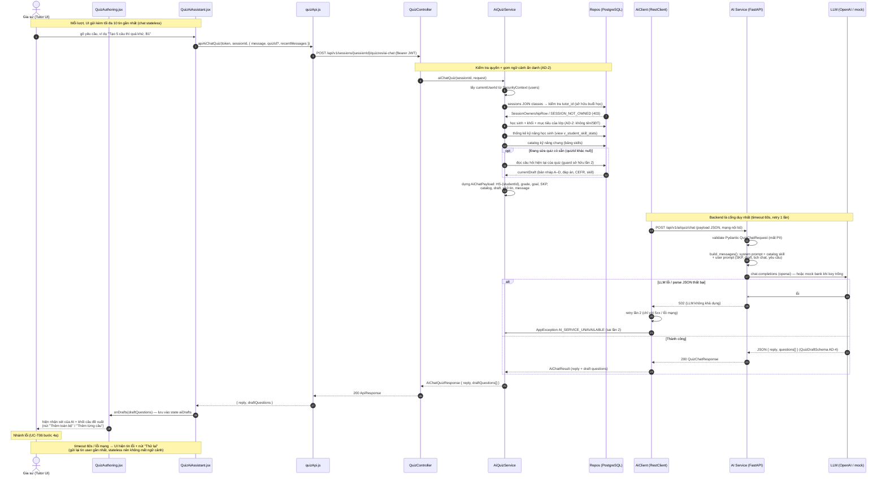
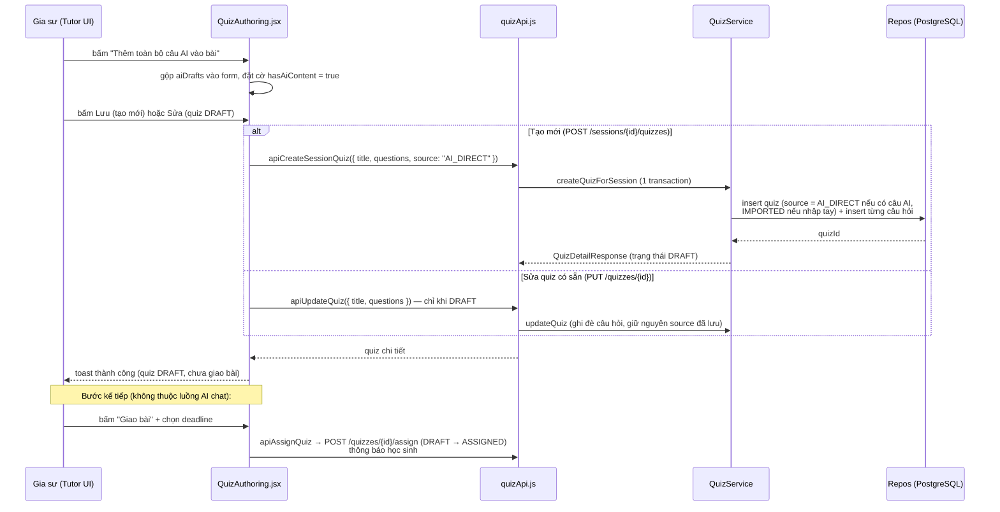

# Sequence Diagram — Trợ lý AI soạn quiz (FR-13, UC-T06)

Phạm vi: 1 lượt hội thoại với trợ lý AI (gồm cả nhánh tạo mới và sửa quiz DRAFT có sẵn),
kết thúc bằng việc gia sư lưu quiz. Nguồn code: `QuizController`, `AiQuizService`,
`AiClient` (backend), `ai/app/main.py`, `ai/app/prompt.py`, `ai/app/llm.py` (AI Service),
`QuizAuthoring.jsx`, `QuizAiAssistant.jsx`, `quizApi.js` (frontend).

## Diagram chính — 1 lượt chat

## Ghi chú các mốc quan trọng

| Mốc | Vị trí | Ghi chú thiết kế |
| :--- | :--- | :--- |
| Quyền sở hữu | `AiQuizService.aiChatQuiz` | Guard kép: buổi học phải thuộc `currentUserId` qua `sessions → classes.tutor_id`; quiz (nếu có) guard thêm tầng `QUIZ_NOT_OWNED` |
| Ẩn danh (AD-2) | `AiQuizService` → payload | Chỉ gửi mã `HS-{studentId}`, cấp, mục tiêu học, thống kê kỹ năng — không có tên/SĐT học sinh |
| Stateless (AD-?) | Frontend + `AiRecentMessage` | Lịch hội thoại do UI giữ và gửi kèm (≤10 tin), backend/AI không lưu MongoDB |
| Sửa quiz DRAFT | `currentDraftQuestions` | Câu hiện có được nhúng thẳng vào prompt → LLM chỉ trả các câu bị sửa/cộng mới |
| Retry | `AiClient.quizChat` | Tối đa 2 lần (5xx hoặc lỗi mạng), sau đó map `AI_SERVICE_UNAVAILABLE` → UI nút "Thử lại" |
| Provider LLM | `ai/app/llm.py:generate` | `openai` (mặc định, `LLM_API_KEY`) hoặc `mock` (key trống → chọn 5 câu mẫu từ bank theo SKP + cefr_hint) |

## Diagram phụ — từ draft AI đến lưu quiz (gia sư gộp câu vào form)

## Tóm tắt điểm kiểm soát trong luồng

1. **Guard quyền** (2 tầng): buổi học phải của gia sư đăng nhập; quiz (nếu có) cũng phải của chính họ.
2. **AD-2 (ẩn danh)**: AI Service chỉ nhận dữ liệu đã gom phía backend, không truy cập DB, không nhận PII.
3. **AD-4 (schema cứng)**: LLM ép trả JSON `QuizChatSchema` (4 phương án A–D, CEFR, skill_code hợp lệ từ catalog); parse fail → 502 → retry.
4. **Stateless chat**: lịch hội thoại sống ở UI, gửi ≤10 tin/lần — AI Service không giữ session.
5. **Truy vấn DB (theo operation)**:
   - `ai-chat` (read-only): `sessions+classes` (sở hữu), `classes` (ngữ cảnh học sinh), view `v_student_skill_stats`, `skills`, `quiz_questions` (nếu quizId).
   - `createQuizForSession`: INSERT `quizzes` + `quiz_questions` (1 transaction, `quizzes.source` = AI_DIRECT/IMPORTED).
   - `updateQuiz`: UPDATE `quizzes` + thay `quiz_questions` (chỉ DRAFT).
   - `assignQuiz`: UPDATE `quizzes` (DRAFT→ASSIGNED, deadline) + thông báo học sinh.
