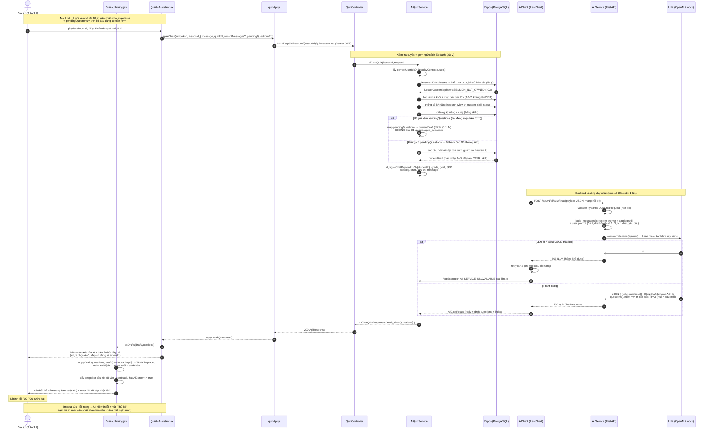
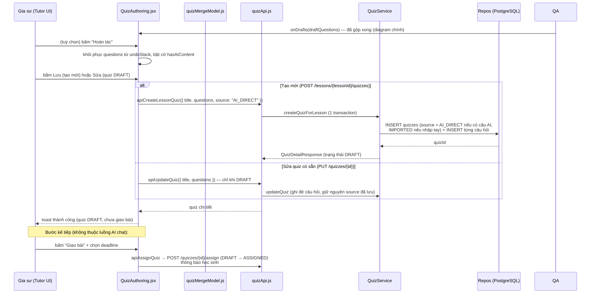

# Sequence Diagram — Trợ lý AI soạn quiz (FR-13, UC-T06)

Phạm vi: 1 lượt hội thoại với trợ lý AI (gồm cả nhánh tạo mới và sửa quiz DRAFT có sẵn),
kết thúc bằng việc gia sư lưu quiz. Nguồn code: `QuizController`, `AiQuizService`,
`AiClient` (backend), `ai/app/main.py`, `ai/app/prompt.py`, `ai/app/llm.py` (AI Service),
`QuizAuthoring.jsx`, `QuizAiAssistant.jsx`, `quizApi.js`, `quizMergeModel.js` (frontend).

> **Thay đổi 2026-XX (gộp tự động):** AI trả về câu hỏi được **gộp thẳng** vào
> form gia sư — không còn bước "xem trước → bấm Gộp". Gia sư xem đủ 4 lựa chọn
> + đáp án đúng ngay trong chat, và mọi thao tác gộp đều **Hoàn tác** được.

## Diagram chính — 1 lượt chat

## Ghi chú các mốc quan trọng

| Mốc | Vị trí | Ghi chú thiết kế |
| :--- | :--- | :--- |
| Quyền sở hữu | `AiQuizService.aiChatQuiz` | Guard kép: bài giảng phải thuộc `currentUserId` qua `lessons → classes.tutor_id`; quiz (nếu có) guard thêm tầng `QUIZ_NOT_OWNED` |
| Ẩn danh (AD-2) | `AiQuizService` → payload | Chỉ gửi mã `HS-{studentId}`, cấp, mục tiêu học, thống kê kỹ năng — không có tên/SĐT học sinh |
| Stateless (AD-?) | Frontend + `AiRecentMessage` | Lịch hội thoại do UI giữ và gửi kèm (≤10 tin), backend/AI không lưu MongoDB |
| `pendingQuestions` | FE `buildPendingQuestions` → BE | Trọn bộ câu đang có trên form (đã loại câu rỗng) → LLM đánh số 1..N theo đúng thứ tự mảng để hiểu "câu số k". Ưu tiên cao hơn việc đọc DB |
| `index` (thay câu) | AI Service → BE → FE | `index = k` (1 ≤ k ≤ N câu không rỗng) → thay in-place câu k; `null` → câu mới (thêm cuối); lệch → thêm cuối kèm cảnh báo cho gia sư |
| Gộp tự động | `QuizAuthoring.handleAiDrafts` + `quizMergeModel.applyDrafts` | Không còn bước "xem trước → bấm Gộp". Mỗi lần gộp đẩy snapshot vào `undoStack` (tối đa 10 bước) → nút **Hoàn tác** ở footer hành động |
| Retry | `AiClient.quizChat` | Tối đa 2 lần (5xx hoặc lỗi mạng), sau đó map `AI_SERVICE_UNAVAILABLE` → UI nút "Thử lại" |
| Provider LLM | `ai/app/llm.py:generate` | `openai` (mặc định, `LLM_API_KEY`) hoặc `mock` (key trống → chọn 5 câu mẫu từ bank theo SKP + cefr_hint) |

## Diagram phụ — gộp câu AI vào form → lưu quiz

## Tóm tắt điểm kiểm soát trong luồng

1. **Guard quyền** (2 tầng): bài giảng phải của gia sư đăng nhập; quiz (nếu có) cũng phải của chính họ.
2. **AD-2 (ẩn danh)**: AI Service chỉ nhận dữ liệu đã gom phía backend, không truy cập DB, không nhận PII.
3. **AD-4 (schema cứng)**: LLM ép trả JSON `QuizChatSchema` (4 phương án A–D, CEFR, skill_code hợp lệ từ catalog); parse fail → 502 → retry.
4. **Stateless chat**: lịch hội thoại sống ở UI, gửi ≤10 tin/lần — AI Service không giữ session.
5. **Gộp có kiểm soát**: không có bước duyệt thủ công, nhưng (a) AI phải trả `index` hợp lệ để thay đúng câu, (b) lệch → append kèm cảnh báo, (c) luôn có **Hoàn tác**, (d) quiz không còn DRAFT thì không gộp.
6. **Truy vấn DB (theo operation)**:
   - `ai-chat` (read-only): `lessons+classes` (sở hữu), `classes` (ngữ cảnh học sinh), view `v_student_skill_stats`, `skills`; `quizzes`+`quiz_questions` **chỉ khi** không có `pendingQuestions`.
   - `createQuizForLesson`: INSERT `quizzes` + `quiz_questions` (1 transaction, `quizzes.source` = AI_DIRECT/IMPORTED).
   - `updateQuiz`: UPDATE `quizzes` + thay `quiz_questions` (chỉ DRAFT).
   - `assignQuiz`: UPDATE `quizzes` (DRAFT→ASSIGNED, deadline) + thông báo học sinh.
