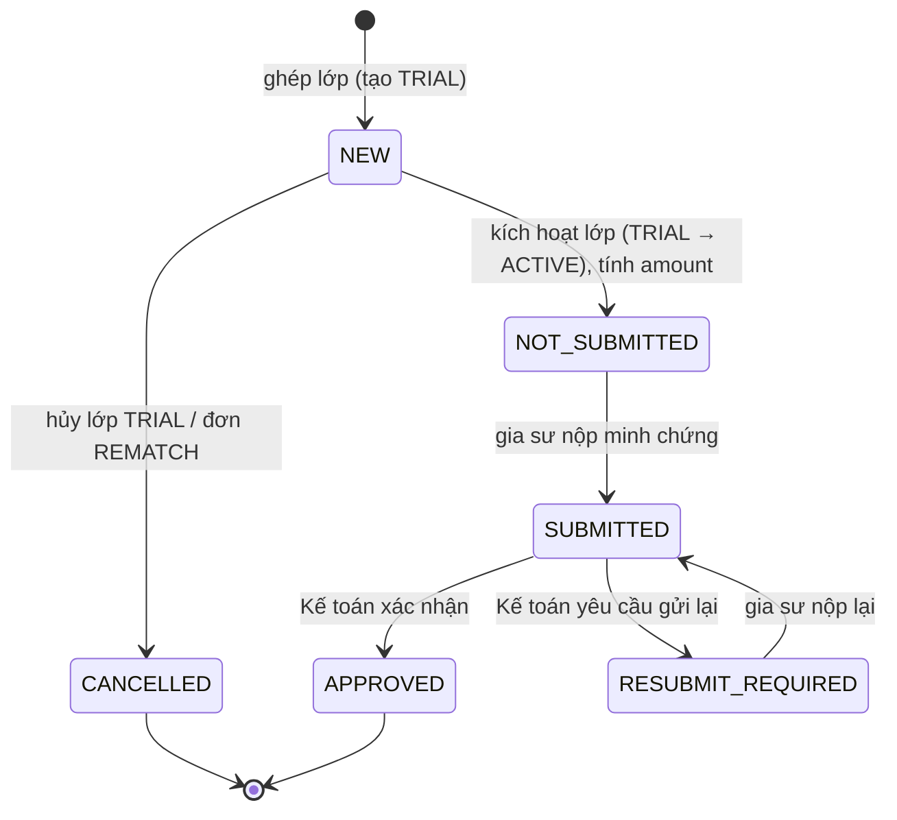

# Kế hoạch triển khai: Gia sư thiết lập lịch dạy cố định & Trung tâm kích hoạt lớp

> **Ngày cập nhật:** 28/10/2026  
> **Liên quan:** UC-T09, UC-REC-06.1, UC-T06, T7-B3  
> **Nhánh hiện tại:** `feature/fixed-schedules`  
> **Phụ thuộc:** T7-A3 (lớp `TRIAL` đã tồn tại), T7-C2 (`payments` đã có), V10 (`class_requests.fee_percentage`, `sessions_per_week`)
> **Thay đổi lớn so với bản trước:** payment tạo **ngay khi ghép lớp (TRIAL)** với `status = NEW` để snapshot `fee_percentage` + `price_per_session`; `amount = NULL` cho đến khi kích hoạt lớp.
> **Cập nhật 28/10/2026:** render lịch **không còn dựa vào `classes.active_from`** — bảng `class_schedules` thêm `valid_from` (DATE, NOT NULL) + `valid_to` (DATE, NULL = không có ngày kết thúc) cho **từng ca** (V11). FE chỉ render tuần nằm trong khoảng hiệu lực của ca; on-demand session phải rơi vào `[valid_from, valid_to]` (mục 4.2, 4.6).

---

## 1. Quyết định nghiệp vụ đã chốt

| # | Câu hỏi | Quyết định |
|---|---|---|
| 1 | Ai được kích hoạt lớp? | **Chỉ RECEPTIONIST/ADMIN**. Gia sư không được tự kích hoạt. |
| 2 | Phí nhận lớp được tính như thế nào? | **Công thức cố định** (Quy định I.6): `phí = fee_percentage% × sessions_per_week × 4 × price_per_session`, làm tròn đến nghìn đồng (mục 10). Nguồn dữ liệu: `class_requests.fee_percentage` (V10, default 40), `classes.sessions_per_week` + `classes.price_per_session` (V11). **Không nhập số tiền thủ công** — cột `fee_amount` trên `class_requests` không tồn tại. **Payment tạo sớm** (`NEW`) khi ghép lớp `TRIAL` để snapshot `fee_percentage` + `price_per_session`; `amount = NULL`. Khi lớp chuyển `ACTIVE`, hệ thống tính `amount` và chuyển payment `NEW → NOT_SUBMITTED` (công thức mục 10). |
| 3 | Gia sư có được cập nhật lịch cố định? | **Có**. Update ghi đè `class_schedules` (xóa ca cũ, lưu ca mới). **Không chạm vào bảng `sessions`** — session chính thức chỉ được tạo on-demand (mục 4.6) nên không có session nào cần xóa khi sửa lịch. **Không** tạo thêm khoản phí. |
| 4 | Khoảng hiệu lực lịch (`class_schedules.valid_from` / `valid_to`) | **Gia sư tự chọn cho từng ca**: `valid_from` bắt buộc, mặc định là ngày kích hoạt, không được ở quá khứ; `valid_to` tùy chọn (NULL = không có ngày kết thúc). Render lịch + kiểm tra on-demand session dùng khoảng hiệu lực từng ca — **không dùng `classes.active_from` nữa** (trường này chỉ còn ghi nhận ngày kích hoạt). |
| 5 | Session chính thức được sinh ra khi nào? | **On-demand**: gia sư bấm nút **"Tạo buổi học"** trên lịch (ngày có ca dạy) → API tạo 1 `sessions` (mục 4.6). Trước đó lịch thuần túy là `class_schedules` + FE tự render — **không có `SessionGenerator` sinh trước 4 tuần**. |

> **Khác so với UC-T09 gốc:** gia sư không tự chuyển lớp sang `ACTIVE`. Phí nhận lớp **không do trung tâm nhập tay** — hệ thống tính tự động từ `class_requests.fee_percentage` và các trường trên lớp. **Payment được tạo ngay khi ghép lớp (`TRIAL`)** với `status = NEW` để snapshot `fee_percentage` + `price_per_session` — tránh phí bị thay đổi sau đó. `amount = NULL` cho đến khi kích hoạt lớp. Khi kích hoạt lớp, nếu lớp chưa có đủ dữ liệu tính phí (`sessions_per_week`, `price_per_session`), lễ tân/admin bổ sung ngay tại modal kích hoạt; nếu thiếu `fee_percentage` (đơn cũ trước V10) thì mặc định 40%. Sau đó gia sư mới thiết lập lịch cố định. Phí đã lưu không thay đổi khi gia sư chốt hoặc sửa lịch.
>
> **Lý do `sessions_per_week` nằm trên `classes` chứ không lấy từ `class_requests`:** phụ huynh chưa xác định được số buổi/tuần khi gửi đơn, nên con số này do lễ tân quyết định cho lớp cụ thể (có thể khác mong muốn ban đầu của phụ huynh).

---

## 2. Luồng nghiệp vụ

```mermaid
flowchart LR
    A["Phụ huynh gửi yêu cầu"] --> B["Lễ tân tạo / xử lý đơn ghép lớp\n(fee_percentage trên đơn)"]
    B --> C["Lớp TRIAL\n+ tạo payment NEW\n(snapshot fee_percentage, price_per_session)"]
    C --> D["Gia sư đặt buổi dạy thử\n(UC-T08 — đã có)"]
    D --> E{"PH & GS\nđồng ý tiếp tục?"}
    E -->|Có| F["Lễ tân/Admin\nXác nhận ghép thành công\nTRIAL → ACTIVE\n(bổ sung sessions_per_week nếu thiếu)"]
    F --> G["Tính amount theo công thức\npayment NEW → NOT_SUBMITTED"]
    G --> H["Gia sư chốt lịch cố định\n(UC-T09): lưu class_schedules\n(ca + valid_from/valid_to)"]
    H --> I["FE render lịch tuần\ntừ class_schedules"]
    I --> J["Gia sư bấm \"Tạo buổi học\"\n→ tạo session on-demand"]
    E -->|Không| K["Hủy / Ghép lại\npayment NEW → CANCELLED"]
```

**Luồng cập nhật lịch:** gia sư mở lớp `ACTIVE` → sửa ca → ghi đè `class_schedules` → thông báo học sinh. **Không chạm `sessions`** (session đã tạo on-demand thuộc về từng ngày cụ thể, không bị xóa khi đổi lịch tuần). Phí đã lưu trên `payments` **không thay đổi**.

---

## 3. Phân tích hiện trạng code

### 3.1. Đã có (✅)

| Thành phần | File | Ghi chú |
|---|---|---|
| Kích hoạt `TRIAL → ACTIVE` | [StaffMatchRequestController.java](backend/src/main/java/com/mycompany/englishtutor/module/matching/controller/StaffMatchRequestController.java), [StaffMatchRequestService.java](backend/src/main/java/com/mycompany/englishtutor/module/matching/service/StaffMatchRequestService.java) | `POST /api/v1/match-requests/{id}/complete-match` cho RECEPTIONIST/ADMIN. Set `classes.status = 'ACTIVE'`, `active_from = COALESCE(active_from, CURRENT_DATE)`, ghi audit `COMPLETE_MATCH_REQUEST`, báo gia sư. |
| UI kích hoạt | [MatchRequests.jsx](frontend/src/pages/admin/MatchRequests.jsx) | Nút "Xác nhận ghép thành công" ở tab dạy thử; [ReceptionistMatchRequests.jsx](frontend/src/pages/receptionist/ReceptionistMatchRequests.jsx) dùng lại trang Admin. |
| Lịch dạy thử | [TutorClassController.java](backend/src/main/java/com/mycompany/englishtutor/module/classroom/controller/TutorClassController.java), [TutorClassService.java](backend/src/main/java/com/mycompany/englishtutor/module/classroom/service/TutorClassService.java) | `GET /tutors/me/classes`, `GET /classes/{id}`, `POST/PUT /classes/{id}/trial-session`. |
| Kiểm tra trùng ca buổi thử | [ScheduleConflictChecker.java](backend/src/main/java/com/mycompany/englishtutor/module/classroom/service/ScheduleConflictChecker.java) | Chỉ kiểm tra `sessions` theo ngày cụ thể (buổi thử). Chưa kiểm tra `class_schedules` tuần. |
| Đơn ghép lớp / lớp cần gia sư | [StaffMatchRequestService.java](backend/src/main/java/com/mycompany/englishtutor/module/matching/service/StaffMatchRequestService.java), [StaffClassRequestService.java](backend/src/main/java/com/mycompany/englishtutor/module/matching/service/StaffClassRequestService.java) | Tạo đơn và lớp `TRIAL`. Đơn có `price_per_session`; **lớp chưa có `sessions_per_week`** (cần migration V11). |
| Tỷ lệ phí trên đơn | Migration V10 ([V10__extend_request_fee_and_tutor_open.sql](backend/src/main/resources/db/migration/V10__extend_request_fee_and_tutor_open.sql)) | `class_requests.fee_percentage` `DECIMAL(5,2) NOT NULL DEFAULT 40` (0–50) — **đã có**, dùng làm tỷ lệ tính phí. |
| Công thức tính phí | [FeeCalculator.java](backend/src/main/java/com/mycompany/englishtutor/module/payment/service/FeeCalculator.java) | `feePercentage × slotsPerWeek × 4 × pricePerSession`, làm tròn đến nghìn đồng — **chính là công thức cần dùng**, tái dùng trực tiếp. |
| Phí nhận lớp | [PaymentService.java](backend/src/main/java/com/mycompany/englishtutor/module/payment/service/PaymentService.java), [PaymentQueryRepository.java](backend/src/main/java/com/mycompany/englishtutor/module/payment/repository/PaymentQueryRepository.java) | `createForClass()` (T7-B3) lấy `slotsPerWeek` bằng `COUNT(class_schedules)` trong `findClassFeeInfo`/`SELECT_COLUMNS` — **bị thay bằng `classes.sessions_per_week`** (V11): cả `findClassFeeInfo` (lúc kích hoạt, lớp `TRIAL` chưa có `class_schedules`) lẫn `createForClass` (lúc chốt lịch) đều dùng một nguồn duy nhất là `classes.sessions_per_week`. |
| Bảng dữ liệu | [V5 migration](backend/src/main/resources/db/migration/V5__create_remaining_englishpath_tables.sql) | `classes` (có `status`, `active_from`, `price_per_session`), `class_schedules`, `sessions`, `class_requests`, `payments`. |

### 3.2. Thiếu / lệch (❌)

| Thành phần | Ghi chú |
|---|---|
| `classes.sessions_per_week` | Chưa có cột trên `classes` (V11): dùng làm `slotsPerWeek` khi tính phí ở bước kích hoạt, vì phụ huynh chưa xác định số buổi/tuần khi gửi đơn. |
| `class_schedules.valid_from` / `valid_to` | Chưa có (V11): khoảng hiệu lực từng ca — **thay thế `classes.active_from`** cho render lịch và kiểm tra on-demand session. |
| Tạo payment `NEW` khi ghép lớp | Các endpoint tạo lớp `TRIAL` (`confirmMatchRequest`, `selectApplication`, `assignTutor`) chưa tạo payment; cần bổ sung tạo payment `NEW` (snapshot `fee_percentage` + `price_per_session`, `amount = NULL`) khi tạo lớp `TRIAL`. |
| Kích hoạt payment khi kích hoạt lớp | `completeMatchRequest` chưa chuyển payment `NEW → NOT_SUBMITTED`; cần tính `amount` và cập nhật payment. |
| API chốt / cập nhật lịch cố định | Chưa có `POST /classes/{id}/finalize-schedule`, `PUT /classes/{id}/schedules`; chưa có unique index `sessions(class_id, session_date, start_time)` (idempotent on-demand — V11). |
| Kiểm tra trùng lịch cố định tuần | `ScheduleConflictChecker` chưa đọc `class_schedules` của các lớp `ACTIVE` khác. |
| Tạo session on-demand | Chưa có `POST /classes/{id}/sessions` (nút "Tạo buổi học"): tạo 1 `sessions` `SCHEDULED` cho ngày + ca đúng lịch. |
| Trả lịch cố định về FE | `ClassDetailResponse` chưa có `schedules` / `hasSchedules`; chưa có `sessionsDates[]` (các ngày đã có session, để FE render nút "Mở buổi học" thay vì "Tạo buổi học"). |
| UI gia sư chốt lịch | Chưa có form chọn ca tuần + ngày bắt đầu + xem/sửa lịch; chưa có lưới lịch tuần với nút "Tạo buổi học / Mở buổi học". |
| Thông báo học sinh khi kích hoạt | Hiện chỉ báo gia sư; chưa báo học sinh (phụ huynh không có tài khoản). |

---

## 4. Thiết kế API

> **Ghi chú phân công:** các mục [TUTOR] là việc của role gia sư (Phase 2–3); các mục [STAFF] là việc của role RECEPTIONIST/ADMIN (Phase 1).

### 4.1. [STAFF] Kích hoạt lớp — dùng lại API đã có, bổ sung tạo phí theo công thức

```
POST /api/v1/match-requests/{id}/complete-match
Authorization: RECEPTIONIST, ADMIN

Body (tùy chọn, chỉ khi dữ liệu chưa đủ): { "sessionsPerWeek": 2, "pricePerSession": 300000, "feePercentage": 40 }
```

Không tạo endpoint mới. Sửa `StaffMatchRequestService.completeMatchRequest` để trong **cùng transaction**:

1. Khóa và kiểm tra đơn/lớp như hiện tại (lớp phải `TRIAL`).
2. Tìm payment `NEW` của lớp (tạo sẵn khi ghép lớp, mục 4.1.2). Nếu không có (dữ liệu cũ trước migration) → tạo mới.
3. Xác định 3 tham số tính phí (theo thứ tự ưu tiên):
   - `feePercentage`: đọc từ payment `NEW` (`fee_percentage` đã snapshot lúc ghép lớp). Fallback: `class_requests.fee_percentage` (default 40 nếu `NULL` — đơn cũ trước V10). Body **tùy chọn** có thể ghi đè `feePercentage` (validate 0–50) → dùng giá trị đó và cập nhật lại lên payment.
   - `sessionsPerWeek`: `classes.sessions_per_week`; nếu `NULL` mà body có `sessionsPerWeek > 0` → dùng và **lưu lại vào `classes`**.
   - `pricePerSession`: `classes.price_per_session` (hoặc từ payment `NEW` nếu lớp chưa có); nếu `NULL` mà body có `pricePerSession > 0` → dùng và **lưu lại vào `classes`**.
   - Thiếu `sessionsPerWeek` hoặc `pricePerSession` sau khi áp fallback → `CLASS_FEE_INCOMPLETE` (lễ tân phải bổ sung trong modal).
4. Tính phí: `FeeCalculator.calculate(feePercentage, sessionsPerWeek, pricePerSession)` (mục 10).
5. Chuyển `classes.status → 'ACTIVE'`, `active_from = COALESCE(active_from, CURRENT_DATE)` (chỉ ghi nhận ngày kích hoạt — **không dùng cho render lịch**, lịch render theo `class_schedules.valid_from/valid_to`).
6. Cập nhật payment: `amount = giá trị tính được`, `fee_percentage = feePercentage` (có thể đã ghi đè ở bước 3), `status = NEW → NOT_SUBMITTED`.
   - Nếu payment đã `NOT_SUBMITTED` (idempotent) → giữ nguyên.
   - Gửi thông báo khoản phí cho gia sư (giống `createForClass` hiện tại).
7. Ghi audit `COMPLETE_MATCH_REQUEST` (đã có) + audit `ACTIVATE_PAYMENT` (payment chuyển trạng thái).
8. Thông báo gia sư (đã có) + thông báo học sinh: _"Lớp học đã chuyển sang trạng thái chính thức."_

**Nguyên tắc:** số tiền trên `payments` chỉ được tính từ công thức, không nhập tay. Modal kích hoạt chỉ cho phép bổ sung `sessionsPerWeek` / `pricePerSession` khi lớp thiếu, đồng thời **hiển thị số phí sẽ được tính** trước khi xác nhận.

**Error codes:** `CLASS_REQUEST_NOT_FOUND`, `MATCH_REQUEST_NOT_TRIAL`, `CLASS_FEE_INCOMPLETE`, `FEE_PERCENTAGE_OUT_OF_RANGE`, `PAYMENT_NOT_FOUND` (payment `NEW` không tồn tại — dữ liệu cũ).

### 4.1.1. Sửa form đơn + đường ghi dữ liệu phí (điền trước khi ghép)

> **Gap hiện tại (đã verify code):** cột `class_requests.fee_percentage` (V10, default 40) **đã tồn tại trong DB nhưng chưa endpoint nào ghi vào** (grep module matching = trống). `price_per_session` đã có đường ghi qua form tạo/sửa request.

**Nguyên tắc phân loại dữ liệu phí (theo mục 10):**
- `fee_percentage` → **trên đơn** (`class_requests`), lễ tân chỉnh trong form đơn.
- `sessions_per_week` (bản dùng cho phí) → **trên lớp** (`classes`, V11), lễ tân quyết định cho lớp cụ thể; **không lấy từ `class_requests.sessions_per_week`** (trường V10 của phụ huynh, không xác định vì phụ huynh chưa chốt).
- `price_per_session` → **trên lớp** (`classes`), snapshot từ đơn khi tạo TRIAL; sửa qua modal kích hoạt.

**DTO + SQL (chỉ `feePercentage` lên form đơn):**
- `CreateMatchRequest`, `CreateClassRequest`: thêm `feePercentage` (optional, default 40, validate 0–50).
- `createMatchRequest` / `createClassRequest`: thêm `fee_percentage` vào câu `INSERT INTO class_requests` (trường `sessions_per_week`/`price_per_session` của request giữ như cũ, **không** dùng cho phí).
- `UpdateClassRequest`: thêm `feePercentage`; câu `UPDATE class_requests` (lễ tân sửa khi request `NEW`) thêm `fee_percentage` bằng `COALESCE`.
- **Mới `PUT /match-requests/{id}`** (mirror class-requests, chỉ khi `status = NEW`): sửa `class_requirement`, `teaching_mode`, `price_per_session`, `fee_percentage` — cho lễ tân hoàn thiện đơn (đơn từ form công khai do admin tạo) trước khi `confirm`.
- `MatchRequestDetailResponse`, `ClassRequestDetailResponse`: thêm `feePercentage`; map `cr.fee_percentage` trong query repository.

**Giới hạn:** sau khi request đã `MATCHED` (lớp TRIAL đã tạo + payment `NEW` đã snapshot `fee_percentage`), **không sửa trực tiếp các trường phí trên request qua form đơn** — chỉnh duy nhất tại bước kích hoạt: fallback body `complete-match` (mục 4.1, bước 3) cho phép bổ sung/ghi đè `feePercentage`, `sessionsPerWeek`, `pricePerSession` (cập nhật lại payment + `classes` tương ứng) cho đơn cũ thiếu dữ liệu; hoặc qua task mục 9 (sửa khi `payments.status IN (NEW, NOT_SUBMITTED)`).

### 4.1.2. Tạo payment `NEW` khi ghép lớp (tạo lớp TRIAL)

> **Mục đích:** snapshot `fee_percentage` + `price_per_session` ngay thời điểm ghép lớp, tránh phí bị thay đổi sau đó.

**Điểm gọi:** mọi nơi tạo lớp `TRIAL` — `confirmMatchRequest`, `selectApplication`, `assignTutor` (tất cả đều nằm trong `StaffMatchRequestService` / `StaffClassRequestService`).

**Logic (trong cùng transaction tạo lớp):**
1. Đọc `fee_percentage` từ `class_requests.fee_percentage` (default 40 nếu NULL — đơn cũ).
2. Đọc `price_per_session` từ `classes.price_per_session` (snapshot từ đơn khi tạo lớp, có thể NULL nếu đơn cũ).
3. Tạo payment: `payer_type = TUTOR`, `fee_percentage = giá trị đọc được`, `amount = NULL`, `status = NEW`.
4. **Không** gửi thông báo khoản phí (chưa kích hoạt, chưa có số tiền cụ thể).
5. Ghi audit `CREATE_PAYMENT_DRAFT`.

**Xử lý khi lớp `TRIAL` bị hủy / đơn `REMATCH`:**
- Payment `NEW` của lớp → `CANCELLED`.
- Khi ghép lại với gia sư mới → tạo lớp `TRIAL` mới + payment `NEW` mới.

### 4.2. [TUTOR] Gia sư chốt lịch cố định

```
POST /api/v1/classes/{id}/finalize-schedule
Authorization: TUTOR (sở hữu lớp)
```

**Request body** (mỗi ca có khoảng hiệu lực riêng):
```json
{
  "schedules": [
    { "dayOfWeek": 2, "startTime": "19:30", "endTime": "21:00", "validFrom": "2026-11-03", "validTo": null },
    { "dayOfWeek": 5, "startTime": "19:30", "endTime": "21:00", "validFrom": "2026-11-03", "validTo": "2026-12-15" }
  ]
}
```
- `validFrom`: bắt buộc mỗi ca, `≥ hôm nay`.
- `validTo`: tùy chọn (NULL = ca áp dụng mãi tới khi sửa lịch); nếu có thì `≥ validFrom`.
- Không còn trường `activeFrom` cấp request (mỗi ca tự quyết khoảng hiệu lực của mình).

**Logic:**
1. Lớp tồn tại, thuộc gia sư hiện tại, đang `ACTIVE`.
2. Lớp **chưa có** `class_schedules` (nếu đã có → `SCHEDULE_ALREADY_EXISTS`).
3. Validate mỗi ca: `1 ≤ dayOfWeek ≤ 7`, `startTime < endTime`, `validFrom ≥ hôm nay`, `validTo ≥ validFrom` (nếu có), không có 2 ca trùng/đè nhau trong cùng thứ.
4. Kiểm tra trùng:
   - **Theo tuần (có hiệu lực theo ngày):** các ca `class_schedules` của lớp `ACTIVE` khác cùng gia sư, trùng thứ + giao giờ + **khoảng hiệu lực giao nhau** (`cs.valid_from <= validTo hoặc không có validTo` AND `validFrom <= cs.valid_to hoặc cs.valid_to IS NULL`). Ca không nằm trong khoảng hiệu lực (đã kết thúc hoặc chưa bắt đầu) không tính là trùng.
   - **Theo ngày cụ thể:** các `sessions` (kể cả buổi thử) của gia sư vào **ngày + giờ** mà ca dự kiến rơi vào, chỉ xét ngày nằm trong `[validFrom, validTo]` của ca (vì không sinh session trước, nên chỉ kiểm tra các ngày đã có session thật).
5. Trong một transaction:
   - Lưu `class_schedules` (kèm `valid_from`/`valid_to` từng ca);
   - **Không ghi `classes.active_from` ở đây** — khoảng hiệu lực nằm trên `class_schedules`;
   - Ghi audit `FINALIZE_SCHEDULE`;
   - Thông báo học sinh: lịch học chính thức (kèm ca tuần + khoảng hiệu lực).
6. **Không sinh `sessions`** — ngày học render từ `class_schedules` theo khoảng hiệu lực của từng ca (mục 4.4, 4.6).

**Response:**
```json
{
  "code": 0,
  "message": "Chốt lịch học cố định thành công",
  "result": {
    "classId": 1,
    "schedules": [
      { "dayOfWeek": 2, "startTime": "19:30", "endTime": "21:00", "validFrom": "2026-11-03", "validTo": null },
      { "dayOfWeek": 5, "startTime": "19:30", "endTime": "21:00", "validFrom": "2026-11-03", "validTo": "2026-12-15" }
    ]
  }
}
```

### 4.3. [TUTOR] Gia sư cập nhật lịch cố định

```
PUT /api/v1/classes/{id}/schedules
Authorization: TUTOR (sở hữu lớp)
```

Body giống `finalize-schedule` (kèm `validFrom`/`validTo` mỗi ca). Logic khác:

1. Lớp phải đang `ACTIVE` và **đã có** `class_schedules` (nếu chưa có → `SCHEDULE_NOT_FOUND`).
2. Validate + kiểm tra trùng như trên (kể cả giao khoảng hiệu lực), **loại trừ chính lớp này** (thêm ngoại lệ: không báo trùng với các ca đã bị xóa của chính lớp này).
3. Trong một transaction:
   - Xóa `class_schedules` cũ, lưu lịch mới (kèm khoảng hiệu lực từng ca);
   - **Không ghi `classes.active_from`** (chỉ dùng `valid_from`/`valid_to` trên ca);
   - Ghi audit `UPDATE_CLASS_SCHEDULE`;
   - Thông báo học sinh về lịch mới.
4. **Không xóa/sinh `sessions`**: các buổi đã tạo (có học sinh, có dữ liệu bài dạy) giữ nguyên; ngày nào không còn ca trong lịch mới thì đơn giản là FE không render nữa — không có session `SCHEDULED` nào bị "cắm cờ hủy".

### 4.4. [TUTOR] Mở rộng chi tiết lớp

Thêm vào `ClassDetailResponse`:
```java
List<ScheduleInfo> schedules;      // rỗng nếu chưa chốt; ScheduleInfo gồm dayOfWeek, startTime, endTime, validFrom, validTo
boolean hasSchedules;
List<LocalDate> sessionDates;     // các session_date có session chính thức (is_trial = FALSE) của lớp
List<ScheduleSlot> todaySlots;    // ca của hôm nay theo lịch (FE dùng đánh dấu "hôm nay")
```
- `schedules`: query `class_schedules` (kèm `valid_from`, `valid_to`) trong `CLASS_DETAIL_QUERY` hoặc truy vấn riêng.
- `sessionDates`: `SELECT DISTINCT session_date FROM sessions WHERE class_id = ? AND is_trial = FALSE` — FE render ngày có session → nút **"Mở buổi học"**, ngày chưa có → nút **"Tạo buổi học"**.
- **Render lịch:** FE chỉ hiện tuần nào nằm trong khoảng hiệu lực của ca (`valid_from ≤ ngày ≤ valid_to`, NULL `valid_to` = mở). Tuần trước `valid_from` hoặc sau `valid_to` không render (không dùng `classes.active_from`).

### 4.5. [STAFF] Thay đổi `PaymentService` / `PaymentQueryRepository`

| Thành phần | Mô tả |
|---|---|
| `createForClassWithFeeInfo(Long classId, BigDecimal feePercentage, int sessionsPerWeek, BigDecimal pricePerSession)` | **Kích hoạt payment đã có** (tạo sẵn khi ghép lớp): tìm payment `NEW` của lớp, tính `amount` bằng `FeeCalculator.calculate`, cập nhật `fee_percentage` (nếu ghi đè), set `status = NOT_SUBMITTED`. Idempotent: nếu đã `NOT_SUBMITTED` → giữ nguyên. Fallback: nếu không có payment `NEW` (dữ liệu cũ) → tạo mới với `status = NOT_SUBMITTED`. |
| `createDraftForClass(Long classId, BigDecimal feePercentage, BigDecimal pricePerSession)` | **Tạo payment `NEW`** khi ghép lớp `TRIAL`: `payer_type = TUTOR`, `amount = NULL`, `status = NEW`. Idempotent theo `(class_id, payer_type = TUTOR, status = NEW)`. |
| `cancelDraftPayment(Long classId)` | **Hủy payment `NEW`** khi lớp `TRIAL` bị hủy hoặc đơn `REMATCH`: chuyển `status = NEW → CANCELLED`. |
| `createForClass(Long classId)` | Giữ nguyên luồng (lúc gia sư chốt lịch), **nhưng đổi nguồn `slotsPerWeek`** từ `COUNT(class_schedules)` → `classes.sessions_per_week` (xem dòng 4.5.1). `fee_percentage` cũng lấy từ `class_requests.fee_percentage` thay vì `properties.getDefaultFeePercentage()` để thống nhất một nguồn. |
| `updateFeePercentage(...)` | Dùng được với payment tạo theo công thức (làm tròn lại bằng `FeeCalculator` với cùng `sessions_per_week`, `price_per_session`); giữ nguyên cho dữ liệu cũ. |

**4.5.1. Đổi nguồn `slotsPerWeek` trong [PaymentQueryRepository.java](backend/src/main/java/com/mycompany/englishtutor/module/payment/repository/PaymentQueryRepository.java):**
- `ClassFeeInfo` (record) đổi nghĩa: `slotsPerWeek` giờ đọc từ `classes.sessions_per_week` (cột V11) thay vì subquery `COUNT(class_schedules)`.
- `findClassFeeInfo`: `SELECT c.id, c.tutor_id, c.price_per_session, c.sessions_per_week FROM classes c WHERE c.id = ?`.
- `SELECT_COLUMNS`: bỏ dòng `(SELECT COUNT(*) FROM class_schedules cs ...) AS slots_per_week`, thay bằng `c.sessions_per_week`.

> **Nguyên tắc:** mọi nơi tính/hiển thị phí đều dùng `classes.sessions_per_week` làm nguồn duy nhất. `COUNT(class_schedules)` không còn dùng cho phí; bảng `class_schedules` chỉ phục vụ luồng lịch cố định (mục 4.2–4.3, 4.6).

### 4.6. [TUTOR] Tạo buổi học on-demand (nút "Tạo buổi học / Mở buổi học")

```
POST /api/v1/classes/{id}/sessions
Authorization: TUTOR (sở hữu lớp)

Body: { "sessionDate": "2026-11-10" }
```

**Logic:**
1. Lớp `ACTIVE`, thuộc gia sư; `sessionDate` phải nằm trong khoảng hiệu lực của ca (`valid_from <= sessionDate <= valid_to`, NULL `valid_to` = mở) — nếu không → `SESSION_DATE_NOT_IN_SCHEDULE`.
2. Ngày phải có ca trong `class_schedules` (`day_of_week` khớp) — nếu không → `SESSION_DATE_NOT_IN_SCHEDULE`.
3. **Idempotent:** có session chính thức (`is_trial = FALSE`) trùng `(class_id, session_date, start_time)` → trả session đó (dùng unique index mục V11, không lỗi khi bấm nhầm 2 lần). Cùng ngày có 2 ca → `SESSION_AMBIGUOUS_TIME` (bắt buộc truyền thêm `startTime`).
4. Tạo session: `title = 'Buổi học chính thức'`, `start_time`/`end_time` theo ca, `is_trial = FALSE`, `teaching_mode = classes.teaching_mode`, `status = 'SCHEDULED'`.
5. `meeting_url`/`location` để trống — gia sư bổ sung trong page chi tiết buổi học (task sau).
6. Ghi audit `CREATE_SESSION` + trả session (FE chuyển sang chế độ "Mở buổi học" của ngày đó).

**Response:** `result` là `SessionDetail` (id, sessionDate, startTime, endTime, status, isTrial, createdNow: true/false).

> **Phạm vi:** chỉ tạo session. Các chức năng "thêm tài liệu, log kiến thức, dặn dò, bài tập" là **task sau** (mở rộng page chi tiết buổi học) — các cột `log_knowledge`, `log_homework` đã tồn tại trên `sessions` (V5).

### 4.7. ErrorCode mới

| Code | Enum | HTTP | Phân công |
|---|---|---|---|
| 1115 | `CLASS_FEE_INCOMPLETE` — "Lớp chưa đủ thông tin tính phí nhận lớp (thiếu số buổi/tuần hoặc học phí mỗi buổi)" | CONFLICT | [STAFF] |
| 1133 | `CLASS_NOT_ACTIVE` — "Lớp học chưa được kích hoạt" | CONFLICT | [TUTOR] |
| 1134 | `SCHEDULE_ALREADY_EXISTS` — "Lớp học đã có lịch dạy cố định" | CONFLICT | [TUTOR] |
| 1135 | `SCHEDULE_NOT_FOUND` — "Lớp học chưa có lịch dạy cố định" | NOT_FOUND | [TUTOR] |
| 1136 | `SCHEDULE_INVALID_TIME` — "Giờ kết thúc phải sau giờ bắt đầu" | BAD_REQUEST | [TUTOR] |
| 1137 | `SCHEDULE_DATE_IN_PAST` — "Ngày bắt đầu hiệu lực không được trong quá khứ" | BAD_REQUEST | [TUTOR] |
| 1138 | `SCHEDULE_INVALID_RANGE` — "Ngày kết thúc hiệu lực phải sau hoặc bằng ngày bắt đầu" | BAD_REQUEST | [TUTOR] |
| 1139 | `SCHEDULE_DUPLICATE` — "Các ca dạy trong tuần bị trùng nhau" | BAD_REQUEST | [TUTOR] |
| 1140 | `SESSION_DATE_NOT_IN_SCHEDULE` — "Ngày này không có ca dạy trong khoảng hiệu lực của lịch cố định lớp" | BAD_REQUEST | [TUTOR] |
| 1141 | `SESSION_AMBIGUOUS_TIME` — "Ngày này có nhiều ca, cần chỉ định giờ bắt đầu" | BAD_REQUEST | [TUTOR] |

---

## 5. Triển khai chi tiết theo Phase

### Phase 1 — [STAFF] Dữ liệu tính phí + kích hoạt (1–1.5 ngày)

**Migration `V11__add_class_sessions_per_week.sql`:**
```sql
-- 1. classes: số buổi/tuần dùng cho tính phí (mục 10) — do lễ tân quyết định cho lớp
ALTER TABLE classes ADD COLUMN IF NOT EXISTS sessions_per_week SMALLINT;
ALTER TABLE classes
    DROP CONSTRAINT IF EXISTS chk_classes_sessions_per_week;
ALTER TABLE classes ADD CONSTRAINT chk_classes_sessions_per_week
    CHECK (sessions_per_week IS NULL OR sessions_per_week > 0);

-- 2. class_schedules: khoảng hiệu lực từng ca — thay thế classes.active_from
--    cho render lịch + kiểm tra on-demand session (mục 4.2, 4.6)
--    valid_from NOT NULL; valid_to NULL = ca áp dụng không giới hạn (cho tới khi sửa lịch)
ALTER TABLE class_schedules ADD COLUMN IF NOT EXISTS valid_from DATE;
ALTER TABLE class_schedules ADD COLUMN IF NOT EXISTS valid_to   DATE;
ALTER TABLE class_schedules ALTER COLUMN valid_from SET NOT NULL;
ALTER TABLE class_schedules
    DROP CONSTRAINT IF EXISTS chk_class_schedules_valid_range;
ALTER TABLE class_schedules ADD CONSTRAINT chk_class_schedules_valid_range
    CHECK (valid_to IS NULL OR valid_to >= valid_from);
UPDATE class_schedules SET valid_from = COALESCE(c.active_from, CURRENT_DATE)
    FROM classes c WHERE c.id = class_schedules.class_id AND valid_from IS NULL;

-- 3. sessions: unique index phục vụ create-on-demand idempotent (mục 4.6)
--    — bấm "Tạo buổi học" 2 lần cùng ca không nhân đôi session
CREATE UNIQUE INDEX IF NOT EXISTS uq_sessions_class_date_start
    ON sessions (class_id, session_date, start_time)
    WHERE is_trial = FALSE;
```

> **Lưu ý scope V11:** thêm `classes.sessions_per_week` + `class_schedules.valid_from/valid_to` + unique index sessions. **Không** thêm `fee_amount` (mục 1, quyết định 2 — phí tính bằng công thức, không nhập số tiền). `classes.active_from` giữ nguyên (ghi nhận ngày kích hoạt) nhưng **không còn dùng cho render lịch**. Dữ liệu cũ: backfill `valid_from` từ `classes.active_from` (fallback hôm nay).

**Backend:**
- **Đường ghi `fee_percentage` (gap hiện tại — hiện chưa endpoint nào ghi):**
  - `CreateMatchRequest`, `CreateClassRequest`: thêm `feePercentage` (optional, default 40, validate 0–50) → thêm vào câu `INSERT INTO class_requests`.
  - `UpdateClassRequest` + `UPDATE class_requests` (request `NEW`): thêm `fee_percentage` (`COALESCE`).
  - **Mới `PUT /match-requests/{id}`** (mirror class-requests, chỉ `NEW`): sửa `class_requirement`, `teaching_mode`, `price_per_session`, `fee_percentage` — lễ tân hoàn thiện đơn trước `confirm`.
- **`classes.sessions_per_week` (V11):** lễ tân nhập tại **modal kích hoạt** (fallback body mục 4.1) khi request chưa có số buổi cho lớp. Không snapshot từ `class_requests.sessions_per_week` (trường phụ huynh, không xác định).
- `MatchRequestDetailResponse`, `ClassRequestDetailResponse`: thêm `feePercentage`, `sessionsPerWeek` (request); map `cr.fee_percentage`, `cr.sessions_per_week`.
- `PaymentService.createForClassWithFeeInfo(classId, feePercentage, sessionsPerWeek, pricePerSession)` (mục 4.5), tính bằng `FeeCalculator`.
- [PaymentQueryRepository.java](backend/src/main/java/com/mycompany/englishtutor/module/payment/repository/PaymentQueryRepository.java) (mục 4.5.1): đổi `slotsPerWeek` từ `COUNT(class_schedules)` → `classes.sessions_per_week` ở `findClassFeeInfo` + `SELECT_COLUMNS`; `createForClass` đổi `fee_percentage` sang `class_requests.fee_percentage`.
- `StaffMatchRequestService.completeMatchRequest`: đọc `class_requests.fee_percentage` + `classes.sessions_per_week`/`price_per_session`; fallback body bổ sung `sessionsPerWeek`/`pricePerSession` thiếu (lưu vào `classes`); tính phí; thiếu → `CLASS_FEE_INCOMPLETE`; tạo payment cùng transaction; thông báo học sinh.
- Thêm `ErrorCode.CLASS_FEE_INCOMPLETE` (1115).

**Frontend:**
- [MatchRequests.jsx](frontend/src/pages/admin/MatchRequests.jsx): form tạo đơn ghép lớp thêm ô **"Tỷ lệ phí nhận lớp (%)"** (default 40, 0–50); modal chi tiết hiển thị phí tính toán (lấy `fee_percentage` của đơn + `sessions_per_week`/`price_per_session` của lớp, nếu chưa có thì ghi "chưa đủ thông tin"); modal kích hoạt: hiển thị số phí sẽ tính, nếu thiếu `sessions_per_week` hoặc `price_per_session` thì cho nhập bổ sung 2 ô này (gửi kèm body).
- [ClassRequests.jsx](frontend/src/pages/admin/ClassRequests.jsx): form tạo/sửa lớp cần gia sư thêm ô tỷ lệ phí; modal chi tiết hiển thị.
- [matchRequestApi.js](frontend/src/lib/matchRequestApi.js): `apiCompleteMatchRequest(id, token, body?)` — body gồm `sessionsPerWeek`, `pricePerSession` (optional).

**Test:**
- Tạo lớp `TRIAL` → có 1 payment `NEW` với `fee_percentage` snapshot, `amount = NULL`.
- Kích hoạt với đủ dữ liệu → payment `NEW → NOT_SUBMITTED`, `amount = round(fee% × sessionsPerWeek × 4 × price, nghìn)`, `fee_percentage` = giá trị snapshot (hoặc ghi đè từ body).
- Thiếu `sessions_per_week` / `price_per_session` → 409 `CLASS_FEE_INCOMPLETE`; bổ sung qua body → lưu vào `classes` + kích hoạt payment.
- Gọi lại không nhân đôi payment; học sinh + gia sư nhận thông báo.
- Hủy lớp `TRIAL` → payment `NEW → CANCELLED`.
- Ghép lại (`REMATCH`) → payment cũ `CANCELLED`, lớp mới có payment `NEW` mới.
- Thay đổi `class_requests.fee_percentage` sau khi đã tạo payment `NEW` → payment giữ giá trị snapshot (không bị ảnh hưởng).

### Phase 2 — [TUTOR] Backend chốt / cập nhật lịch cố định (1.5 ngày)

**2.1. DTO** (`module/classroom/api/request`, `response`):
- `FinalizeScheduleRequest` (danh sách `ScheduleSlot`: `dayOfWeek`, `startTime`, `endTime`, `validFrom` (bắt buộc), `validTo` (tùy chọn)). Không còn `activeFrom` cấp request.
- `FinalizeScheduleResponse`, `ScheduleInfo` (kèm `validFrom`, `validTo`).
- `CreateSessionRequest` (`sessionDate`, `startTime` tùy chọn — dùng khi ngày có nhiều ca, mục 4.6).

**2.2. `ClassroomQueryRepository`:**
- `hasSchedules(classId)`, `findSchedules(classId)` (kèm `valid_from`, `valid_to`), `countSchedules(classId)`.
- `insertSchedules(classId, slots)` (kèm `valid_from`/`valid_to`), `deleteSchedules(classId)`.
- Bỏ `updateActiveFrom(classId, date)` — không còn ghi `classes.active_from` khi chốt/sửa lịch (trường này chỉ do bước kích hoạt ghi nhận ngày).
- `findWeeklyConflicts(tutorId, slot, excludeClassId)`:
```sql
SELECT cs.day_of_week, cs.start_time, cs.end_time,
       cs.valid_from, cs.valid_to,
       c.id AS class_id, c.class_name, u.full_name AS student_name
FROM class_schedules cs
JOIN classes c ON c.id = cs.class_id
JOIN users u ON u.id = c.student_id
WHERE c.tutor_id = ?
  AND c.status = 'ACTIVE'
  AND c.id <> ?
  AND cs.day_of_week = ?
  AND cs.start_time < ?   -- endTime mới
  AND cs.end_time   > ?   -- startTime mới
  -- khoảng hiệu lực giao nhau: cs.valid_from <= validTo(mới) và validFrom(mới) <= cs.valid_to
  AND cs.valid_from <= ?
  AND (? IS NULL OR cs.valid_to >= ?)
```
(3 tham số cuối truyền theo ca mới đang kiểm tra: `valid_to` (NULL được gán một ngày rất xa) và `valid_from`.)
- `findSessionConflicts(tutorId, date, start, end, excludeClassId)`: các `sessions` (cả buổi thử, status `SCHEDULED/IN_PROGRESS`) của gia sư vào đúng ngày + giao giờ, thuộc lớp khác.
- `findSessionAt(classId, date, startTime)`: kiểm tra idempotent mục 4.6.
- `insertSession(...)`, `sessionDatesOf(classId)` (distinct `session_date` các session chính thức, cho `ClassDetailResponse.sessionDates`).
- Mở rộng `CLASS_DETAIL_QUERY` trả `schedules` + `sessionDates`.

**2.3. `ScheduleConflictChecker`:**
- `findWeeklyConflicts(...)` tái dùng SQL trên (kể cả điều kiện giao khoảng hiệu lực); `describeWeeklyConflict(...)` trả tên lớp + học sinh + thứ + giờ + khoảng hiệu lực.
- `findSessionConflicts(...)` (mục ngày cụ thể): chỉ gọi cho các ngày nằm trong `[validFrom, validTo]` của ca, vì session ngoài khoảng hiệu lực không tồn tại.

**2.4. `TutorClassService`:**
- `requireOwnedActiveClass(classId)` (mới).
- `finalizeSchedule(classId, request)`, `updateSchedule(classId, request)` theo mục 4.2–4.3 — **không gọi sinh sessions**.
- `createSessionOnDemand(classId, request)` theo mục 4.6 (idempotent).
- Gọi audit + notification sau khi lưu lịch.

**2.5. Controller:** thêm 3 endpoint vào `TutorClassController` (`POST /finalize-schedule`, `PUT /schedules`, `POST /sessions`), giữ `@PreAuthorize("hasRole('TUTOR')")`.

**2.6. Test:**
- Unit `ScheduleConflictChecker`: trùng tuần hẳn, trùng một phần, liền kề (kết thúc 21:00 = bắt đầu 21:00 → không trùng), khác thứ; ca khác không giao khoảng hiệu lực → không trùng; trùng ngày cụ thể chỉ với session đã tồn tại.
- Unit `createSessionOnDemand`: tạo mới, idempotent khi bấm lại, `SESSION_DATE_NOT_IN_SCHEDULE` (ngày không khớp ca **hoặc** ngoài `[valid_from, valid_to]`), `SESSION_AMBIGUOUS_TIME`, không tạo trước `valid_from`.
- Unit validate: `validTo < validFrom` → `SCHEDULE_INVALID_RANGE`; `validFrom` quá khứ → `SCHEDULE_DATE_IN_PAST`.
- Integration: chốt lịch (không sinh sessions — `sessions` không đổi); update lịch chỉ ghi `class_schedules` (sessions đã tạo còn nguyên); rollback khi lỗi.

### Phase 3 — [TUTOR] Frontend gia sư (1–1.5 ngày)

- [classroomApi.js](frontend/src/lib/classroomApi.js): thêm `apiFinalizeSchedule`, `apiUpdateClassSchedules`, `apiCreateSession(classId, token, { sessionDate, startTime? })`; map `schedules`, `hasSchedules`, `sessionDates`, `todaySlots` trong `mapClassDetail`.
- [TutorClassWorkspace.jsx](frontend/src/pages/tutor/TutorClassWorkspace.jsx):
  - Banner khi lớp `ACTIVE` và `!hasSchedules`: "Thiết lập lịch dạy cố định".
  - Form/modal: chọn thứ trong tuần, giờ bắt đầu/kết thúc cho từng ca, **ngày hiệu lực bắt đầu `valid_from` (mặc định hôm nay, chặn quá khứ) và ngày kết thúc `valid_to` (tùy chọn, trống = không giới hạn)**; preview "Thứ 2: 19:30 - 21:00 (hiệu lực từ 03/11/2026)".
  - Sau khi chốt: chế độ xem read-only (hiển thị `valid_from`/`valid_to` từng ca) + nút "Chỉnh sửa lịch".
  - **Lưới lịch tuần (render từ `schedules` theo khoảng hiệu lực từng ca)**: tuần nào có ngày nằm trong `[valid_from, valid_to]` (NULL `valid_to` = mở) của ca nào thì render tuần đó; các ngày có ca hiển thị ca (thứ + giờ + khoảng hiệu lực); ngày có id trong `sessionDates` → nút **"Mở buổi học"**, ngày chưa có → nút **"Tạo buổi học"**. Bấm "Tạo buổi học" gọi `apiCreateSession`; ngày có nhiều ca → hiện dropdown chọn ca trước khi gọi. Sau khi tạo thành công, refresh `sessionDates` (nút chuyển sang "Mở buổi học").
  - Validate client: `start < end`, không trùng ca cùng ngày, `valid_from ≥ hôm nay`, `valid_to ≥ valid_from`.
  - Hiển thị lỗi trùng ca / ngày không trong lịch từ backend kèm tên lớp/học sinh/thứ/giờ.
- Tuân thủ [frontend/AGENTS.md](frontend/AGENTS.md): tiếng Việt 100%, dark mode, `lucide-react`, `Button/Card/Badge` sẵn có, không emoji.

> UI kích hoạt lớp của Lễ tân/Admin **đã có** ở `MatchRequests.jsx`; Phase 1 chỉ bổ sung ô nhập phí trong modal xác nhận, không làm lại trang. Page chi tiết buổi học (tài liệu, log kiến thức, dặn dò, bài tập) là task sau — Phase 3 chỉ tạo session + mở nút.

### Phase 4 — [CÙNG NHAU] Kiểm thử tổng thể (0.5 ngày)

- Chạy backend + frontend, test E2E theo mục 8.
- Kiểm tra DB sau từng bước.

---

## 6. Bảng đọc/ghi DB theo thao tác

| Thao tác | Vai trò | Bảng đọc | Bảng ghi |
|---|---|---|---|
| Tạo đơn ghép lớp | [STAFF] Lễ tân | `tutors`, `users`, `parents`, `students` | `class_requests` (kèm `fee_percentage`), `parents`, `students`, `users`, `audit_logs`, `notifications` |
| Sửa đơn ghép lớp (khi `NEW`) | [STAFF] | `class_requests` (FOR UPDATE) | `class_requests` (kèm `fee_percentage`), `audit_logs` |
| Tạo/sửa lớp cần gia sư | [STAFF] | `parents`, `students`, `users` | `class_requests` (kèm `fee_percentage`, `price_per_session`), `students`, `users`, `audit_logs` |
| Đăng lớp / chọn gia sư | [STAFF] | `class_requests`, `class_applications`, `tutors` | `class_requests`, `class_applications`, `classes` (tạo `TRIAL`), `audit_logs`, `notifications` |
| Xác nhận dạy thử (confirm) | [STAFF] | `class_requests`, `classes` | `class_requests`, `classes` (tạo `TRIAL`), `audit_logs`, `notifications` |
| **Tạo lớp TRIAL (confirm / selectApp / assign)** | [STAFF] | `class_requests` (gồm `fee_percentage`), `tutors`, `students` | `classes` (tạo `TRIAL`), `class_requests` (`MATCHED`), **`payments` (tạo `NEW`, snapshot `fee_percentage` + `price_per_session`)**, `audit_logs`, `notifications` |
| **Kích hoạt lớp (complete-match)** | [STAFF] | `class_requests`, `classes` (FOR UPDATE, gồm `sessions_per_week`, `price_per_session`), **`payments` (FOR UPDATE, `NEW`)** | `classes` (`ACTIVE`, `active_from`; bổ sung `sessions_per_week`/`price_per_session` nếu fallback), **`payments` (tính `amount`, `NEW → NOT_SUBMITTED`)**, `audit_logs`, `notifications` |
| **Hủy lớp TRIAL / REMATCH** | [STAFF] | `classes`, `payments` | `classes` (`CANCELLED`), **`payments` (`NEW → CANCELLED`)**, `class_requests` (`REMATCH`/`CANCELLED`), `audit_logs` |
| Xem chi tiết lớp | [TUTOR] gia sư | `classes`, `users`, `students`, `sessions`, `class_schedules` (kèm `valid_from`, `valid_to`) | — |
| **Chốt lịch cố định** | [TUTOR] | `classes`, `class_schedules`, `sessions` (kiểm tra trùng ngày, trong khoảng hiệu lực) | `class_schedules` (kèm `valid_from`, `valid_to`), `audit_logs`, `notifications` |
| **Cập nhật lịch cố định** | [TUTOR] | `classes`, `class_schedules`, `sessions` (kiểm tra trùng) | `class_schedules`, `audit_logs`, `notifications` |
| **Tạo buổi học on-demand** | [TUTOR] | `classes`, `class_schedules` (hiệu lực), `sessions` (idempotent) | `sessions`, `audit_logs`, `notifications` |

---

## 7. Ràng buộc nghiệp vụ

| # | Ràng buộc | Kiểm tra ở |
|---|---|---|
| 1 | Chỉ RECEPTIONIST/ADMIN kích hoạt lớp | `@PreAuthorize` của `StaffMatchRequestController` |
| 2 | Chỉ gia sư sở hữu lớp mới chốt/cập nhật lịch | Service layer |
| 3 | Lớp phải `ACTIVE` trước khi chốt/cập nhật lịch | Service layer |
| 4 | Phí nhận lớp = `fee_percentage × classes.sessions_per_week × 4 × classes.price_per_session` (mục 10); `fee_percentage` trong 0–50 (V10), `sessions_per_week` > 0, `price_per_session` > 0; thiếu thông tin → không kích hoạt được | DTO validate + `completeMatchRequest` |
| 5 | Payment tạo `NEW` khi ghép lớp (snapshot `fee_percentage`); kích hoạt `NEW → NOT_SUBMITTED` khi lớp `TRIAL → ACTIVE`; chốt/cập nhật lịch không thay đổi phí | `PaymentService`, idempotent theo `(class_id, payer_type)` |
| 5.1 | Lớp `TRIAL` bị hủy / đơn `REMATCH` → payment `NEW → CANCELLED` | `PaymentService.cancelDraftPayment` |
| 6 | Số tiền trên `payments` luôn tính bằng `FeeCalculator` (mục 10), không nhập tay | `PaymentService.createForClassWithFeeInfo` |
| 6.1 | Hệ số số buổi/tuần của phí **luôn** lấy từ `classes.sessions_per_week`; **không bao giờ** tính bằng `COUNT(class_schedules)` | `PaymentQueryRepository.findClassFeeInfo` / `SELECT_COLUMNS`, `createForClassWithFeeInfo`, `createForClass`, `updateFeePercentage` |
| 7 | Trùng ca tuần (giao giờ + giao khoảng hiệu lực) → reject toàn bộ, transaction rollback | `@Transactional` |
| 8 | Ca liền kề không tính trùng; chỉ giao nhau thực sự mới trùng | `ScheduleConflictChecker` |
| 9 | Update lịch chỉ ghi đè `class_schedules`; **không** xóa/sinh `sessions` (session đã tạo on-demand giữ nguyên) | Repository |
| 10 | Mỗi đơn tối đa 1 lớp `TRIAL/ACTIVE` | Unique index `uq_classes_one_current_per_request` |
| 11 | State machine: `TRIAL → ACTIVE → COMPLETED/CANCELLED` | Service validate |
| 12 | Session chính thức chỉ tạo **on-demand** (nút "Tạo buổi học"), 1 session/ca, không sinh sẵn 4 tuần; ngày phải nằm trong `[valid_from, valid_to]` của ca | `createSessionOnDemand` + unique index `uq_sessions_class_date_start` |
| 13 | `valid_from` không ở quá khứ; `valid_to ≥ valid_from` (NULL = không giới hạn) | Validate request + CHECK `chk_class_schedules_valid_range` |
| 14 | On-demand idempotent: bấm lại cùng `(class_id, session_date, start_time)` không nhân đôi session | Unique index `uq_sessions_class_date_start` (WHERE `is_trial = FALSE`) |
| 15 | Render lịch theo khoảng hiệu lực từng ca (`class_schedules.valid_from/valid_to`); `classes.active_from` chỉ ghi nhận ngày kích hoạt | FE + `ClassDetailResponse` |

---

## 8. Test E2E thủ công

Giả lập: `fee_percentage = 40`, `sessions_per_week = 2`, `price_per_session = 300.000đ` → phí = `40% × 2 × 4 × 300.000 = 960.000đ`.

1. **[STAFF]** **Lễ tân** tạo đơn ghép lớp, giữ tỷ lệ phí mặc định **40%** (`class_requests.fee_percentage = 40`); khi tạo lớp `TRIAL` set `price_per_session = 300.000`.
   - ✅ `payments`: 1 dòng `TUTOR`, **`status = NEW`**, `fee_percentage = 40`, `amount = NULL` (snapshot từ đơn).
2. **[TUTOR]** **Gia sư** đặt buổi dạy thử → lớp giữ `TRIAL`, payment giữ `NEW`.
3. **[STAFF]** **Lễ tân** bấm "Xác nhận ghép thành công"; modal hiển thị phí sẽ tính **960.000đ** (nếu `sessions_per_week` chưa có thì modal cho nhập **2 buổi/tuần** trước, lưu vào `classes`):
   - `classes.status = 'ACTIVE'`, `active_from = hôm nay`;
   - `payments`: **`status = NEW → NOT_SUBMITTED`**, `amount = 960.000`, `fee_percentage = 40` (giữ nguyên snapshot);
   - Học sinh + gia sư nhận thông báo.
4. **[TUTOR]** **Gia sư** mở lớp → thấy banner "Thiết lập lịch dạy cố định".
5. **[TUTOR]** Chọn T3/T5 19:30–21:00, ca T3 `valid_from` = **thứ 2 tuần sau**, ca T5 `valid_from` = thứ 2 tuần sau, `valid_to` = 15/12:
   - `class_schedules`: 2 dòng, kèm `valid_from`/`valid_to`;
   - `sessions`: **không đổi** (chưa có session nào được sinh — lịch mới là dữ liệu tuần);
   - Phí giữ nguyên 960.000đ (không tính lại).
6. **[TUTOR]** **Gia sư** mở lưới lịch tuần → thấy các ngày T3/T5 **trong khoảng hiệu lực** có nút **"Tạo buổi học"** (tuần trước `valid_from` không render; sau `valid_to` của T5 không render ca T5); bấm vào 1 ngày T5 trong khoảng:
   - `sessions`: +1 dòng `SCHEDULED`, `is_trial = FALSE` (đúng ca 19:30–21:00);
   - Bấm lại cùng ngày → **không nhân đôi** (unique index), nút chuyển thành **"Mở buổi học"**.
7. **[TUTOR]** **Gia sư** sửa lịch thành 3 ca/tuần (thêm T2):
   - `class_schedules`: 3 dòng; **session đã tạo ở bước 6 vẫn giữ nguyên** (không xóa);
   - Lưới lịch thêm ngày T2 với nút "Tạo buổi học";
   - Phí vẫn giữ nguyên 960.000đ.
8. **[TUTOR]** Thử chốt trùng ca với lớp `ACTIVE` khác → lỗi `SCHEDULE_DUPLICATE` kèm tên lớp/học sinh/thứ/giờ.
9. **[CẢ HAI]** Kiểm tra `audit_logs`: có `CREATE_PAYMENT_DRAFT` (khi tạo TRIAL), `COMPLETE_MATCH_REQUEST`, `ACTIVATE_PAYMENT`, `FINALIZE_SCHEDULE`, `UPDATE_CLASS_SCHEDULE`, `CREATE_SESSION`.
10. **[STAFF]** Với lớp cũ thiếu `sessions_per_week` hoặc `price_per_session`: modal kích hoạt cho nhập bổ sung → lưu lại vào `classes` rồi mới kích hoạt payment.
11. **[STAFF]** **Test snapshot:** thay đổi `class_requests.fee_percentage` từ 40 → 30 sau khi đã tạo lớp `TRIAL` → payment vẫn giữ `fee_percentage = 40` (snapshot không bị ảnh hưởng).
12. **[STAFF]** **Test hủy TRIAL:** hủy lớp `TRIAL` → payment `NEW → CANCELLED`; ghép lại → lớp mới có payment `NEW` mới.

---

## 9. Giả định & điểm cần lưu ý

- **Phụ huynh không có tài khoản** → chỉ gửi thông báo cho học sinh và gia sư.
- **Session on-demand, không sinh sẵn**: lịch học render từ `class_schedules` theo **khoảng hiệu lực từng ca** (`valid_from`–`valid_to`; NULL `valid_to` = mở, không giới hạn 4 tuần). **Không dùng `classes.active_from`** (trường này chỉ ghi nhận ngày kích hoạt). Session chính thức chỉ tồn tại khi gia sư bấm "Tạo buổi học" (ngày phải nằm trong khoảng hiệu lực của ca). Việc chấm công / hoàn thiện session (tài liệu, log kiến thức, dặn dò, bài tập) là task sau (các cột `log_knowledge`, `log_homework` đã có sẵn trên `sessions`).
- **Mỗi ca có khoảng hiệu lực riêng**: cùng một lớp, ca T3 có thể `valid_from` 03/11 còn ca T5 có thể `valid_from` 10/11. Khoảng không giao nhau → không tính là trùng ca tuần.
- **Sửa lịch không xóa session**: session đã tạo (có dữ liệu dạy học) thuộc về ngày cụ thể, giữ nguyên dù ca của ngày đó bị đổi/bớt trong lịch mới — FE chỉ không render ngày không còn ca.
- **`meeting_url` / `location`** không sinh tự động vì `classes` không lưu; gia sư bổ sung khi vào buổi học (task sau).
- **Mỗi thứ có thể có nhiều ca**, nhưng 2 ca trùng/đè giờ trong cùng ngày bị chặn ở cả client và server.
- **On-demand khi ngày có nhiều ca**: gia sư phải chọn ca (API nhận `startTime`) — FE hiển thị danh sách ca của ngày để chọn trước khi gọi API.
- **Phí nhận lớp tính theo công thức** (mục 10) từ `fee_percentage` + `sessions_per_week` + `price_per_session`; không nhập số tiền tay. **Payment tạo sớm** (`NEW`) khi ghép lớp `TRIAL` để snapshot `fee_percentage` + `price_per_session` — tránh phí bị thay đổi giữa lúc ghép và lúc kích hoạt. `amount = NULL` cho đến khi kích hoạt lớp (bổ sung `sessions_per_week`). `sessions_per_week` do lễ tân xác định cho lớp (phụ huynh chưa chốt khi gửi đơn); nếu thiếu thì bổ sung ngay tại modal kích hoạt.
- **`fee_percentage` trên payment là giá trị snapshot** từ lúc ghép lớp (lấy từ `class_requests.fee_percentage`). Sửa được khi payment `NEW` hoặc `NOT_SUBMITTED` qua modal kích hoạt hoặc `PATCH /payments/{id}/fee-percentage`. Thay đổi `class_requests.fee_percentage` sau khi đã tạo payment `NEW` không ảnh hưởng đến payment.
- **Endpoint `PATCH /payments/{id}/fee-percentage`** hiện có vẫn dùng được với payment tạo theo công thức (làm tròn lại theo `FeeCalculator` dựa trên cùng dữ liệu) — không bị ảnh hưởng.
- **Đơn từ form công khai** chỉ có thông tin liên hệ; Lễ tân phải hoàn thiện `fee_percentage` (nếu khác 40) qua form đơn, và `sessions_per_week`, `price_per_session` tại modal kích hoạt.
- **Chưa có API sửa dữ liệu tính phí sau khi đã kích hoạt payment.** Nếu trung tâm nhập nhầm, cần bổ sung (sửa `fee_percentage`/`sessions_per_week`/`price_per_session` khi `payments.status = NOT_SUBMITTED` rồi tính lại) ở task sau — hiện chưa nằm trong phạm vi kế hoạch này.

---

## 10. Công thức tính phí nhận lớp

Theo Quy định nền tảng I.6 (ERD v2.4), tái dùng `FeeCalculator.calculate(feePercentage, slotsPerWeek, pricePerSession)`:

1. `raw = price_per_session × sessions_per_week × 4 × fee_percentage / 100`
2. `amount = raw` làm tròn đến nghìn đồng (`HALF_UP`)
3. `amount` lưu cố định trên `payments`; `fee_percentage` lưu tham chiếu (không lưu `sessions_per_week`/`price_per_session` trên `payments` — chỉ `class_requests.fee_percentage` là nguồn tỷ lệ)

**Nguồn dữ liệu:**

| Tham số | Nguồn | Ghi chú |
|---|---|---|
| `fee_percentage` | Payment `NEW` snapshot từ `class_requests.fee_percentage` (V10, NOT NULL DEFAULT 40, CHECK 0–50) khi ghép lớp | Lễ tân chỉnh trong form đơn; sửa trên payment khi `NEW` hoặc `NOT_SUBMITTED` |
| `sessions_per_week` | `classes.sessions_per_week` (V11, `SMALLINT`, CHECK > 0) | Lễ tân nhập cho lớp cụ thể; fallback body modal kích hoạt |
| `price_per_session` | `classes.price_per_session` (đã có, V5) | Fallback body modal kích hoạt |

**Ví dụ:** `fee_percentage = 40`, `sessions_per_week = 2`, `price_per_session = 300.000` → `300.000 × 2 × 4 × 40 / 100 = 960.000đ`.

**Lưu ý:** khi gia sư chốt/cập nhật lịch cố định, số ca/tuần thực tế có thể khác `classes.sessions_per_week` (dùng cho tính phí) — đây là giả định chấp nhận: phí tính theo số buổi **cam kết**, không theo số ca thực dạy.

**Payment state machine:**


